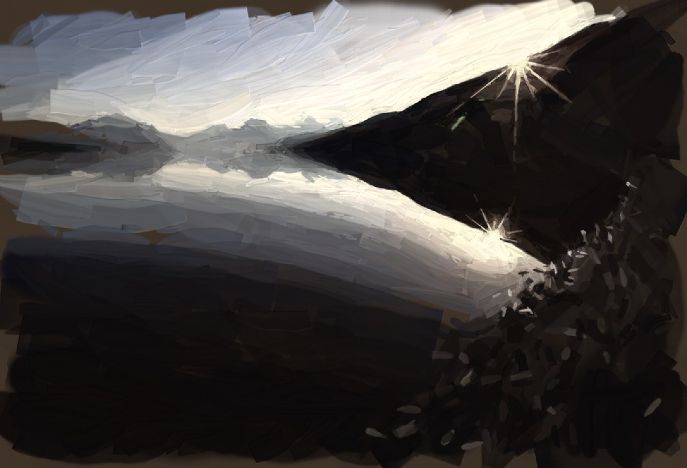
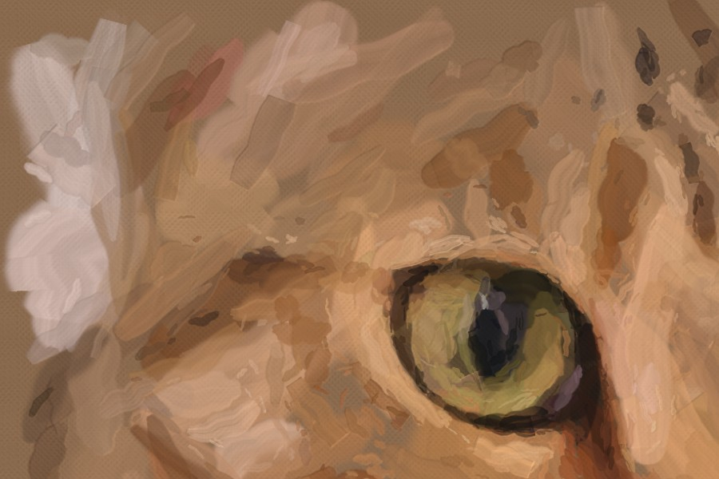
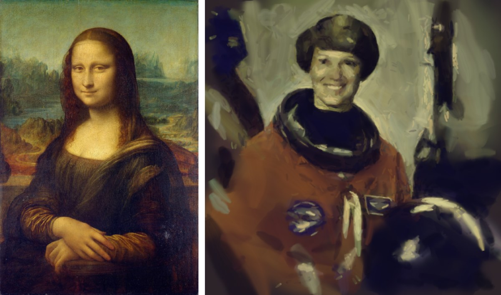
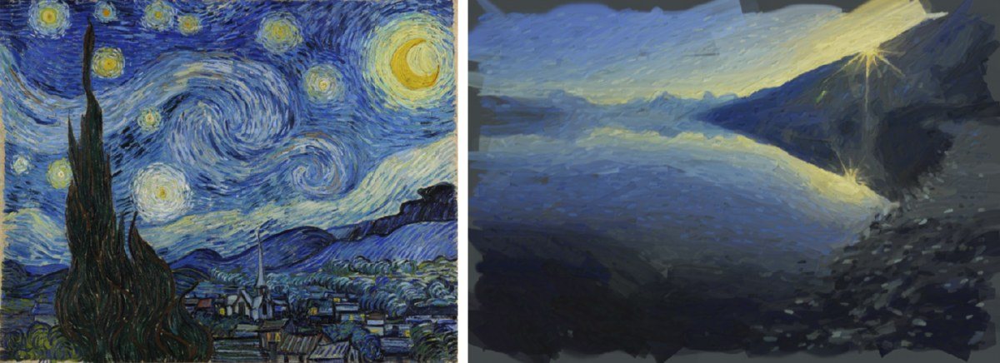
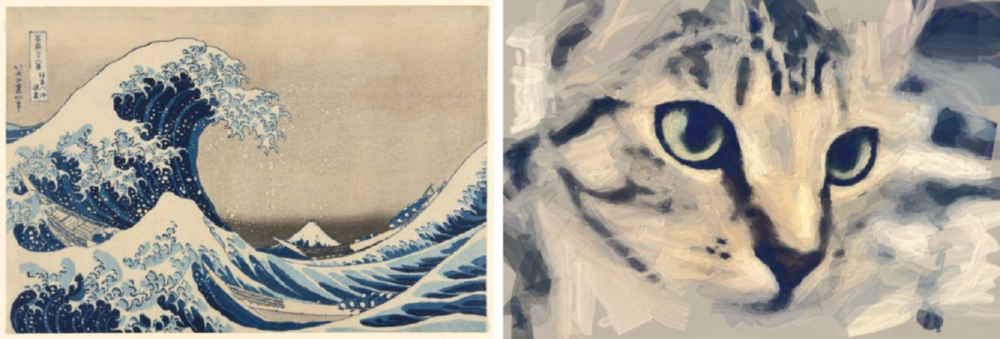
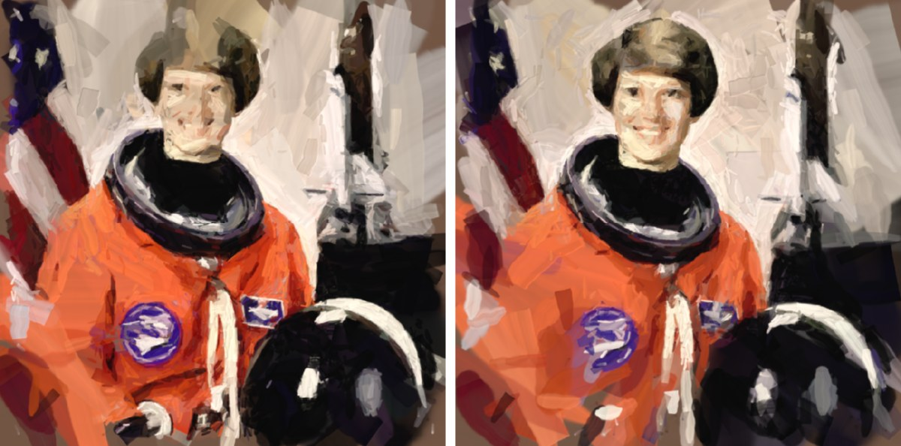

# Pinxit

Pinxit paints a photo. It does not start from noise and remove it. It looks at the picture, decides what it is
about, mixes a palette, and lays brush strokes from broad to fine. Each stroke has a brush, two colours, a
pressure and a speed. What comes back is the list of strokes, so a painting can be rendered at any size, played
back, saved with its memory and changed later.

"Pinxit" is what painters wrote after their name: he painted it.

```bash
pip install "helix-lm[paint]"
```

```python
from helix_lm.paint import load_eye, paint

eye = load_eye()                         # a pretrained vision model that finds the subject (section 6)
painting = paint("photo.jpg", style="mona lisa", emotion="majesty", eye=eye)
painting.save("painting.png")            # the canvas, 1600 pixels wide, with its bare edge
painting.save("painting.pinxit")         # the painting with its memory, to change later
painting.save("painting.gif")            # how it was painted
```

```bash
helix paint make photo.jpg --style "the starry night" --eye siglip --out painting.png --keep painting.pinxit
helix paint make photo.jpg --style my_favourite_painting.jpg --emotion tenderness --sheet passes.png
helix paint change painting.pinxit --add boat.png --box 0.2,0.5,0.5,0.8 --out painting2.png
helix paint change painting.pinxit --undo
helix paint read a_painting.jpg          # the style and the feeling measured from a painting
helix paint styles                       # the famous paintings whose style can be asked for by name
```

This runs today, on a CPU, with no trained weights: a hand made of written rules proposes the strokes and
gradient descent settles them. A photo takes about a minute. The trained model does the same job in one pass
per layer of the painting; section 9 says how to train it and section 11 what has and has not been checked.



## 1. A stroke

A stroke is a curve with a width, drawn in a small window of the canvas. Ten numbers place it: where its middle
is, how long and how wide it is, which way it points, how much it bends, how it tapers, how opaque it is, how
hard the brush was pressed and how fast it moved. Then a brush (flat, round, filbert, dry, knife or wash), two
pigment mixes and how much of the second shows as streaks.

Pressure and speed are not decoration. They change the mark, the way they do on a canvas:

- a heavy stroke is wider and denser, leaves thicker paint, pools where the brush lands and lifts, and has
  ridges along its edges;
- a fast stroke runs dry towards its end, shows the hairs of the brush and ends in a flick;
- a slow stroke trembles a little.

`painting.performance()` gives every stroke with the time it starts and how long it takes, so the painting can
be replayed as gestures.

Colours are mixed as pigments (Kubelka and Munk's model), so blue and yellow make green and not grey. They come
from a palette of twelve taken from the style, or from the photo when no style is given.

## 2. Paint and canvas

An early version looked like a photo with a filter on it. Seen at full size the reasons were plain: every
stroke was a smooth blob, its "bristle marks" ran in rings round its tip like contour lines on a map, there was
no canvas, and the strokes followed every gradient of the photo. This is what changed.

- **Hairs.** A brush is a row of hairs. Each leaves its own track along the stroke, a little lighter or darker
  than its neighbour's. The tracks run straight on past the stroke's end, each hair lifts off at its own
  moment, so a fast or dry stroke ends ragged, and along a track the paint breaks up as the brush runs out.
- **Canvas.** The canvas has a weave. A dry brush catches only the tops of the threads. Thin paint lets the
  weave show and thick paint buries it. Thick paint catches the light.
- **The edge.** A saved picture shows the canvas as it would be photographed, with a bare, toned edge where
  the strokes stop. `border=0` cuts it off.
- **Planes.** A photo holds every pore and every smooth gradient. Before a stroke is made the photo is seen
  the way a painter squints at a subject: small differences inside a shape are levelled, the borders between
  shapes are kept, and light and dark are gathered into a handful of tones. The subject keeps more of its
  modelling than the rest. `abstraction=0` keeps every detail.



The check that called an early sample "hard to say, perhaps a filter" has not been run on these. Section 11.

## 3. The passes

The canvas is toned first. Then it is painted in passes, each on a grid twice as fine as the last. The first
two cover the whole canvas with broad strokes. The middle ones work where the canvas is still far from the plan.
The last is only for the subject. A stroke that would change nothing is not made, and there is a budget.

`painting.sheet("passes.png")` shows the photo, the plan and each pass.


## 4. What makes it look painted by someone

Three things were asked of it. Each is a part of the code you can read and turn up or down.

**The trace of the hand.** Sections 1 and 2: pressure and speed are part of every stroke and shape the mark.

**Restraint.** A plan says how finished each part should be. The subject gets the finest pass. The rest is
left broader, and a part that is not to be finished but is still wrong is put in with one fast, dry stroke
instead of twenty careful ones. `restraint=0` finishes everything, `restraint=1` leaves most of the picture
rough.

**Deliberate distortion.** Before a stroke is made, the photo is changed into what is to be painted:

- composition: the frame is cut so the subject sits on a third (`compose`);
- the subject is made a little larger and the posture is stretched or tilted with the feeling (`exaggerate`);
- colour: lights are pushed warm and shadows cool, or the other way round, shadows are tinted against the light,
  values are gathered into a few masses, contrast and colour are raised at the subject and quieted elsewhere,
  the corners are darkened.

The plan's own report says what it did. It is printed by `helix paint make` and kept in `painting.plan.report`.

These choices are written rules. They are the experimental part: they came from what painters say they do, they
are not learned from data, and they will sometimes be wrong for a picture. Every one has a setting.

| setting | default | what it does |
|---|---|---|
| `work` | 512 | the size the painting is planned at; larger means more and finer strokes |
| `compose` | 0.6 | how far the frame may be cut to place the subject; 0 keeps the photo's frame |
| `exaggerate` | 0.6 | how far the subject, the posture and the colours are pushed; 0 keeps the photo |
| `abstraction` | 0.6 | how far the photo is seen in planes and tones; 0 keeps every detail |
| `restraint` | from the feeling | how much is left unfinished |
| `style_strength` | 0.8 | how far the colours and the handling move to the style's |
| `palette_strength` | 0.7 | how closely strokes keep to the palette |
| `budget` | 2600 | the most strokes after the first two passes |
| `weave` | 0.6 | how much the canvas's cloth shows; 0 paints on a smooth board |
| `border` | 0.025 | the bare edge round a saved picture, as a share of its width |
| `seed` | 0 | another seed, another painting of the same plan |

## 5. Style: give it a painting

`style` is a picture of a painting, yours or anyone's. Pinxit measures it and paints the photo that way.

```python
painting = paint("me.jpg", style="that_painting_i_love.jpg", eye=eye)
card = read_style("that_painting_i_love.jpg")      # what was measured, to look at or keep
```

What is measured:

- **the palette**: twelve pigments and how much of the picture each takes, the tone of the ground, and how the
  colours spread (which hues go with which tones);
- **edges**: in the middle of its strong edges, how much steeper is an edge seen sharply than seen blurred? A
  clean cut measures 2.47, the same cut blurred by three pixels 1.43. The Mona Lisa is the softest of fourteen
  famous paintings (1.84), Monet's Water Lilies the crispest (2.53);
- **outlines**: thin marks darker than what lies on both sides of them. Van Gogh's Bedroom has the most,
  Hokusai's Great Wave comes next, the Mona Lisa has none;
- **paint**: how much detail there is at the size of a brush mark. Leonardo and Vermeer show none, Van Gogh and
  Monet show it everywhere; and how much of the picture is even colour, as in Hokusai's print;
- how long and wide the marks are, which way they run, and the feeling of the colours.

What the painter then does with it:

- the photo's whole cloud of colours is carried onto the painting's (not channel by channel: a blue flag painted
  after a brown and olive painting becomes one of that painting's darks) and drawn toward its pigments;
- for soft edges every brush is softened, the paint goes on in thin layers with the wash, and the gradations
  are kept instead of being stepped;
- for outlines the borders between the planes are drawn in the darkest pigment;
- where the picture is built from marks of paint (its paint shows, and it is not made of even areas the way
  a print is), a last pass lays short marks all over the canvas, each close to one pigment and a little lighter
  or darker than its neighbour, following the style's flow. Thick paint is lit more strongly.

Fourteen famous paintings come measured with the package, so no picture is needed: `style="mona lisa"`,
`"the starry night"`, `"the great wave"`, `"girl with a pearl earring"`, `"water lilies"`, `"the scream"`,
`"the birth of venus"`, `"the night watch"`, `"the kiss"` and more. A painter's name works too (`"vermeer"`).
`helix paint styles` lists them. Only the measurements are in the package, not the pictures.







What this is and is not: the palette, the tones, the edges, the outlines and the kind of mark carry over. The
drawing does not. A portrait painted after the Mona Lisa has her colours and her soft edges, not Leonardo's
hand.

`emotion` is one of eight: awe (also called majesty), serenity, joy, tenderness, melancholy, fear, anger,
mystery. A feeling is a set of numbers that reach into everything above: how saturated and warm the colours are,
the key and the contrast, how fast and heavy the strokes are, how much is left unfinished, which brushes are
used and which way the strokes flow. A style passes on its own feeling when you give none. That feeling is read
from the colours alone (the formulas of Valdez and Mehrabian, 1994). It is a starting point. It does not know
what the painting shows.

## 6. The eye

The rules find the subject by colour and contrast. That is often wrong: in a portrait the badge on the jacket
has more contrast than the face. A pretrained vision model knows better. Pinxit uses SigLIP 2
(`google/siglip2-base-patch16-256`, Apache-2.0) as its eye:

```python
from helix_lm.paint import load_eye, paint

eye = load_eye()                         # downloads SigLIP 2 once, about 1.5 GB
painting = paint("portrait.jpg", emotion="awe", eye=eye)
```

The eye is asked what the picture is about in a plain way. Part by part the photo is blurred away and the eye
gives its summary of the picture again. The more the summary changes, the more that part matters. (SigLIP 2's
patch features do not say this by themselves; four ways of reading them were tried and all lit up a few stray
patches.) It costs 37 looks, about five seconds on a CPU.

Below, the same photo with the same settings. Without the eye the badge and the helmet got the finest work and
the face stayed rough. With it the face is finished and the rest is left loose. For portraits, use the eye.



DINOv2 (`facebook/dinov2-small`) works as a smaller eye. It does not read text.

## 7. Memory, and changing a painting

A `.pinxit` file holds everything that was done: every stroke in order, the plan, the palette, the feeling,
what the model remembers of each place, and the history of changes. Open it a year later and go on.

```python
from helix_lm.paint import Painting

painting = Painting.load("painting.pinxit")
painting.add(image="boat.png", box=(0.2, 0.5, 0.5, 0.8))     # paint a picture in, in this painting's palette
painting.touch((0.4, 0.2, 0.7, 0.5))                         # take a part further
painting.rework("melancholy")                                # paint it again with another feeling
painting.undo()                                              # take the last change back
painting.save("painting.pinxit")
```

`box` is left, top, right, bottom as shares of the canvas. Changes are painted on top, as a painter works over
a canvas. Each change keeps what it altered, so `undo` puts the painting back exactly, also after it was saved
and opened again. A change that fails half-way leaves the painting as it was.

A picture with transparency is painted in as a cut-out. Its light and colour are moved halfway to those of the
place it goes to, and it is painted with the painting's own palette and brushes.

`painting.add(text="a small red boat", box=..., eye=eye)` tries to paint from words. It does not work well
enough to use: see section 11. To add something, give a picture of it.

## 8. The model

The rules hand works one stroke at a time and needs dozens of gradient steps per pass. The model is trained to
give all the strokes of a canvas cell at once.

It is a fine-tune in the usual sense: a pretrained base, small trained adapters in it, and a new part on top.

- **The eye** is the base. SigLIP 2 stays as it was trained. Low-rank adapters (LoRA, rank 16, 2.4M numbers) are
  added to the attention layers of its vision half and trained. Words and the subject are always judged by the
  eye without the adapters, so training cannot pull those apart.
- **Pinxit** is the new part. For each cell of the canvas it reads a short sequence: a brief (which pass, how
  finished this place should be, which way strokes flow here), the style, the feeling, what it remembers of this
  place, what the eye sees here, the twelve pigments, and 64 tokens of the window (the plan, the canvas so far
  and their difference). It answers with up to 14 strokes: ten gesture numbers each, a brush, two pigment mixes
  as weights over the palette, and whether the stroke is made at all. It also writes a note to its memory.
- **The trunk** between input and answer is the Helix trunk (`helix_lm.anansi`), the same one the language
  models and TriStream use.

Memory works across passes and across time. What the model writes down for a cell in a coarse pass is read by
the four cells under it in the next. It is saved in the `.pinxit` file and read again when you change the
painting.

| size | parameters |
|---|---|
| `px-tiny` | 0.3M (tests) |
| `px-small` | 11.0M |
| `px-base` | 44.8M (the default) |
| `px-large` | 153.4M |

```python
from helix_lm.paint import load_hand, paint

hand, eye = load_hand("CorxLabs/Pinxit-1")       # a checkpoint file or a Hub repository
painting = paint("photo.jpg", style="mona lisa", emotion="majesty", hand=hand, eye=eye)
```

`load_hand` gives the model and the eye it was trained with, adapters loaded. `polish` (0.25) is the share of
the rules hand's gradient steps still run on the model's strokes; 0 takes them as they are.

To fine-tune it further on your own pictures, put them in the training folder (section 9) and run more hours.

## 9. Training

Two stages.

**Practice sheets.** Windows are made from random strokes, so every stroke that is missing is known. The model
learns the craft: to see what is missing and make it with the right gesture, brush and pigments, broad strokes
first. No data is needed.

**Pictures.** Real photos, each with a plan made for a style and a feeling drawn at random. For a pass of the
plan the model lays its strokes on a canvas that looks the way earlier passes would have left it. It is judged
on how close the canvas comes to the plan where it matters, on whether its strokes are as fast, heavy, long and
wide as the rules say they should be in that place (that is where the gestures come from), and on whether it
made as many strokes as it was allowed. The eye's adapters are trained in this stage.

One plan in four is not a photo. It is one of the paintings, copied as it is with its own style card, the way a
student copies in a museum. That is how the model meets brushwork made by a hand and learns what strokes a
style card stands for.

The pictures come from open collections, fetched by the program and listed with their sources:

| what | from | licence |
|---|---|---|
| 1,000 paintings | Art Institute of Chicago | CC0 |
| 2,500 paintings | Cleveland Museum of Art | CC0 |
| 2,500 paintings | National Gallery of Art, Washington | CC0 |
| 10,000 photos | Open Images V7, validation set | CC BY 2.0, authors listed in `photos.jsonl` |

Your own photos in `<root>/uploads/photos` and paintings in `<root>/uploads/paintings` are used too and met
twenty times as often.

### One cell

[notebooks/pinxit_molab_cell.py](../notebooks/pinxit_molab_cell.py) is one cell of plain Python for a molab
notebook or any machine with a GPU. Paste a Hugging Face token, set the GPU hours you have, run it.

- The GPU starts on practice sheets within a minute. The pictures are fetched beside it by a second process.
- Two fifths of the hours go to practice sheets, three fifths to pictures.
- Everything is mirrored to a private Hub repository every hour: the checkpoint, the markers, the gallery.
- A molab session ends after 12 hours. The run saves, pushes and stops half an hour before. Run the cell again
  in the next session and it goes on. Each stage keeps its own hours, so giving it more hours later continues it.
- At the end it paints a small gallery with the trained model and with the rules hand on the same plans, and
  writes their scores next to the pictures.

### Memory

The Helix trunk keeps a lot per token while it trains: about 150 MB for one canvas cell at `px-small`. Three
things keep a run inside the GPU. The trunk recomputes its activations in the backward pass, which cuts that to
a quarter for a third more time and gives exactly the same gradients. Each stage measures what fits: as many
practice sheets, or as many cells of real pictures, as fill 88% of the memory. A picture step takes the passes
of several pictures at once, and when they hold more cells than fit, the rest go through without gradients. A
step that still runs out of memory is dropped and the next ones are made smaller.

## 10. Scores

`helix_lm.paint.bench.judge(painting)` measures whether a painting did what was asked of it:

| score | meaning |
|---|---|
| `closeness` | how far the painting is from its plan, weighted by what matters (lower is nearer) |
| `at_subject` | the same at the subject only |
| `left_broad` | how far it is from the plan where it was told to stay rough (higher means more was left out) |
| `strokes`, `last_pass` | how many strokes, and how many of them in the finest pass |
| `pressure_spread`, `speed_spread` | how much the strokes differ in weight and speed |
| `palette_use` | how many of the pigments carry the painting |
| `subject_off_third`, `balance` | where the subject sits in the frame |

They say nothing about whether a painting is good. That needs eyes.

## 11. What has been checked, and what has not

Checked here, on a CPU:

- the engine on real photos, by eye at full size and with the scores, before and after the changes of section 2;
- style copying on the Mona Lisa, The Starry Night, the Great Wave and Van Gogh's Bedroom, by eye, and the
  measurements on fourteen paintings and on plain shapes blurred by known amounts;
- saving, opening, adding a picture, touching up, reworking and undoing, with undo exact to the bit;
- the real SigLIP 2 eye: it matches four test photos to the right words, it finds the face in a portrait, its
  adapters train, save and load;
- every stage of the training program on a small scale, with the real eye, including a session that ends in the
  middle and a run that goes on from the Hub;
- a test that tags every tensor that would be on the GPU and fails if one meets a CPU tensor. It found one
  crash that would only have shown on a GPU.

Not checked:

- **Whether a checker calls the pictures hand-made.** An early sample was judged "hard to say, perhaps a
  filter" by Google's check. The causes that could be seen are fixed (section 2) and at full size the pictures
  now show hair tracks, ragged ends, canvas and a bare edge. The check itself has not been run again, so that
  is still open. Nothing was done to fool a checker: the changes are to how the paint is laid.
- **No GPU run has been made.** The step sizes, the hours and the quality of the trained model are plans.
- **The trained model has only been trained for a few steps here.** After those it is worse than the rules
  hand, as it should be. How good it gets with 20 GPU hours is not known.
- **Painting from words does not work well enough to use.** With the real eye the score for "a small red
  sailing boat" went from 0.02 to 0.19, higher than a photo of one would score, and what appeared was a scatter
  of pale marks and a red smear. The eye can be pleased without a boat being there. It also took fourteen
  minutes on a CPU. To add something, give a picture of it.
- Faces are small in most photos. The strokes there are a few pixels wide and a likeness is rough. A larger
  `work` (768) helps and takes longer.
- The feeling read from a painting comes from colour statistics. It is a prior, not a judgement.
- The outline measure also counts dark dashes between lighter ones, so Monet's Water Lilies reads as somewhat
  outlined.
- The Met's open collection is not used: its image server answers scripts with a bot check, and that was left
  alone.
