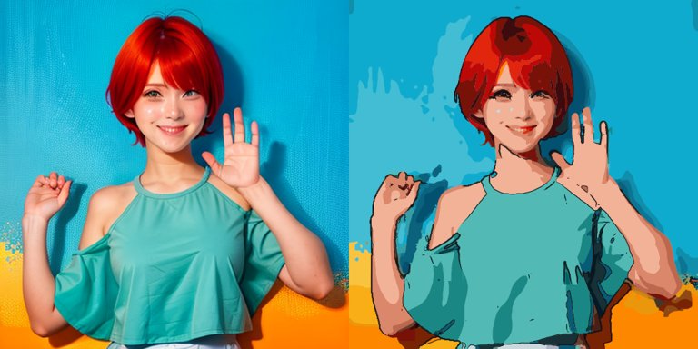
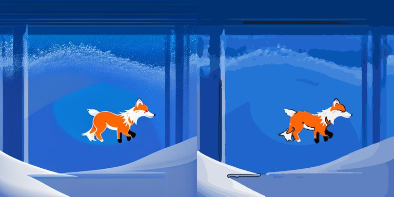
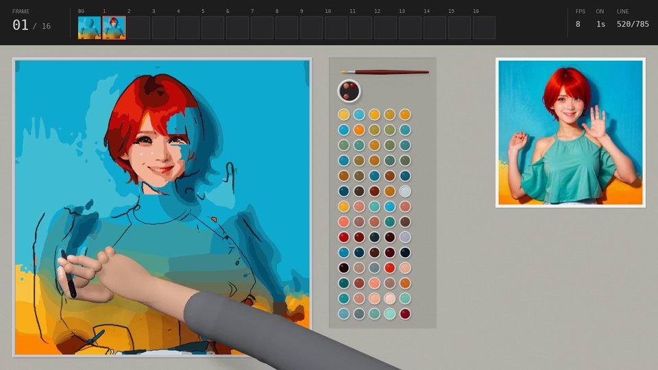

# Pinxit Animate

Ask for an animation in words. An open video model imagines how it moves. Then Pinxit draws it as anime, the
way a studio does: the background painted once and held, the character inked and painted as a cel on every
drawing, timed on ones, twos and threes, faces drawn again with care, every line steadied through time, every
drawing checked against its frame. You can watch it being drawn at a desk, a hand holding the pen.

```bash
pip install "helix-lm[paint]"
```

```python
from helix_lm.paint.animate import animate

clip = animate("a cheerful anime girl with short red hair waving hello, upper body, in a sunny park")
clip.save("girl.mp4", fps=24)              # the animation, at any frame rate
clip.making_of("girl_being_drawn.mp4")     # the desk, the hand, every drawing made
clip.save("girl.pinxa")                    # everything, to change or carry on later
```

```bash
helix paint animate "a fox running through snow" --out fox.mp4 --out-fps 24 --making-of drawn.mp4 --keep fox.pinxa
helix paint animate --video my_clip.mp4 --out drawn.mp4                     # draw a video of your own
helix paint animate "she dances" --model wan-animate --character me.png --motion dance.mp4
```

On a large GPU the cell [notebooks/pinxit_animate_cell.py](../notebooks/pinxit_animate_cell.py) does all of it.







## 1. Who does what

| part | module | what it does |
|---|---|---|
| the video model | `video` | imagines the motion from the words, or makes a character picture perform a motion video |
| the space | `space` | how things move, how near they are (a depth model), which pixels are the character, the camera, one clean picture of the set |
| ink and paint | `cel` | the colours, clean flat shapes, line art, the shadow and highlight shapes |
| the principles | `motion` | timing on ones, twos and threes, holds, keys, steadying, in-betweens with ease and arcs |
| faces and details | `detail` | eyes, mouths, hands, paws drawn at three times the size, carried over rigidly |
| the check | `check` | each drawing scored against its frame, the bad places drawn again |
| the desk | `studio` | the making-of video: the board, the exposure sheet, the tray, the hand |
| all of it | `anime` | the order a studio works in |

To be plain about the "no noise" part: the video models are diffusion models, so the *idea* of the motion comes
from a model that works by removing noise. Nothing on the board does. Every mark is a pen line or a painted cel
shape with a position and a time, drawn in the order a person draws.

## 2. How a clip is drawn

1. **The space.** The clip is read once: the motion between frames, the depth (Depth Anything V2 Small,
   Apache-2.0), which pixels are the moving character (motion against the camera's, and depth: a near layer
   with some part moving), how the camera moves, and one clean picture of the set with the character taken out
   (the median of the frames where the set shows, filled in where the character always stood).
2. **The colours** are chosen once for the clip, 16 for the character, so her hair is the same red in every
   drawing. Small but clearly different colours (an eye, a nose) count for more than their area.
3. **The background** is painted once from the clean picture, with 28 colours of its own and finer detail, and
   held under every drawing. If the camera moves, the painting moves with it. It does not boil or morph.
4. **The timing.** As on an exposure sheet, worked out on 24 frames a second whatever the clip's rate: fast
   action on ones, most movement on twos (`on=` changes it), slow movement on threes, a hold when the character
   is still. Keys go where the motion stops or turns.
5. **Each drawing** inks and paints only the character, exactly to its frame: line art with a brush pen (bold
   silhouette, thinner inner lines), flat colour up to the line, one to three simple shadow shapes per part and
   a highlight band, coloured the anime way (the shadow darker, cooler and a little more saturated). Paint lies
   under the ink, as on the back of a cel, so it can never cover a line.
6. **Faces and small parts** are found (a face by its two eyes, then its eyes and mouth; hands, paws, ears by
   how much small detail they hold) and drawn again at three times the size. From one drawing to the next, a
   part that only moved is carried over by a rotation, a scale and a shift: the same eye, not a new one. It is
   drawn again only when it really changed (a blink, a smile).
7. **The check.** Each drawing is rendered over its background and scored against its frame (the colour, the
   board left bare, how far the ink lies from the frame's edges). Clearly wrong places are drawn again, and the
   new drawing is kept only where it scores better. The numbers are kept with the animation.
8. **Steadying.** Each line keeps its name from drawing to drawing when it is the same line moved. The path of
   every line through time is then smoothed with a spline that leaves a steady ease or a parabola as it was, so
   shakes and wobble go and arcs stay. Keys are pinned.

If no character can be told apart from the set, every drawing is painted whole, background and all, so the set
picture cannot show a ghost of the character.

## 3. The video models

`load_animator(name)` takes any of these, or any Hub repository (`helix_lm.paint.video.list_models()` lists
them with sizes and memory):

| name | model | licence | memory (all on GPU / offloaded) |
|---|---|---|---|
| `animatelcm` | AnimateLCM on DreamShaper 8 | none on its card; DreamShaper CreativeML OpenRAIL-M | runs on a CPU |
| `animatediff` | AnimateDiff v1.5-3 on DreamShaper 8 | as above | runs on a CPU |
| `wan` | Wan 2.2 TI2V 5B | Apache-2.0 | 34 / 21 GB |
| `wan-14b`, `wan-i2v-14b` | Wan 2.2 T2V and I2V A14B | Apache-2.0 | 81 / 41 GB |
| `wan-animate` | Wan 2.2 Animate 14B | Apache-2.0 | 62 / 49 GB |
| `wan-vace`, `wan-vace-1.3b` | Wan 2.1 VACE | Apache-2.0 | 56 / 44, 21 / 16 GB |
| `ltx`, `ltx2` | LTX-Video, LTX-2 | a paid licence from $10M revenue | 46 / 34, 80 / 50 GB |
| `hunyuan` | HunyuanVideo 1.5 | not valid in the EU, UK or South Korea | 44 / 27 GB |
| `cogvideox` | CogVideoX 5B | commercial use needs a free registration | 30 / 19 GB |
| `skyreels` | SkyReels V2 14B | Skywork Community | 53 / 41 GB |

`"auto"` picks Wan 2.2 A14B from 80 GB of GPU memory (the I2V one when a character picture is given), TI2V 5B
from 40 GB, else AnimateLCM. Check a model's licence before using what it makes commercially.

**A character that keeps its look.** Give a picture of the character: `character="me.png"`. With
`wan-animate` and a `motion=` video of someone moving, the character performs that motion, which is the best
route to the same character in every frame. Pinxit makes the pose video with RT-DETR and ViTPose (17 body
points, so hands are not posed); for the best result pass `motion={"pose": ..., "face": ...}` made with Wan's
own preprocessing.

**Fine-tuning.** Every model takes a LoRA: `load_animator("wan-14b", lora="you/your-style-lora")`. A LoRA
trained on a character keeps that character the same across clips. Training a LoRA is not part of this
release: use the training scripts of `diffusers` for the model you picked, then load the result here.

Words are given to the model with "anime style, cel shading, clean line art, flat colours, crisp details,
detailed background" added, because that is what a cel painter draws well. `drawable=False` turns it off.

## 4. The desk

`clip.making_of(path)` is a video of the animation being drawn: the board in the middle, the background art
drawn first, then each drawing over a faint copy of the last (the lightbox); an exposure sheet along the top
with each drawing and how long it is held; a tray with the pens, the brush and the paint pots; the frame being
drawn pinned beside the board. The look is kept plain on purpose, as a real animation tool is: neutral greys,
one accent, thin rules on a grid, no gradients or glow.

The hand is built from shaded 3D shapes in a tripod grip on the real tool. Its shadow on the board grows and
softens when it lifts. It follows the stroke with a damped spring (a little lag and overshoot where a line
turns), turns its wrist with the line, slows on curves, hovers between strokes, and puts one tool down to pick
up the next. It is a render, not a photograph of a hand.

## 5. Memory and changes

A `.pinxa` file keeps every drawing's lines, the background art, the holds, the cameras, the colours and the
frames the drawing was made from.

```python
from helix_lm.paint.animate import Animation

clip = Animation.load("girl.pinxa")
clip.recolor((0.2, 0.4, 0.9), at=(0.45, 0.2))   # her hair blue in every drawing; shadows stay shadows
clip.retool("pen")                              # every line with a finer pen
clip.extend("she laughs and runs down the path")  # the next clip, same background, same colours
clip.save("girl.mp4", fps=30)
```

## 6. What was checked, and what was not

Checked here, on a CPU (four cores):

- two real clips made with AnimateLCM on DreamShaper 8 (16 frames, 512 by 512, about 17 and 29 minutes each on
  the CPU): a cartoon fox walking in snow, and a semi-realistic anime girl with red hair waving in front of a
  blue wall. Drawn as anime at 512 pixels, the whole clip took 2 minutes (the fox) and 3.6 minutes (the girl),
  depth model included; the making-of of the girl at 1280 pixels (66 seconds of video) took 2.7 minutes;
- by eye, at full size: the fox keeps its shape, its orange and its white fur, with an eye, a nose and an ear;
  the girl is flat teal and skin with simple shadow shapes, her hair a vivid red base with one shadow and a
  highlight, two eyes with lashes and a smile with teeth; the background is painted once and held, no ghost of
  the character in it;
- the check against the frames: colour off by 0.025 (fox) and 0.046 (girl) on average (mean OKLab distance),
  no board left bare;
- the space: the fox found in 3 to 4 percent of the picture and the girl in 44 to 47, the camera still in both,
  the set picture with the character taken out;
- tests for every part: exact fills with holes, paint under the ink, line identity, the timing, steadying (a
  shaky path brought to within 0.25 pixel of the true one, its arc kept), in-betweens, rigid carrying of an eye
  (shape kept to 0.997 IoU after a turn), the self-check, the camera on a pan, the desk video, saving and
  opening, recolouring with shadows kept, playing at another frame rate.

Weak spots seen on those two clips: a few faint light-blue dots stay on her cheeks in some drawings; the wall
behind her is painted with some lighter patches where the frame's texture was; her shadow on the wall stays
where it is when her hand moves; the fox's legs are rougher than its body; a face is found only where both eyes
are open (11 of the girl's 16 frames, and carried over between).

Not checked:

- **The large video models were not run**: there is no GPU here and about 1 GB of disk. Every call was checked
  against the code of `diffusers` 0.43; the first real run will tell how they look and how much memory they
  take.
- **The video model decides how good the motion is.** AnimateLCM on a CPU morphs hands and changes small
  shapes between frames. The drawing follows its frame; steadying takes out shakes, not a melt that lasts
  several frames. A bigger model on a GPU is the way to clean motion.
- Faces are found by two open, visible eyes. A face in profile, or with closed eyes, is drawn as ordinary
  detail.
- Shapes come from the colours of the frame, not from an understanding of anatomy. A photo-like frame gives
  shadow shapes where its light falls, which may not be where an animator would put them.
- Training a LoRA is not built in.
