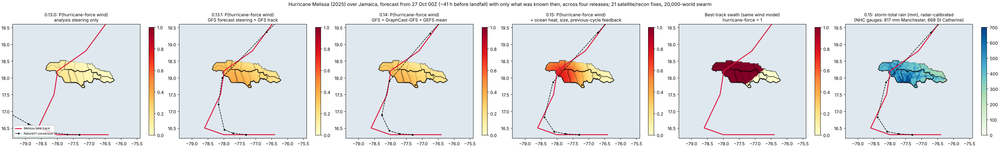

# NatureV1 — a probabilistic weather and hurricane model built on geometric attention

> **Status: trained and scored — a research model, not an operational forecast.** The first full run is complete
> and every number in [section 4](#4-results) was measured on data the model never trained on, including an
> end-to-end test on the 2023 hurricane season (a strong El Niño year no part of the model ever saw). It beats
> physics-only steering and straight-line extrapolation on hurricane track at every lead, but it is several times
> less accurate than the National Hurricane Center and the leading global models, it misses rapid intensification,
> and a red-team pass (section 4.8) found failure modes you should know before using any output. **Do not use it
> for real decisions** — for those, use [the National Hurricane Center](https://www.nhc.noaa.gov).
>
> **Training took about one week** of wall-clock time on a single GPU in a hosted notebook (molab), including
> session restarts and re-staging; the rollout stage alone was 74 GPU-hours.
>
> **Version 0.11** adds stage three — storm-centred infrared satellite imagery for the hurricane heads — and fixes
> what the red team found: calibrated probabilities, an input monitor, and a forecast that can no longer state
> impossible structure (section 4.9). `training_record.json` says which stage the released weights come from.
>
> **Version 0.12 (code ready, not yet trained)** rebuilds the satellite path around the red team's findings and
> moves the storm heads from the Atlantic to every basin — see [section 4.10](#410-012-the-satellite-path-rebuilt-and-every-basin-code-ready-not-yet-trained).
> The released weights do not use it until it has been trained and has beaten them on the same test storms.
>
> **Version 0.13** adds `naturev1.cyclone`: 39 modules of tropical-cyclone physics that need **no neural network**,
> measured on 4,447 forecasts of 407 storms in every basin in seasons they were never fitted on (2018, 2020-2022).
> The physics consensus beats straight-line extrapolation at **every lead from 6 to 120 hours** (+12% to +38%,
> every interval clear of zero) and beats CLIPER at every lead. It does **not** beat GraphCast, Pangu-Weather,
> HRES, Aurora, FGN (WeatherNext 2), FuXi or GenCast past 6 hours; combined with any of them it is never worse and
> is better at 6-12 hours. Plus genesis detection (68% of formations flagged a median 24 h ahead), multi-teacher
> distillation, data assimilation and a 0.25-degree decoder — [section 4.12](#412-013-hurricane-physics-measured-on-seasons-it-never-saw).
> The **swarm sandbox** takes satellite fixes minute by minute and maps impacts parish by parish across the whole Caribbean.
> On unseen seasons its stall probabilities are skilful, its cone is not better than the fixed cone, and on Hurricane
> Melissa it kept western Jamaica at risk but far too low — [section 4.13](#413-013-the-swarm-sandbox-the-satellite-path-and-caribbean-impacts).
> **0.13.1** steers the track with a dynamical model's forecast winds (GFS live, HRES in the hindcasts) and blends
> in the model's own track. Held-out track errors fall by 12% to 65% (72 h: 512 → 184 km), slightly ahead of HRES
> alone to 72 h. On Melissa the track now curves north into Jamaica, but the intensity is still far too low —
> [section 4.14](#414-0131-the-turns-and-rapid-intensification).
> **0.14** blends the consensus with the equal-weight mean of several models (live: GFS, ECMWF IFS and AIFS,
> GraphCast-GFS, GEFS), which cuts held-out errors another 11% at 24 h and 19-23% at 48-120 h (72 h: 142 km), sizes
> the cone per forecast, and makes the swarm's worlds each follow one model —
> [section 4.15](#415-014-several-models-at-once-a-cone-sized-per-forecast-and-a-quieter-swarm).

NatureV1 is an 89-million-parameter model of the atmosphere that forecasts global weather out to five days and,
for tropical cyclones, where a storm will go, how strong it will get, whether it will intensify rapidly, and
whether it will make landfall. Every number it produces comes with an uncertainty. It is built on
[iHELIX](https://pypi.org/project/ihelix/), an attention engine that works on the physical geometry of the planet
rather than on a flat grid, and trained by a single, resumable, self-verifying pipeline that lives in one notebook
cell. The whole stack — engine, model, training pipeline, verification — is open and written by one person.

- Code and training pipeline: `pip install naturev1[all]` — [naturev1 on PyPI](https://pypi.org/project/naturev1/)
- Engine: `pip install ihelix` — [ihelix on PyPI](https://pypi.org/project/ihelix/)
- Author: Nathan. License: Apache-2.0.

---

## 1. What it does

Given six frames of the atmosphere (the last 30 hours of ERA5 reanalysis: 89 channels — 11 surface fields and 6
variables on 13 pressure levels — on a 1.5° global grid), NatureV1 produces:

**Global weather, at 6, 12, 18, 24, 36, 48, 72, 96 and 120 hours**
- A **full-state rollout**: the whole atmosphere — all 86 prognostic channels, surface to 50 hPa — stepped forward
  6 hours at a time on its own forecast, with mass conservation, out to 72 hours, as an ensemble. **This is the
  weather output with measured skill** (section 4.2).
- 2 m temperature, mean sea-level pressure, 10 m wind and precipitation directly at each lead, as a mean and a 90%
  interval. These direct surface heads were not updated after the rollout stage and have no skill in this release;
  use the rollout.
- A weather-type category head exists but was never trained, so it is never shown.

**For a tropical cyclone, given its current centre**
- **Track as scenarios, not a line**: six weighted trajectories ("38% recurves offshore, 27% tracks the coast…"),
  each with a tilting uncertainty ellipse per lead, so the cone of uncertainty is drawn from the model, not
  from a lookup table.
- A **multi-model consensus track**: the learned track, a physics-only steering-flow track, and straight
  extrapolation, blended with per-lead weights fitted on held-out seasons — the way the National Hurricane Center's
  consensus beats every single model in it, done inside one model. Every member is reported alongside the blend.
- **Intensity**: maximum wind and minimum central pressure per lead, with intervals and the Saffir–Simpson category.
- **Rapid intensification**: the probability of a 25, 30 and 35 kt gain in 24 hours, plus the expected change.
  It ranks risk well but its probabilities are far too high (section 4.8).
- **Landfall**: the probability of landfall by each lead. (The landfall-timing head was never trained and is not
  shown.)
- **Core structure**: peak eyewall wind, radius of maximum wind, and 34/50/64 kt wind radii by quadrant, kept
  physically ordered (34 ≥ 50 ≥ 64 kt; radius of maximum wind inside the gale radius).
- **A cone drawn from the whole scenario mixture** (`track_cone`: the radius holding 50% and 90% of the mixture
  per lead), which on held-out storms held the truth as often as it claims to.
- **What the satellite sees (0.11, after stage three).** Storm-centred 11-micron infrared — now and six hours
  earlier — from HURSAT-B1, GridSat-B1 or a live GOES scene, read by a small branch aimed at intensity.
- **The storm's environment**, read from the model's own atmosphere: deep-layer steering, 200–850 hPa shear,
  mid-level humidity, ocean temperature — the predictors operational statistical schemes (SHIPS) are built on.

**A local forecast** for any point on Earth, in physical units, from the gridded fields.

### What it refuses to do
This is as much a part of the model as the outputs above.
- An output whose head has **never received a training step is never shown**. It is replaced by
  `{"available": false, "reason": ...}`. The training record travels inside the checkpoint.
- A forecast run from an input path the model was never trained on (today, the satellite path) is marked
  **`trustworthy: false`** and the live satellite forecast is refused outright.
- An **input monitor** (0.11) compares the storm features with what training looked like; a forecast from
  inputs unlike anything it learned from — corrupted data, noise, zeros — is marked `trustworthy: false`.
- `check_forecast` tests every scenario track, the consensus and the cone, intensity, eyewall and RI value
  against **physical bounds**, and checks that landfall never becomes less likely with time and wind radii stay
  ordered: no
  400 kt hurricane, no pressure outside 850–1100 hPa, no cone wider than an ocean, no probabilities that do not sum
  to one. It reports problems; it does not block the forecast, so a caller must act on what it returns. Section
  4.8 lists what it does not catch.
- The pipeline publishes only if the model beats persistence somewhere on held-out data and demonstrably changes
  its answer when the weather changes. That gate is weak (precipitation alone can pass it); this release was
  published after the full scorecards and red-team below were reviewed.

---

## 2. How it works

### 2.1 The engine: iHELIX, attention over physical space
Most weather transformers flatten the globe into tokens and let attention learn geography from scratch. iHELIX
keeps the geometry:

- **Geometry axes.** A domain is composed from spherical, periodic, linear and logarithmic axes. `Geometry.globe()`
  is the Earth's surface; `Geometry.atmosphere()` is a spherical shell whose vertical axis is log-pressure, so that
  1000→500 hPa is the same distance as 500→250 hPa. Every point carries a local east/north/up frame, so "20 km
  north" means the same thing everywhere.
- **FieldGrid: data, not architecture.** The points data lives on — ERA5's 240×121 grid, a 4,096-point Fibonacci
  mesh, a satellite scan's pixel footprints — with true area weights. The same model reads any of them.
- **GeodesicAttention.** Every attention head has a physical radius in kilometres with compact support: heads
  from 120 km (fronts, convection) to 1,600 km (synoptic scale). Attention is over great-circle distance.
- **IndexAttention.** A region tree with beam search lets a point reach distant points (teleconnections) without
  paying for the whole globe.
- **TemporalStrand.** A gated delta-rule recurrence carries state across the six input frames at linear cost —
  inherited from HELIX, a linear-context language model this engine grew out of.
- **Encode → process → decode.** Any source grid is read onto a shared 4,096-point mesh, processed by 17 blocks,
  and decoded onto any output grid.

### 2.2 The model: NatureV1
| | |
|---|---|
| Parameters | 89.45 M: 17 iHELIX blocks 84.67 M, input encoders 2.42 M, decoder 0.79 M, storm heads 1.23 M, time embedding 0.13 M, other output heads (field, weather type, noise, ENSO) 0.11 M, state head 0.09 M, norms + mesh seed ~3 k |
| Hidden size / heads | 512 / 8 heads (4 key-value heads), head dim 64, MLP 2048 |
| Latent mesh | 4,096 points, 48 neighbours, cluster 64 |
| Head radii | 120 km to 1,600 km |
| History | 6 frames × 6 h |
| Inputs | ERA5 analysis (89 channels + observation masks, padded to 96); calendar features (solar angle, season) given explicitly; optional satellite and environment encoders; per-member noise for ensembles |
| Outputs | gridded fields with log-variance; full-state residual with log-variance; track mixture (6 modes × 9 leads × 5 parameters); intensity; landfall; RI; eyewall; ENSO |
| Precision | bf16 mixed precision; gradient checkpointing |

**The storm path** pools the processed mesh around the storm centre with a 500 km Gaussian and, since 0.9, a
second 1,000 km pool (the ridge that steers a storm sits a thousand kilometres from the eye). It adds the storm's
own state (wind, pressure, 12 h motion, 12 h wind change — what a 1.5° reanalysis cannot show), the storm's
position (Coriolis and beta drift), and the **physical environment** computed from the state tensor. The track
head predicts the **residual from a steering-flow track**, which is a far easier target than the whole track:
beta drift, trough interactions, what steering alone gets wrong.

**Everything new starts at exactly zero effect.** The state head opens as persistence, the ensemble noise as
nothing, the environment inputs as nothing. Adding a capability can never make an existing checkpoint worse, and
uncertainties open at climatological spread rather than at a confident guess.

### 2.3 The physics inside the model
- **Channel roles.** Every input channel is prognostic (evolved), forcing (incoming solar radiation, recomputed
  each step from orbital geometry) or static (land mask, orography, observation masks, padding). A static field
  marked prognostic lets a model slowly move a coastline; this is what prevents it.
- **Rollout.** The whole atmosphere advances 6 h at a time on the model's own forecast, with surface-pressure mass
  conservation and a GraphCast-style curriculum from one step to twelve.
- **Ensembles.** Per-point noise is spread spatially by the geodesic blocks; a fair CRPS loss grows the spread only
  as far as the data justifies; spread/skill is reported.
- **Hurricane physics** (`naturev1.steering`): thickness-weighted 850–200 hPa steering over the 200–800 km ring
  around the centre, 200–850 hPa shear, 700 hPa specific humidity, SST versus 26.5 °C; advection with the correct
  longitude scaling and climatological beta drift; a steering track from today's analysis held steady, or from the
  model's own rolled-out atmosphere step by step. The steering track needs **no training at all**.

### 2.4 Training, in stages
The whole run took **about one week of wall-clock time** on one RTX PRO 6000 (96 GB) in a hosted notebook. The
GPU time was roughly three to four days; the rest was hosted-session overhead — sessions end after 12 hours or 90
idle minutes and the disk is wiped, so each restart re-pulled checkpoints and staged data from this repository
before training resumed. Every stage is resumable from a one-minute checkpoint, so no restart lost more than a
minute of training.

1. **Stage one — pretraining on reanalysis.** Every surface channel at every lead, Gaussian negative
   log-likelihood, area-weighted, on years of ERA5. This is where the backbone learns what the atmosphere does,
   from about 2×10¹¹ supervised values.
2. **Stage 1b — full-state rollout.** The residual state head is trained to roll the whole atmosphere forward,
   curriculum to 12 steps (72 h), 2-member CRPS ensemble.
3. **Stage two — hurricane heads on HURDAT2.** The backbone is **frozen**; only ~1.2 M parameters ever see a
   best-track label. The frozen backbone runs once per storm into a cached feature bank; the heads then train in
   seconds per epoch with early stopping on seasons never trained on. Afterwards the consensus weights are fitted
   on the held-out seasons.
4. **Stage three — the satellite (0.11).** Every storm sample gets two storm-centred infrared images (now and
   six hours earlier; 256 × 256 pixels at 0.07°, about 18° across): HURSAT-B1 for 1979–2016, GridSat-B1 after
   — the same ISCCP B1 record on the same grid (on Katrina at landfall they agree with correlation 0.989).
   A small network (0.84 M parameters: a CNN plus the Dvorak technique's own radial profile of cloud-top
   temperature) is added to the hurricane heads with its output at exactly zero, then fine-tuned with the
   backbone frozen. The model it starts from is the score to beat on held-out storms; if the satellite does not
   beat it, that model is kept unchanged. Then landfall and rapid-intensification probabilities are calibrated
   on held-out seasons, the input monitor is fitted, and the rollout's tendency statistics are stored with the
   weights.

### 2.5 Data
- **ERA5 via WeatherBench 2**, 1.5°, 240×121, six-hourly, 13 pressure levels. Split **by time** over 1959–2021
  (train to 2015, validation 2016–2019, test 2020–2021); this run staged the last **five training years,
  2011–2015 (7,300 global states, ~38 GB)**, and validated on 2016. A random split would leak tomorrow's answer
  into training.
- **HURDAT2** Atlantic best tracks, 1979 onward (the satellite era). Split **by season** (validation 2017, 2019,
  2021; test 2018, 2020). Labels are paired with the reanalysis **by timestamp**, not row index; off-synoptic
  landfall specials are dropped rather than snapped; scarce labels (radius of maximum wind exists on under 5% of
  points) arrive as NaN and are masked, never imputed.
- Normalisation per flat channel with log and asinh transforms for spiky fields (precipitation, vertical velocity)
  and observation masks for gappy ones (sea-surface temperature).

---

## 3. Verification and safety

The model is scored the way operational centres score: against the baselines a forecaster would actually use, on
data it never saw, in physical units.

- **WeatherBench-style scorecards**: area-weighted RMSE and anomaly correlation for t2m, mslp, u10, v10,
  precipitation and for Z500 / T850 rollouts, against **persistence** and **climatology** on identical batches,
  with a 1% margin before anything is called skill.
- **Storm scorecard** on held-out seasons: great-circle track error of the learned track, the physics-only
  steering track, the consensus (scored leave-one-season-out), a storm that stays put, and straight extrapolation;
  intensity MAE against persistence. Beating extrapolation and persistence is the bar; beating steering is what
  the learned part is for.
- **Hindcast**: a held-out hurricane (Dorian 2019) forecast from its real analysis, every member against what
  happened, with wind forecast versus actual.
- **Training watchdog**: raises on a non-finite loss, warns on divergence and on collapse; held-out validation
  every 500 steps with an explicit over-fitting flag.
- **Preflight**: grid alignment, normalisation spikes, grid weights and device agreement are checked before step
  one, and the run halts if anything fails.
- **Does it respond to the weather?** A probe confirms different inputs give different outputs.

Resilience is part of safety for a multi-day run: atomic checkpoint writes every minute with snapshots and a
second copy elsewhere; the optimizer, schedule, scaler and random states travel with the weights; damaged
checkpoints fall back to older ones and incompatible ones are quarantined rather than force-loaded; a supervised
background process restarts the run on crash, out-of-memory or stall; every file the run reads back is written
atomically; and on a hosted notebook everything expensive is mirrored to this repository so a wiped disk costs
minutes.

---

## 4. Results

All numbers below come from the published weights. Track errors are great-circle kilometres; "steering" is the
physics-only steering-flow track (no training), "straight" is extrapolation of the last 12 hours, "stay-put" is a
storm that does not move, and wind "persistence" is "it stays as strong as it is now". The raw outputs are in
[`results/`](./results) and the scripts that produced them in [`eval/`](./eval).

### 4.1 Training, in numbers
| Stage | What trained | Steps | Notes |
|---|---|---|---|
| One — reanalysis pretraining | backbone + surface heads | 7,275 (8 epochs) | ERA5 2011–2015, Gaussian NLL |
| 1b — full-state rollout | backbone + state head | 4,000 | curriculum to 12 steps (72 h), 2-member CRPS; **74.3 GPU-hours** (4,459 min) |
| Two — hurricane heads | storm heads only, backbone frozen | best epoch 3 of 28 | 584 storms / 16,219 samples, 1979+; feature banks ~2 h, heads minutes; early-stopped on held-out seasons |

**About one week end to end** (three to four GPU-days plus hosted-notebook restarts), one RTX PRO 6000 (96 GB). The full per-output training record is in `training_record.json`; outputs with zero
steps (weather type, landfall timing, RI onset, ENSO, satellite and environment encoders) are never shown.

### 4.2 Global weather (held-out data)
From the run's own WeatherBench-style scorecard, on identical batches for every baseline:
- **Full-state rollout: beats climatology by more than 1% on 84 of 84 field-lead pairs, and has skill against both
  persistence and climatology out to +72 h on msl, q700, t2m, t850, u10, v10 and z500.** The ensemble
  spread/skill ratio at +24 h is **1.08** (1.0 is perfectly calibrated).
- The **direct multi-lead surface heads do not have skill** (they beat persistence on 6 of 45 field-lead pairs, all
  precipitation). They were trained in stage one and not updated when the rollout retrained the backbone under
  them; use the full-state rollout for weather. The complete tables are in `logs/train.log`.

### 4.3 Hurricane track and intensity — held-out seasons 2017, 2019, 2021
59 Atlantic storms (including Harvey, Irma, Maria, Dorian, Lorenzo, Ida) that neither the backbone nor the storm
heads trained on. Consensus weights scored leave-one-season-out.

| Lead | n | **NatureV1** consensus | learned track | steering | straight | stay-put | wind error | persistence |
|---|---|---|---|---|---|---|---|---|
| 6 h | 1589 | **39** | 42 | 54 | 53 | 140 | 6.2 kt | 3.4 kt |
| 12 h | 1530 | **75** | 84 | 107 | 121 | 275 | 7.8 kt | 6.6 kt |
| 24 h | 1412 | **163** | 180 | 233 | 283 | 527 | **11.0 kt** | 11.8 kt |
| 48 h | 1187 | **421** | 457 | 572 | 628 | 977 | **16.1 kt** | 18.8 kt |
| 72 h | 997 | **739** | 844 | 978 | 1002 | 1369 | **19.5 kt** | 24.2 kt |
| 120 h | 677 | **1373** | 1576 | 1779 | 1828 | 2081 | **22.8 kt** | 31.6 kt |

Track beats steering and straight-line extrapolation at **every** lead; wind beats persistence from 24 h on.

### 4.4 End to end on an unseen El Niño season — the 2023 hurricanes
2023 was a strong El Niño year and is outside everything the model saw. ERA5 for 2023 was rebuilt at WeatherBench 2's
1.5° grid from ARCO-ERA5 with area-weighted conservative regridding — checked against the WeatherBench 2 store on
an overlapping date, where it agrees to rounding precision (0.03 Pa in sea-level pressure) — and every forecast
ran through the **full** model, raw weather in. All seven hurricanes, one forecast per day at 00Z (96 forecasts),
with the shipped consensus weights and no refitting.

| Lead | n | **NatureV1** | steering | straight | stay-put | wind error | persistence | 2017/19/21 for comparison |
|---|---|---|---|---|---|---|---|---|
| 6 h | 96 | **38** | 47 | 53 | 125 | 6.5 kt | 2.9 kt | 39 |
| 12 h | 95 | **74** | 99 | 128 | 248 | 7.5 kt | 5.8 kt | 75 |
| 24 h | 89 | **167** | 231 | 309 | 476 | **10.7 kt** | 11.9 kt | 163 |
| 48 h | 82 | **503** | 689 | 719 | 866 | **14.7 kt** | 18.7 kt | 418 |
| 72 h | 75 | **810** | 1146 | 1132 | 1211 | **15.8 kt** | 21.5 kt | 735 |
| 120 h | 61 | **1487** | 2028 | 1868 | 1807 | **16.1 kt** | 28.0 kt | 1374 |

| Storm (peak) | 24 h | 48 h | 72 h |
|---|---|---|---|
| Lee (145 kt) | **100** (steering 120) | **240** (378) | **325** (635) |
| Margot | 84 (167) | 350 (522) | 678 (926) |
| Tammy | 125 (223) | 441 (601) | 838 (1295) |
| Don | 169 (222) | 439 (577) | 858 (1031) |
| Idalia | 165 (245) | 534 (718) | 1049 (1373) |
| Franklin | 211 (262) | 680 (944) | 827 (1263) |
| Nigel | 292 (369) | 727 (924) | 1111 (1429) |

Out to 24 h the El Niño season scored the same as the held-out neutral/La Niña seasons; from 48 h the errors are
larger, but the margin over physics steering grew (29% better at 72 h, against 25%). It beat steering for every
storm at every one of these leads. One season, seven storms, 00Z only: encouraging, not conclusive.

### 4.5 Landfall, rapid intensification and structure (2017/19/21)
| Output | Result | Verdict |
|---|---|---|
| Landfall probability | Brier skill over the base rate +4% (6 h) to +29% (72 h); AUC 0.81–0.86. 2023: +30 to +42% from 72 h, AUC 0.81–0.95 | skilful |
| Rapid intensification (3 thresholds) | ranks risk well (AUC 0.82–0.84) but probabilities are too high (Brier worse than the base rate) | needs calibration before use |
| Peak wind (eyewall head) | MAE 6 / 11 / 19 kt at 6 / 24 / 72 h vs 22–26 kt for the climatological mean | beats climatology |
| 34/50/64 kt wind radii | MAE 32–37 n mi vs 47–49 for the mean | about 30% better |
| Radius of maximum wind | 28 vs 29 n mi (6 h), loses by 72 h | no skill |

### 4.6 Individual forecasts
**Maria 2017**, issued 18 Sep 00Z east of the Lesser Antilles, the full model from raw ERA5 (`results/maria_2017_end_to_end.txt`):
miss **14 / 26 / 15 / 65 / 118 / 343 km** at 6 h / 1 / 2 / 3 / 4 / 5 days, against 33 / 91 / 101 / 136 / 181 / 245 km
for steering. Wind forecast about 70 kt against an observed 145–150 kt.

**Dorian 2019**, issued 30 Aug 18Z, from the run's hindcast:

| Lead | 6 h | 24 h | 48 h | 72 h | 120 h |
|---|---|---|---|---|---|
| learned track (top scenario 26%) | 24 | 99 | 336 | 688 | 1034 |
| consensus | 12 | 106 | 355 | 669 | 935 |
| steering | 14 | 177 | 382 | 546 | 531 |
| straight | 17 | 161 | 397 | 651 | 1012 |

Good to two days; Dorian then stalled over the Bahamas, which steering handled better.

### 4.7 In context
For scale only: the National Hurricane Center's official Atlantic track error averaged about 66 km at 24 h and
168 km at 72 h over 2018–2022, and the leading global AI models (GraphCast, Pangu-Weather, FuXi) and ECMWF are in
the same league. NatureV1's 163 km and 739 km are **2.5–4.5× larger**. It is a 1.5° model trained on five years
of data with a few GPU-days of compute; those systems use 0.25°, decades of data and orders of magnitude more
compute. Intensity is the weakest output: like every 1.5° model it cannot see an eyewall, and it forecasts about
70 kt for storms that reach 145–160 kt.

### 4.8 Red team: where it breaks
A deliberate attempt to break the published model: physically impossible inputs, calibration against what
actually happened, removing one input at a time, logical consistency, a data-leak audit, and the hardest storm we
could find. Everything here is on held-out data unless noted; scripts in [`eval/`](./eval).

**Data leakage — none found.** Storm-head training seasons are 1979–2016; held-out 2017/2019/2021 and test
2018/2020/2022 never appear in training; the weather backbone trained on 2011–2015 only. 2023 is outside
everything.

**Calibration — is the uncertainty honest?** (2017/19/21; 2023 in brackets)

| Output | Claimed | Actually |
|---|---|---|
| Track, full 6-scenario mixture, 50% region | 50% | 47–53% (32–55%) — honest |
| Track, full mixture, 90% region | 90% | 87–92% (81–93%) — honest, slightly tight at 4–5 days in 2023 |
| Track, **top scenario's "95%" cone** (what a single cone shows) | 95% | **60–87%** — over-confident; the other scenarios carry the rest |
| `cone_radius_km_68` field | 68% | it is the 1-sigma ellipse, which holds **39%** in two dimensions — mislabelled |
| Wind, 90% interval | 90% | 85–93% — honest |
| Landfall by 72 h | 18% / 39% / 61% / 79% | 10% / 31% / 51% / 79% — too high below 70% |
| Rapid intensification (+30 kt/24 h) | 21% / 39% / 55% | **1% / 10% / 38%** — far too high; do not read these as probabilities |

**Intensity is biased low, and worse for stronger storms** (forecast minus actual, held-out):

| Current strength | 24 h | 72 h |
|---|---|---|
| Tropical storm (<64 kt) | −3 kt | −6 kt |
| Category 1–2 | −7 kt | −15 kt |
| Category 3–5 | −10 kt | −18 kt |

**What the hurricane heads actually rely on** (remove one input, held-out error change):

| Removed | Track 24 h | Track 72 h | Wind 24 h |
|---|---|---|---|
| Physics steering-track prior | **+240%** | +40% | 0% |
| All backbone features | +30% | +13% | +18% |
| Backbone features from a different storm | +29% | +12% | +43% |
| 1,000 km far pool | +10% | +3% | +5% |
| Physical environment (shear, steering, humidity, SST) | +14% | +4% | **+2%** |
| Current wind and pressure | 0% | 0% | **+58%** |
| Last 12 h of motion | +10% | +15% | −1% |

The track is the physics steering track plus a learned correction worth about 30% at 24 h. The intensity forecast
leans on the storm's current wind; the shear/humidity/SST inputs built to help intensity barely move it.

**Inputs the safety checks do not catch.**
- **Garbage in, plausible out.** Random noise in place of the backbone features produced a normal-looking forecast
  (22–45 kt, a sensible track) with **zero** check failures. There is no out-of-distribution detector.
- **A corrupted steering prior passes straight through.** Shifting the prior by 30° moved the forecast 30° with
  zero check failures.
- **The consensus track is not bounds-checked** — a centre near the pole gave consensus latitudes above 90°;
  only the scenario tracks were flagged.
- A missing (NaN) storm centre is flagged on the track, but intensity and RI are still produced as if valid.
- Caught correctly: a 400 kt current wind (forecast 370 kt → flagged), positions off the planet, cones wider than an
  ocean, and the untrained satellite path (`trustworthy: false`). The dateline and Southern Hemisphere beta drift
  are handled correctly.
- Bug: `build_forecast` without a training record crashes on outputs that carry no ENSO field.

**Logical consistency.**
- Landfall is "probability of landfall *by* this lead", which can never fall as the lead grows. It falls in **20%**
  of forecasts (by up to 12 points).
- A 50 kt or 64 kt wind radius exceeds the 34/50 kt radius in **21%** of forecasts, and the radius of maximum wind
  exceeds the 34 kt radius in **17%** — both physically impossible.
- Consistent: the three RI thresholds are always ordered, and the two intensity heads agree to 1.5 kt on average.

**The hardest case: Hurricane Otis, 2023** (East Pacific — outside the Atlantic the storm heads trained on; full
model from raw ERA5, 5 forecasts). Otis went from 50 kt to a 130 kt Category 5 in 24 hours and struck Acapulco.
From 24 Oct 00Z NatureV1 forecast **45 kt** — a slight weakening — and gave rapid intensification 44%, about what
it said on the quiet days before (34–38%). Track: 104 km at 24 h (steering 156 km), but at 72 h it kept Otis at the
same latitude while it moved 5° north. **It cannot warn of explosive intensification.**

**Reproducibility gap.** The full-state rollout scales its residuals by per-channel tendency statistics measured
from the training data; they are not shipped in this release, so reproducing the weather rollout exactly means
re-measuring them from ERA5 2011–2015 (64 evenly spaced training windows).

**Outside the Atlantic — the Southern Hemisphere** (full model from raw ERA5; the storm heads only ever saw
Atlantic storms):

| Storm | n | 24 h: NatureV1 / steering / straight | 72 h: NatureV1 / steering / straight | 72 h north–south: forecast vs actual |
|---|---|---|---|---|
| Seroja 2021 (South Indian) | 10 | 249 / **180** / 338 km | **682** / 788 / 962 km | −6.4° vs −6.6° |
| Niran 2021 (South Pacific) | 9 | 209 / **181** / 277 km | **976** / 1125 / 1246 km | −3.2° vs −2.6° |

It sends Southern Hemisphere storms poleward — south — as it should, and beats steering at 72 h, but at 24 h the
learned correction, fitted only to Atlantic storms, makes the track *worse* than physics steering alone. Outside
the Atlantic, trust the steering member at short range.

Still running at the time of writing: four more storms outside the Atlantic (West and East Pacific) and a 10-day
rollout to test stability beyond the 72 h trained horizon. They will be added here.

### 4.9 Fixed in 0.11, measured on the same held-out storms
| Red-team finding | Fix | Measured after the fix |
|---|---|---|
| RI probabilities far too high (Brier 74% worse than the base rate) | Platt calibration fitted on held-out seasons | **+12% Brier skill** over the base rate, each season calibrated without itself; says 16% → 12% happen, 38% → 44% |
| Landfall over-forecast below 70% | same | says 20% → 21% happen, 39% → 44%; Brier skill unchanged at +29% |
| Garbage inputs gave a plausible forecast | input monitor (feature z-score and length) | random noise and all-zero inputs flagged **100%**; real held-out storms flagged **0%** |
| Landfall "by this lead" fell with lead in 20% | reported as a running maximum | 0% |
| Wind radii out of order in 21%; RMW beyond the gale radius in 17% | structure made consistent when decoded | 0% |
| Consensus track not bounds-checked; `cone_radius_km_68` mislabelled | checked; renamed `cone_radius_km_39`; `track_cone` from the full mixture | — |
| Rollout tendency statistics not shipped | stored in the weights (`state_tendency`) | — |
| No storm centre still produced intensity and RI | every storm section withheld | — |

Not fixed, and why: a corrupted *steering prior* still passes through (it comes from the model's own analysis,
and a 30° shift is not physically impossible on its own); intensity remains biased low until the satellite stage
has been trained and scored — its results will be added here.

### 4.10 0.12: the satellite path rebuilt, and every basin (code ready, not yet trained)

Every red-team finding mapped to a change. **None of these has results yet** — they are trained on 8x B300 by
`b300_naturev1.py`, and this section will report what they measured on the test seasons (2018, 2020), next to the
released model on the same storms. The release is replaced only if the new model beats it.

| What went wrong | 0.12 |
|---|---|
| Intensity 10–18 kt too weak for majors; Otis 50→130 kt called 45 kt | **SatNet-Storm** (21.8M parameters): a four-frame loop (now, −3, −6, −9 h) of storm-centred 11 µm *and* 6.7 µm imagery → intensity, central pressure, wind radii, RMW, 12–72 h intensity change, motion; trained on ~230,000 fixes in every basin since 1980. Plus a per-lead **intensity bias correction** fitted on held-out seasons |
| RI nearly invisible | **RI 2.0**: the SHIPS-RII thresholds (25/30/35/40 kt in 24 h, 45/36 h, 55/48 h, 65/72 h) as one *ordinal* family (P(≥40) ≤ P(≥35) ≤ …), fed the predictors that carry RI signal — distance below maximum potential intensity, shear, mid-level moisture, ocean temperature, persistence — and SatNet's reading of the inner core; focal loss; calibrated afterwards |
| A storm-centre position was required | SatNet is given a first guess **wrong by up to 150 km** in training and must find the centre; a **vortex tracker** proposes first guesses from the model's own sea-level pressure where there is no advisory |
| Southern hemisphere worse than physics; poleward turns missed (Otis, Rai) | heads work in a **poleward frame** (southern storms mirrored in, mirrored out — an exact mirror, tested); labels from **every basin** (IBTrACS, ~4,500 storms vs 584); two new consensus members from the **model's own rollout**: the storm steered by the *forecast* flow, and the low followed through the forecast pressure field |
| "Satellites do not see the whole atmosphere" | the **retrieval** never pretends to: it brings a 6–48 h old state up to date from a three-frame global satellite loop (window + water vapour, conservative quarter-degree regridding that keeps each cell's coldest pixel and spread, cloud-motion vectors, satellite and view angle per pixel) and starts as *exactly* the stale state; its score is the share of the change since the stale state it recovers |
| Heads trained on perfect reanalysis only | stage B trains the heads **and the backbone's last 4 blocks** with 30% of samples' newest frame replaced by the retrieval, so the model learns from what it gets in real time; the next-step state loss and a pull back to the starting weights keep it a weather model |
| GridSat read naively is 99.95% masked | decoded by hand; QC removes single-pixel glitches but keeps sharp cloud edges; files under half observed rejected and recorded |

Engine: [iHELIX 0.6](https://github.com/Wisk-inc/transformers/tree/claude/linear-context-architecture-a35c6h/ihelix)
adds conservative regridding, seam-free spherical convolution and grid-to-mesh pooling. Training: data-parallel on
8 GPUs with a learning-rate schedule driven by the clock (it ends exactly when the budget does) and **every
checkpoint pushed to this repository** under `checkpoints/<run>/` as it is written.

### 4.11 0.12: physics, wind and a wider consensus (code ready, not yet trained)

No single change here is promised to help. The approach is to give the forecast many independent ways to be
right and let the **held-out seasons decide** how much each one counts: every member below enters a consensus
whose weights are fitted on 2017/2019/2021 and can go to zero, and nothing is scored until the test seasons.

| Area | Added in 0.12 |
|---|---|
| Thermodynamics (`naturev1.thermo`) | Bister–Emanuel **potential intensity** from the model's own sounding (reversible CAPE, iterated eyewall pressure, Ck/Cd 0.9); Tang–Emanuel **ventilation index** and entropy deficit; Emanuel–Nolan **genesis potential**; Hart **cyclone phase space** (B, −VTL, −VTU) for tropical / hybrid / extratropical; 200 hPa divergence, 850 hPa vorticity, mid/low humidity, boundary-layer θe, core rain, land share — 23 storm predictors fed to every head and to RI 2.0 |
| Steering | the steering layer depends on intensity (Velden & Leslie: 850–500 hPa for weak storms up to 850–200 for majors) and beta drift scales with storm size |
| Tracking (`naturev1.tracker`) | **multi-field centre fix** (sea-level pressure, 850/700 hPa vorticity and geopotential, weighted by agreement); intensity and phase read *along the rollout*; a **rollout ensemble** member with its spread; an **analog** member (nearest storms in 45 years of best tracks, in the poleward frame); the satellite centre fix **iterates** — each pass reads a loop cut at the better centre |
| Wind (`naturev1.windfield`) | an **asymmetric Holland wind field** (B from Vickery–Wadhera or fitted to the 34 kt radius per quadrant, Willoughby RMW climatology, Phadke inflow angle, Lin–Chavas motion asymmetry, land roughness, gusts); **NHC-style wind-speed probabilities** (34/50/64 kt) and gale **arrival times** by Monte Carlo over the forecast, at points or on a 0.25° map; Kaplan–DeMaria **inland decay**; R-CLIPER **rain** totals |
| Intensity consensus (`naturev1.statistical`) | a SHIPS-style **regression**, an LGEM-style **logistic growth** model bounded by potential intensity, **climatology–persistence**, the rollout's own intensity, SatNet and the analogs — combined with the network's heads by weights *and* biases fitted per lead on held-out seasons |
| Track consensus | 8 members (two head summaries, steering, extrapolation, rollout-steered, rollout vortex, rollout ensemble, analogs), a per-lead **bias correction** in the poleward frame, and a Goerss-style **predicted consensus error** cone that widens when the members disagree |
| RI | a stacked RI consensus over RI 2.0, the satellite network, the statistical models and the rollout |
| Training | intensity loss **rebalanced by class** (square-root inverse frequency, capped: a major hurricane counts ~4× a tropical storm, the loss keeps its size); an **average of the weights** (EMA 0.999) is what is evaluated and released |
| Forecast time | a **test-time rotation ensemble**: the whole planet turned by the golden angle and run again — the storm, its latitude and its surroundings unchanged, the arithmetic different — merged as a mixture (disagreement widens the uncertainty). Used only if it beats a single pass on the held-out seasons |

### 4.12 0.13: hurricane physics, measured on seasons it never saw

Technical report: [Hurricane tracks without a neural network: a physics consensus scored on four unseen seasons](https://corxlabs-papers.static.hf.space/naturev1-hurricane-physics-report.html).

`naturev1.cyclone` forecasts a storm's track from one 1.5-degree analysis and the best track so far, with no neural
network: 13 members (extrapolation, a rebuilt CLIPER, track-shape analogs, steering trajectories through the
vortex-removed analysis with beta drift that depends on the storm's outer circulation, a flow that keeps evolving
the way it was evolving, a flow that relaxes to the 1981-2010 climatology as its anomaly loses memory, the
vorticity-budget motion, a physics ensemble, a limited-area barotropic model) blended by along- and cross-track
weights per lead. Every constant was fitted on 1980-2014 best tracks or the 2016/2017/2019 hindcasts; the table
below is the four seasons **never used for anything**: 2018, 2020, 2021, 2022, every basin (NA, EP, WP, SI, SP),
forecasts from every 00/12 UTC tropical or subtropical fix, verified while the system stays tropical (NHC rules),
homogeneous samples, 90% intervals from a bootstrap over whole storms.

| track error (km) | 6 h | 12 h | 24 h | 36 h | 48 h | 72 h | 96 h | 120 h |
|---|---|---|---|---|---|---|---|---|
| forecasts | 4,217 | 3,983 | 3,559 | 3,177 | 2,826 | 2,200 | 1,677 | 1,262 |
| strongest extrapolation (best of 6 h / 12 h / great-circle, per lead) | 33 | 74 | 179 | 303 | 442 | 751 | 1,086 | 1,417 |
| CLIPER (rebuilt, 1980-2014) | 32 | 70 | 163 | 268 | 378 | 589 | 769 | 914 |
| **NatureV1 physics consensus** | **29** | **59** | **127** | **207** | **301** | **515** | **719** | **884** |
| skill against extrapolation | +12% | +21% | +29% | +32% | +32% | +31% | +34% | +38% |

**Against the teachers, on their own years and the same storms** (each tracked through its own WeatherBench 2
forecast at 1.5 degrees from the same starting position; tracking at 1.5 degrees costs every teacher a little at
6-12 hours, and they ran at 0.25):

| km | 6 h | 12 h | 24 h | 48 h | 72 h | 120 h |
|---|---|---|---|---|---|---|
| NatureV1 physics (2018, 2020) | 28 | 58 | 126 | 299 | 511 | 914 |
| GraphCast | 49 | 54 | 67 | 102 | 162 | 296 |
| physics + GraphCast, lead-wise selected (weights never see the scored season) | **26** | **47** | 67 | 102 | 162 | 296 |
| Pangu-Weather (2018-2022) | 49 | 58 | 69 | 101 | 151 | 278 |
| physics + Pangu | **27** | **44** | 69 | 101 | 151 | 278 |
| HRES (2018-2022) | 49 | 60 | 79 | 123 | 187 | 326 |
| Aurora (2022) / FGN-WeatherNext 2 (2022) | 46 / 45 | 55 / 51 | 66 / 61 | 92 / 82 | 146 / 111 | 313 / 199 |

So: the physics alone is far better than extrapolation and climatology and far worse than a modern global model
past 6 hours; what it adds to a global model is the first 12 hours. Distilling those models into NatureV1 (below)
is the route to their long-range skill; the physics is then the short-range half of the consensus.

**Intensity, on the same unseen seasons** (SHIFOR, a SHIPS-style regression, a logistic growth model with
Kaplan-DeMaria land and terrain decay, all fitted on 2016/2017/2019 and blended per lead; mean absolute error of the
peak wind, kt):

| kt | 6 h | 12 h | 24 h | 36 h | 48 h | 72 h | 96 h | 120 h |
|---|---|---|---|---|---|---|---|---|
| persistence | 4 | 8 | 14 | 19 | 23 | 28 | 31 | 32 |
| **NatureV1 intensity consensus** | **4** | **6** | **11** | **14** | **17** | **20** | **21** | **22** |
| skill against persistence | +14% | +21% | +24% | +25% | +26% | +29% | +31% | +31% |

Every interval is clear of zero and the consensus beats each of its members at every lead. That is the standard
statistical-dynamical bar; operational models do better, and rapid intensification is still missed.

**Hurricane Dorian (2019, a tuning season; weights fitted on 2016-2017 only):** 21/49/99/164/249/480/656/810 km at
6-120 h against extrapolation's 23/52/131/237/365/641/897/1173 -- and 230 km against 341 at 48 h during the stall
over the Bahamas -- while HRES scored 64 km at 24 h and Pangu 63.

**Synthetic hard cases** (`naturev1.cyclone.synthetic`: a Dorian-type col where the ridge fades and the trough stays
away, ridge breakdown, trough capture, a loop, a Fujiwhara pair, a centre reformation, a sharp turn, a southern
recurvature; truth integrated through the evolving flow, the forecast sees only the start): the physics beats
extrapolation at 48 and 72 h in all nine (Dorian stall 344 vs 552 km at 48 h and 471 vs 961 at 72 h, the loop 56 vs
416 at 48 h), loses at 24 h in four, and loses at 120 h in four, where the scenario's flow is unlike Earth's
climatology (CLIPER and the analogs pull toward real climatology). The stall is not flagged at the initial time when
the col only forms later.

**Genesis** (`naturev1.cyclone.genesis`, northern hemisphere June-November, fitted on 2016/2017/2019, scored on
2018/2020-2022, 259 formations): Brier skill +0.22 over climatology, well calibrated (top third: forecast 12%,
observed 13%); at a 30% threshold it flags 68% of formations a median 24 hours ahead with 52% false alarms.

**Also new in 0.13, code ready and tested, not yet run on a GPU:** multi-teacher distillation (`naturev1.distill`:
every teacher resampled into NatureV1's grid, levels, steps and channels before any loss; skill-weighted mixture
targets with an honest variance; rollout loss with an ERA5 anchor and extra weight near active cyclones), data
assimilation for live inputs (`naturev1.assimilation`: bias correction, gross/background/buddy checks, local
optimal interpolation with NatureV1's own predicted variance as the background error), and a 0.25-degree decoder
(`naturev1.highres`) that reads the latent mesh directly. The molab runbook (`molab_naturev1.py`) runs all of it on
one 96 GB GPU and publishes only if the distilled model beats the physics-only consensus.

### 4.13 0.13: the swarm sandbox, the satellite path and Caribbean impacts

`naturev1.swarm` (idea: Nathan) runs alongside the physics. It is a particle filter over possible futures. Each
world is a **4D worldline**: longitude, latitude, **steering depth** (it follows the storm's intensity and wanders)
and time. It is integrated in micro-segments of a few minutes and carries its own physics: steering-layer depth, beta
drift, how far the flow's recent trend persists, how fast its departure from climatology fades, non-divergent
steering perturbations, and a short-memory wobble.

The **satellite path** comes from NHC's fix deck: Dvorak fixes from GOES imagery, microwave, scatterometer, SAR,
reconnaissance and radar centre fixes. Each fix has its own uncertainty. Fixes stream in at their own minute, and
each one re-weights the worlds. Worlds that disagree with the storm are pruned and the survivors are resampled
with genealogy. Fixes that arrive after the analysis re-weight the forecast itself.

The swarm is then **painted onto the ground**. The map holds every Caribbean country and territory, split into its
parishes, provinces and districts: 309 units on a 3 km grid, with terrain. Each world contributes the
asymmetric Holland wind field, gusts, and R-CLIPER rain with orographic enhancement on windward slopes. Every unit
gets probabilities of tropical-storm, 50 kt and hurricane-force wind (and gusts), rain totals, a flash-flood signal
on steep ground, and an arrival time. A million worlds run on one GPU. On a 4-core CPU it manages about 15,000
120-hour worlds a second, and 1,000 worlds painted over a Jamaica landfall take a minute.

**Measured on the same unseen seasons (2018 and 2020-2022, 4,447 forecasts).**

- **Track:** the swarm's own mean track beats extrapolation from 12 h (+2% to +22%), loses at 6 h (−9%), and is
  well behind the consensus. So the consensus stays the track and the swarm is re-centred on it.
- **Cone:** calibrated on the tuning seasons, the swarm's cone covers 57-64% of positions, against 60-65% for the
  fixed cone, at about the same size. It is **not** better yet: its spread barely predicts the consensus's error
  (rank correlation 0.06-0.13).
- **Scenarios:** what it adds is these. The probability of a Dorian-type **stall** has Brier skill +0.08 over
  climatology, and the probabilities line up with outcomes: forecast 5% → stalled 8%, 17% → 25%, 33% → 38%.
  Loop probabilities are reliable (forecast 2.2%, observed 2.1%). Recurvature and steady-track probabilities are
  no better than climatology.

**Hurricane Melissa (2025), replayed with only what was known at the time.** The inputs were the GFS analysis,
the best track to then, and the 21 merged satellite, recon, microwave and scatterometer fixes of the previous
24 hours.

- From 00 UTC on 27 October, about 41 h before the Category 5 landfall, the consensus missed the northward turn
  and took the storm west-south-west of Jamaica.
- The swarm still put western Jamaica at risk: Westmoreland, St Elizabeth, Hanover, Manchester and St James
  were the most threatened parishes, at 13-20% for hurricane-force wind and 55-70% for tropical-storm wind, with
  the heaviest rain on St Elizabeth's and Manchester's slopes. That is where the worst damage was.
- It was **far too low**. Melissa's best track puts hurricane-force wind over 12 of the 14 parishes and
  250-480 mm of rain over them, against forecasts of 110-175 mm. The intensity consensus forecast 111-125 kt for
  a storm that reached 160 kt: rapid intensification to Category 5 is beyond these statistical models.
- From 26 October, extrapolation beat the consensus from 12 to 48 h while Melissa crawled.

Section 4.14 shows the same forecast after the 0.13.1 upgrade, which fixes the missed turn.

The molab cell (`molab_swarm_cell.py`) runs all of this for every active NHC storm, or replays any storm since
2021, on one GPU. Research model, not an operational forecast: storm surge is not modelled. Boundaries are from
geoBoundaries (OpenStreetMap and others; attribution travels with the map) and terrain from the Terrarium tiles
on AWS Open Data.

### 4.14 0.13.1: the turns, and rapid intensification

A storm turns when its steering changes: a trough digs in, a ridge erodes. The analysis, even with its 12-hour
trend, cannot see a trough that is still 2,000 km and two days away. A dynamical model's forecast can. 0.13.1
uses that forecast the way NHC's Beta and Advection Model does, and blends in the model's own track:

- **Forecast-flow member.** The storm is carried through the model's forecast 850-400 hPa winds, every 12 hours
  to 120 h, plus beta drift and the part of its present motion those winds do not explain. At each forecast hour,
  the model's own copy of the storm is found in its pressure field and removed from its winds, so the storm is
  steered by the environment rather than by itself.
- **Model blend.** The consensus, now with the forecast-flow member, is pulled toward the model's own track by
  one weight per lead, fitted on the tuning seasons: 0.2 at 6 h, 0.7 at 24 h and 0.9 by day 3. One weight per lead
  transferred cleanly between seasons. Fifteen free per-member weights did not, at 96-120 h.
- **Live**, the model is GFS: `GFSAnalysis.forecast_flow` reads its forecast winds and pressure from NOAA's
  bucket, about 150 MB per storm, cached. **In the hindcasts** it is ECMWF HRES from WeatherBench 2, at
  1.5 degrees in both cases.

**Track, held-out seasons 2018 and 2020-2022** (4,188 forecasts at 6 h, 1,103 at 120 h; every gain over the old
consensus has its whole 90% storm-bootstrap interval above zero):

| lead (h) | 6 | 12 | 24 | 36 | 48 | 72 | 96 | 120 |
|---|---|---|---|---|---|---|---|---|
| 0.13.0 consensus (km) | 29 | 59 | 127 | 207 | 301 | 512 | 711 | 874 |
| HRES's own track (km) | 49 | 60 | 79 | 100 | 123 | 187 | 251 | 326 |
| **0.13.1 consensus (km)** | **26** | **45** | **72** | **96** | **120** | **184** | **249** | **326** |
| gain over 0.13.0 | 12% | 24% | 43% | 54% | 60% | 64% | 65% | 63% |
| gain over HRES alone | 48% | 25% | 8% | 4% | 2% | 2% | 1% (n.s.) | 0% (n.s.) |

- **Storms that turned.** On the 561 forecasts whose true track turned by more than 45 degrees between 24 and
  72 h, errors fell from 131 / 326 / 601 / 1,048 km to 71 / 119 / 209 / 363 km at 24 / 48 / 72 / 120 h.
- **Cone.** Recalibrated for the new consensus (27 km at 6 h to 413 km at 120 h), it covers 63-70% of held-out
  positions against a 67% target.
- **Swarm scenarios.** The swarm's worlds are now steered by the same forecast winds, which markedly improves
  its scenario probabilities. Measured on 1,200 held-out forecasts (287 storms with a complete 120-hour truth):

  | Brier skill vs climatology | recurve | stall | steady | loop |
  |---|---|---|---|---|
  | swarm, analysis steering | +0.05 | +0.09 | +0.01 | +0.01 |
  | swarm, forecast steering | **+0.26** | **+0.20** | **+0.14** | **−0.25** |

  Recurvature probabilities are now reliable: forecasts of 33% verified 41% of the time, and 63% verified 67%.
  Loops got worse. The swarm now forecasts them three times too often (6.4% against 2.1% observed), so treat its
  loop probability as unreliable. The swarm's cone still sizes uncertainty no better than the fixed one (rank
  correlation with error 0.09-0.22).

**Intensity: a rapid-intensification switch.** A logistic model gives the probability of a 30 kt rise in 24 hours
from SHIPS-RII-style predictors: recent change, intensity, headroom below potential intensity, shear, humidity,
ocean heat, latitude and land. On the held-out seasons its Brier skill over climatology is +0.10 and its
AUC 0.81, and it is reliable up to about 50%. When it reaches 15%, the intensity consensus switches to weights fitted on
such storms. Those lean on LGEM and a new **trend member**, which carries the last 24 hours' change forward
with a 24-hour memory, capped at the potential intensity and decayed over land.

On all held-out storms the switch lowers the mean absolute error by 0.9-2.6% from 6 to 72 h, every lead
significant, and is neutral at 96-120 h. On the 72 forecasts with P(RI) ≥ 30% it lowers the error by 5-10%
from 6 to 36 h. `physics_forecast` now also returns `ri_probability` and `intensity_regime`.

**Melissa, replayed again** with only what was known at the time:

| track error (km), lead (h) | 6 | 12 | 24 | 36 | 48 | 72 | 96 | 120 |
|---|---|---|---|---|---|---|---|---|
| from 27 Oct 00Z, 0.13.0 | 2 | 12 | 35 | 187 | 392 | 892 | 1,834 | 3,383 |
| from 27 Oct 00Z, **0.13.1** | 5 | 17 | 91 | **55** | **79** | **246** | **369** | **1,011** |
| from 26 Oct 00Z, 0.13.0 | 14 | 29 | 69 | 149 | 236 | 588 | 992 | 1,794 |
| from 26 Oct 00Z, **0.13.1** | 17 | 28 | 69 | 140 | 215 | **294** | **394** | **375** |

- **From 27 October**, about 41 hours before landfall, the track now curves north into Jamaica. The forecast puts
  the storm at 18.0N 78.0W at 36 h, against an actual 17.5N 78.1W.
- **Parishes.** Every parish now gets a 24-47% chance of hurricane-force wind, up from 13-20%. St Elizabeth,
  Manchester and Westmoreland are highest. The four parishes the best track gave only tropical-storm winds
  (St Andrew, St Thomas, Kingston and Portland) are the four lowest.
- **Rain.** The forecast is 165-261 mm per parish, against a best-track swath of 146-431 mm (it was 110-175 mm in
  0.13.0).
- **From 26 October**, extrapolation still wins to 48 h while Melissa crawled, because GFS turned it north too
  early that day.
- **Intensity is still missed.** From 26 October, P(RI) was 26% and the rapid weights were used, yet the
  forecast was 107 kt at 24 h against 125 kt observed, and 100 kt at 48 h against 155. Taking an already intense
  storm to Category 5 is still beyond these statistical models.



**What to keep in mind.** Much of the new track skill comes from a dynamical model: HRES in these hindcasts, GFS
live. GFS has historically tracked storms somewhat less accurately than HRES, so live errors will likely be
larger than this table, and the cone may run slightly narrow. Without GFS's forecast, for example if NOAA's
bucket is unreachable, the forecast falls back to the 0.13.0 consensus and cone, and the run says so.

### 4.15 0.14: several models at once, a cone sized per forecast, and a quieter swarm

**Why the long-range errors were what they were.** After 0.13.1 the consensus had become, from 72 h on, essentially
the one model it was blended with (HRES in the hindcasts, GFS live): 184 / 249 / 326 km at 72 / 96 / 120 h against
HRES's own 187 / 251 / 326. One model's error is the floor you reach that way. Two ideas that sounded right were
measured and turned out wrong, so they are not in the release: anchoring the model's track to the observed
position (NHC's "interpolated" models) made the blend worse at 6-24 h on the held-out seasons, because it makes the
model's short-range error correlated with the physics consensus's and the averaging benefit disappears; and
shrinking the model's weight when it disagrees with the forecast-flow member was worse at every lead, because when
they disagree the model is still the better of the two.

What does work is the oldest result in track forecasting: several independent models, averaged with equal weight.

**Held-out seasons 2018 and 2020-2022, forecasts with at least two archived models** (4,205 of 4,447; the models are
HRES, Pangu-Weather, GraphCast, FuXi, Aurora and FGN, whichever WeatherBench 2 holds for the date; no weight fitted
to them):

| lead (h) | 6 | 12 | 24 | 36 | 48 | 72 | 96 | 120 |
|---|---|---|---|---|---|---|---|---|
| 0.13.1: consensus blended with HRES (km) | 26 | 45 | 72 | 96 | 120 | 184 | 249 | 326 |
| equal-weight model mean alone (km) | 44 | 51 | 64 | 79 | 93 | 140 | 195 | 256 |
| **0.14: consensus blended with the model mean (km)** | **25** | **42** | **64** | **81** | **96** | **142** | **200** | **263** |

Every gain from 24 h on has its whole 90% storm-bootstrap interval above zero. The physics still earns its place
at 6-12 h, where it beats the models' mean by 18-43%; from 24 h on the forecast is mostly the models' mean. That is
the honest shape of it: the physics knows the next day, the models know the week.

**Live, the models are** GFS, ECMWF IFS and AIFS Single (ECMWF open data, CC-BY-4.0), NOAA's GraphCast-GFS and
the GEFS ensemble mean (with its spread as a diagnostic), each read by byte range from its public bucket into the
same 1.5-degree boxes the physics was fitted on (`naturev1.swarm.models`). Any model not yet published for a
cycle is skipped. For replays older than about four days the ECMWF models come from the AWS mirror, which
throttled every request from this session's network, so the Melissa replay below uses the three NOAA models.

**A cone sized for this forecast.** The cone is now a regression of the consensus's error on how far the physics
members spread, how far the model mean sits from the physics consensus, how far the forecast-flow member sits from
the model, the storm's speed, latitude and intensity (Goerss's GPCE idea), fitted on the tuning seasons and scaled
to 67% coverage. On the held-out seasons its radius ranks the actual errors with a correlation of 0.17-0.38 (the
fixed cone, by construction, 0; the swarm's own spread 0.09-0.22) at 64-71% coverage, about 5-10% wider on average
than the fixed cone it replaces. The fixed cone is still returned alongside it.

**The swarm: a tuning that did not survive the held-out test.** With forecast steering the swarm's spread had
been three times the consensus's error at 72-120 h, and that excess motion looked like the reason it forecast loops
three times too often. Cutting the steering-error and residual perturbations to a quarter did bring its spread to
within 12-24% of the error on the tuning seasons and raised every scenario's skill *there*. On the held-out seasons
it did the opposite: the quieter swarm was over-confident (where it said 72% stall, 43% stalled), stall skill fell
from +0.20 to +0.02, steady from +0.14 to +0.06, and the loop over-forecast got worse. The spread that is right for
the swarm's *positions* is not the spread that is right for its *scenarios*, because the swarm is re-centred on a
consensus that is better than its own mean. So 0.14 keeps the 0.13 priors, and the 0.13.1 scenario scores stand:
recurvature +0.26, stall +0.20, steady +0.14, loops unreliable.

What did change: each world now follows **one model's forecast winds**, drawn with equal probability (live: the
models read for that cycle), so the swarm's futures carry the disagreement between models the way an ensemble does.
On the 2019 tuning season, with HRES and Pangu-Weather as the two models, see below; it is not yet scored on the
held-out seasons.
<!-- PENDING swarm two-model -->

**Intensity: the models' own deepening.** The one thing the statistical intensity members cannot know is what
a dynamical model does with the storm. 0.14 reads each model's central pressure along its own track, takes the
change in its pressure deficit (central minus environmental pressure) from the analysis, and uses the models' mean
deepening twice: as a sixth intensity member (``V0`` plus 0.7 kt per hPa at 6 h rising to 2.4 kt per hPa at 48 h,
fitted on the tuning seasons, capped at the potential intensity and decayed over land) and as three more
predictors of the rapid-intensification probability. In the hindcasts the model is HRES at 1.5 degrees; live it is
the mean over the models read.

Held-out seasons, mean absolute intensity error (kt), the 0.13.1 regime consensus against the same with the
model member (every lead significant):

| lead (h) | 6 | 12 | 24 | 36 | 48 | 72 | 96 | 120 |
|---|---|---|---|---|---|---|---|---|
| 0.13.1 | 4.1 | 6.4 | 10.6 | 14.0 | 16.7 | 20.3 | 21.4 | 22.5 |
| **0.14** | **4.1** | **6.3** | **10.1** | **13.1** | **15.5** | **19.1** | **20.6** | **21.8** |
| gain | 0.9% | 1.8% | 4.8% | 6.3% | 7.2% | 5.9% | 3.5% | 3.1% |

The rapid-intensification probability improves from Brier skill +0.096 / AUC 0.813 to **+0.123 / AUC 0.840**. Where it
says 30% or more (98 held-out forecasts), 39% intensified rapidly; above 50% (23 forecasts) only 26% did, so the top
of the scale is over-confident. On those 98 forecasts the point forecast itself is no better than 0.13.1's: the
member helps on the broad population of storms, not yet on the extreme ones.

**Category probabilities.** `physics_forecast` now returns P(≥ 64 / 96 / 113 / 137 kt) at every lead, from the
forecast plus the empirical distribution of the consensus's out-of-sample errors on the tuning seasons (25
quantiles per lead, separately for the normal and the rapid regime). Held-out Brier skill over climatology:

| threshold | 24 h | 48 h | 72 h | 120 h |
|---|---|---|---|---|
| hurricane (≥ 64 kt) | +0.65 | +0.45 | +0.38 | +0.36 |
| major (≥ 96 kt) | +0.48 | +0.30 | +0.26 | +0.17 |
| Category 4 (≥ 113 kt) | +0.36 | +0.23 | +0.17 | +0.10 |
| Category 5 (≥ 137 kt) | +0.18 | +0.10 | +0.11 | −0.01 (19 cases) |

Skilful everywhere except Category 5 at day 5, where there were nineteen cases to score on.

<!-- PENDING melissa -->

## 5. Limitations

- **Resolution.** 1.5° (~165 km) cannot resolve an eyewall, so intensity is the weakest output. The explicit
  environment inputs (shear, humidity, SST) were added to compensate; the red team shows they barely move the
  intensity forecast (section 4.8).
- **Not operational.** It runs on reanalysis, which is available days after the fact. There is no real-time
  analysis feed, and the satellite input path exists but is untrained.
- **Verification is internal.** Three held-out seasons plus the 2023 season, scored by this project's own
  scripts; no independent party has verified it.
- **Intensity.** Biased low, by 10–18 kt for major hurricanes; misses explosive intensification entirely (Otis).
  Rapid-intensification probabilities are calibrated in 0.11 but carry only modest skill; radius of maximum wind
  has no skill. The satellite stage targets this; its effect is measured when it is trained.
- **Uncertainty display.** The full scenario mixture is well calibrated; a single scenario's cone is
  over-confident. Use `track_cone`, drawn from the mixture.
- **Input checks are statistical.** The monitor catches inputs unlike training; a plausible but wrong input
  (another storm's features, a shifted steering prior) is not detectable this way.
- **Other basins.** At 24 h the learned track correction is worse than physics steering outside the Atlantic.
- **Surface heads are stale.** The direct multi-lead surface fields were not retrained after the rollout stage;
  use the full-state rollout for weather.
- **Small data.** Five years of reanalysis at 1.5°, and the storm heads start memorising after about three epochs.
- **Atlantic only** for the storm heads, 1979 onward; other basins are out of distribution.
- **Training cost.** About one week wall-clock on one GPU in a hosted notebook; most of the overhead was session
  restarts. A machine that keeps its disk would cut it to three or four days.
- **Tornadoes, hail, flash floods** are far below this resolution and out of scope.

---

## 6. Using it

Install and train, or score, from one cell (marimo, Colab, Jupyter or a plain script):

```python
pip install "naturev1[all]"            # 0.10 from PyPI
pip install "naturev1[all] @ git+https://github.com/Wisk-inc/transformers@claude/linear-context-architecture-a35c6h#subdirectory=natureweather"   # 0.11
```
The complete pipeline is the cell `colab_naturev1.py` shipped with the package; it installs what it needs, stages
the data, trains in stages, scores itself, and only publishes if it earned it. Every setting is at the top.

Load the released model (weights, config and the normalisation statistics it was trained with):

```python
from naturev1.hub import from_pretrained

model, config, normalizer = from_pretrained("CorxLabs/NatureV1-500")
print(model.trained_heads())      # steps each output has received; 0 = never trained, never shown
```

With satellite imagery (0.11, once stage three has been trained), from a live GOES ABI band 13 file:

```python
import numpy as np
import torch
from naturev1.stormsat import encode_bt, goes_patch

now = goes_patch("C13_now.nc", (lat, lon))                  # storm-centred 0.07-degree patch, kelvin
earlier = goes_patch("C13_6h_ago.nc", (lat_6h, lon_6h))     # where the storm was six hours ago
codes = torch.from_numpy(encode_bt(np.stack([now, earlier])))[None]
outputs = model(..., storm_satellite=(codes, torch.tensor([[True, True]])))
```

The weights are also provided as `model.safetensors`. To reproduce the results in section 4, see [`eval/`](./eval):
`elnino2023.py` rebuilds 1.5° ERA5 for any date from ARCO-ERA5 and runs the full model on a season's storms.

`build_forecast(outputs, config.lead_times_hours, issued, storm_center=(lat, lon), trained=model.trained_heads())`
turns a forward pass into the forecast bundle: track scenarios with cones, consensus with members, landfall,
intensity, rapid intensification, eyewall, and a point forecast, in physical units with 90% intervals, with
every untrained section marked unavailable.

### Files in this repository
```
model.safetensors                 the released weights (89.45 M parameters), safetensors format
model.safetensors.pt              the same weights as a PyTorch state dict (what from_pretrained loads)
config.json, normalizer.json      model configuration and the training normalisation statistics
training_record.json              steps per output, parameter count, stage-two state
results/                          every scorecard and test in section 4, as produced
eval/                             the scripts that produced them
checkpoints/stage1|rollout|stage2 full training checkpoints (with optimizer state) for resuming or fine-tuning
checkpoints/stage3                stage three: satellite branch, calibration, input monitor (0.11)
checkpoints/storm_bank_*.pt       frozen-backbone features for the storm heads
checkpoints/satellite_bank_*.pt   storm-centred infrared for every storm sample (one byte per pixel)
staging/                          the normalised ERA5 staging, so a new session needs no re-download
logs/train.log                    the complete training log, including every scorecard
```

---

## 7. Why it is built this way

Three convictions run through the whole stack.

**Geometry is not something a weather model should have to learn.** Distances, areas, the sphere, the vertical:
these are known. iHELIX gives attention physical radii and true area weights so the parameters go on the
atmosphere, not on rediscovering the globe.

**Scarce labels must be spent on few parameters.** There are 55,230 Atlantic best-track points in history and no
engineering makes more. The backbone learns from 10¹¹ free reanalysis values; the hurricane heads, about a million
parameters, learn from the labels on top of a frozen backbone, with the physics handed to them explicitly.

**A forecast that cannot say "I don't know" is dangerous.** Every output carries an uncertainty, every untrained
head is hidden, the physical bounds are checked, the model is scored against persistence before anyone is
allowed to believe it, and it has been red-teamed so its failures are written down (section 4.8). The light bulb was not made in one shot; this one is instrumented so that when it fails,
it fails visibly.

---

*NatureV1, iHELIX and the training pipeline are by Nathan, Apache-2.0. This card describes the first full
training run of version 0.10 of the pipeline (about one week of training, completed October 2026). ERA5 data: Copernicus Climate Change Service; HURDAT2: NOAA
National Hurricane Center.*
