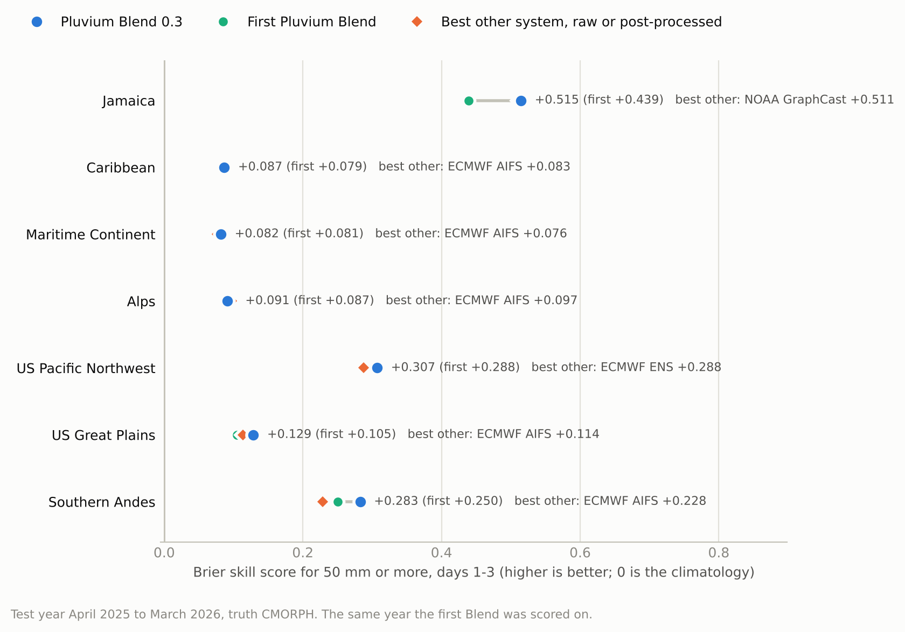
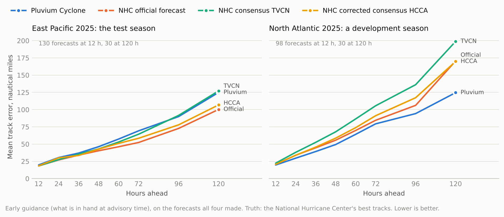

# Pluvium

Rain forecasts for every town and village, in any country between 60 S and 60 N: hour by hour for three days, and day
by day for 14. It started in Jamaica and the Caribbean. For each place Pluvium answers the questions people actually
ask:

* will it rain, hour by hour, and is that drizzle, showers, steady rain, heavy rain or a thunderstorm?
* when will it most likely start, in local time and with a window, and when will it be heaviest?
* how long will it last, and how much will fall (median and a bad case)?
* is lightning active nearby right now, and could it flood?

Three products, one package:

* **Pluvium's network** runs on the NatureV1 / iHELIX engine (geometric attention on the sphere) and forecasts hour by
  hour. **Pluvium-500** is the full-size model: 57.9M parameters ("500" is its name, not its parameter count). It is
  trained on one GPU by a single resumable program.
* **Pluvium Blend** forecasts each day's rain out to 14 days. It reads every operational system at once: ECMWF ENS, HRES
  and AIFS, NOAA GEFS, GFS and GraphCast, and Pluvium's network where it runs. It needs no GPU. It learns from every
  verified day, says when a forecast is beyond anything it was trained on, and gives each amount in the place's own
  terms ("about once in 6 years").
* **Pluvium Cyclone** forecasts where every tropical cyclone in the North Atlantic and the eastern North Pacific will
  go, from the same six systems: a track, a circle that should hold the centre two times in three, and the chance of
  the centre passing near each place. Track only. It needs no GPU.

> Research model, not an official forecast. Follow your national meteorological service and, for hurricanes, the
> National Hurricane Center.

## Install

```bash
pip install pluvium
```

## Use a trained model

```bash
pluvium forecast --country JM            # every place; tables in ./pluvium-forecast, a report on screen
pluvium place "Port Antonio" --country JM  # hour by hour for one place
pluvium learn                              # check past forecasts against airport reports; update the corrections
pluvium info                               # what the published model is and how it scored
```

`pluvium forecast` writes:

| File | Contents |
|---|---|
| `towns.csv` | One row per place: chance of rain now and in 6/12/24/48/72 h, heavy rain, thunder, main weather, likely start and window (local time), heaviest hour, 24 h totals (median, 90th percentile, chance of 10/25/50/100 mm), wettest 3 h, rain over the river catchment, flood risk and reason, lightning now, cause, and a one-sentence summary |
| `parishes.csv` | One row per parish or province, with a headline |
| `towns.geojson` | The same as points, for maps |
| `hourly.npz` | Hourly chance of rain, of each intensity and of thunder, and expected rain, per place |
| `forecast.json`, `report.txt` | Metadata and a readable digest |

From Python:

```python
from pluvium.cli import fetch_model
from pluvium.forecast import Forecaster, place_timeline

fc = Forecaster(fetch_model("CorxLabs/Pluvium-500"))
result = fc.run(out_dir="forecast")
print(place_timeline(fc.towns, result["summary"], "Mandeville", country="JM", hours=24))
```

## Use Pluvium in your country

Nothing in Pluvium is tied to Jamaica. The engine works on the sphere, and every source it learns from is global:
terrain, borders, towns, satellite rain, airports and the driving models. Any country between 60 S and 60 N can be
set up in minutes:

```bash
pluvium setup --country TT --root ~/pluvium-TT     # area, terrain, provinces and every town (Trinidad and Tobago)
pluvium blend train --root ~/pluvium-TT            # learn Pluvium Blend from a year of archived runs (CPU, ~2 h)
pluvium blend forecast --root ~/pluvium-TT         # 14 days of daily rain chances for every town
pluvium blend learn --root ~/pluvium-TT            # every day: update the weights from the days now verified
pluvium program --root ~/pluvium-TT --country TT   # train Pluvium's own network for the country (GPU)
```

`pluvium blend forecast` writes one row per place and day: the chance of 1, 10, 25 and 50 mm; the median, 90th
percentile and expected rain; how many raw systems call for 50 mm; an alert tier (watch, warning, extreme); whether
the forecast is beyond the training record; and how rare the expected amount is at that place.

* `--country` takes ISO codes, one or several (`DO,HT` for Hispaniola). `--box south,north,west,east` sets the extent
  by hand; split large countries into regions.
* Bulletins come in each country's languages: English, Spanish or French, and Jamaican Patois for Jamaica.
* Live "rain now" comes from GOES-East or GOES-West wherever they see (the Americas and the Pacific). Elsewhere
  Pluvium forecasts without it; its network was trained to.
* Set up and tested from live data: Jamaica, Trinidad and Tobago, Sri Lanka (eastern hemisphere) and Ghana (which
  straddles longitude 0).

## Hurricane tracks

```bash
pluvium cyclone --root ~/storms                          # every storm alive now: track, cone, passage chances
pluvium cyclone --root ~/storms --time 2025-10-25T22     # as it would have been issued then
```

It reads the National Hurricane Center's public decks and sea-level pressure from six systems, follows the storm in
every ensemble member, and combines the tracks with weights learned from the forecasts that have already verified.
For each storm it writes a bulletin and a data file: the track to five days, the circle that should hold the centre
two times in three at each lead, the chance of the centre passing within 150 km of each listed place, and scenarios
when the tracks split.

## Train

Every command that trains something, ready to copy, is in [docs/TRAINING.md](docs/TRAINING.md).
`notebooks/pluvium_blend_cell.py` is one cell that sets up a country, trains Pluvium Blend and forecasts, on a CPU.

### Pluvium-500 on one GPU

`notebooks/rtx6000_pluvium.py` is one copy-paste cell for an NVIDIA RTX PRO 6000 Blackwell (96 GB). Set
`GPU_HOURS` and a Hub token and run it. The program then:

1. builds the Caribbean geography and the town list;
2. stages ERA5, CMORPH and airport reports;
3. computes the climatology;
4. trains stage A on reanalysis;
5. trains stage B on real GFS runs, fetched in the background;
6. calibrates and scores on a held-out year;
7. publishes to the Hub;
8. makes the live forecast.

Everything expensive is mirrored to the Hub, so re-running the cell continues where the last session stopped.

```bash
GPU_HOURS=24 HF_TOKEN=... HF_REPO=you/Pluvium-500 pluvium program
```

## How it works

The full explanation is in [docs/ARCHITECTURE.md](docs/ARCHITECTURE.md), every module's purpose is in
[docs/MODULES.md](docs/MODULES.md), and what can go wrong in operation (and what Pluvium does about it) is in
[docs/FAILURE_MODES.md](docs/FAILURE_MODES.md). Four short papers are in [docs/papers](docs/papers/README.md), and
the ideas that were built, tested and dropped are in [docs/WHAT_DID_NOT_WORK.md](docs/WHAT_DID_NOT_WORK.md).

Pluvium Blend, in short:

* each system is post-processed by its own small network, trained on every heavy-rain day with weights that keep
  the chances unbiased;
* a pool weighs them by threshold band and lead, fitted on forecasts the networks did not train on;
* online weights move after every verified day towards whoever has been right;
* a forecast beyond anything in the training period is handed back, in part, to what the raw systems say, in the
  places where that improved the forecast of storms withheld from training;
* scenarios arrange the calibrated amounts in space like the ECMWF ensemble's members.

Pluvium Cyclone, in short: a tracker on sea-level pressure, a consensus whose weights minimise the expected error
given the systems' error covariance so far, a circle sized from verified errors and the systems' spread, and a
cloud of tracks from which passage chances are read.

Pluvium's network, in short:

* **Inputs**:
  * the global models' fields: GFS, ECMWF IFS and AIFS live, ERA5 in training;
  * convective indices (K-index, lifted index, mid-level humidity, shear, upper divergence);
  * rain falling now, from the satellite;
  * the last three hours of airport reports;
  * terrain, coasts, sun and season.
* **Engine**: iHELIX blocks on a Caribbean mesh of 6,075 points (about 11 km over land). Each block combines
  geodesic attention with per-head radii from 15 to 500 km, content-addressed index attention, and a recurrence
  along the forecast's 43 frames.
* **Physics in the loop**:
  * mountain rain (Smith–Barstad linear theory, re-solved every hour with learned parameters);
  * sea-breeze convergence over each island;
  * fronts and shear lines with arrival times;
  * the rain falling now, advected along the steering wind for the first 12 hours.
* **Outputs**: per town and hour, an *intensity chain* (dry, light, moderate, heavy) gives every timing and amount
  answer consistently. Heads for thunder, drizzle/rain/showers and the cause complete it.
* **Training** scores the satellite's and the airports' reports through each instrument's learned confusion
  matrix (a differentiable hidden Markov model), so neither instrument's errors are taught as truth.
* **Live**: one run per driving model, mixed. Calibrated on held-out data. Corrected online from what the
  airports report afterwards.
* **Version 3 depth**, in its own subpackages:
  * `atmos/`: CAPE/CIN, column humidity, Saharan air, tropical waves, cyclone rain, sea breezes, diurnal clocks,
    terrain lift;
  * `engine/`: terrain patches, lead modulation, temporal and neighbour attention, experts, uncertainty heads;
  * `training/`: rare-event curriculum, averaged weights, augmentation, distillation;
  * `prob/`: copulas, conformal intervals, extreme-value tails, scores;
  * `guard/`: input repair, freshness, drift, output repair, fallback;
  * `hydro/`: soil wetness, runoff, flood peak timing;
  * `insight/`: attribution, error analysis, case replays;
  * `render/`: maps, bulletins, CAP alerts;
  * `ops/`: hourly service and JSON API.

## Benchmarks

Losses are reported beside wins in every one of these.

**The second generation of Pluvium Blend (version 0.3)**: see
[docs/FRONTIER_BENCHMARK.md](docs/FRONTIER_BENCHMARK.md). The first full-year benchmark, below, found three weak
spots: 50 mm, winter in mid-latitude climates, and structure at long range. Version 0.3 was aimed at them and scored
on the same year by the same rules, with every part of the design scored on its own.

<!-- frontier-summary:start -->
<!-- frontier-summary:end -->



**Hurricane tracks**: see [docs/CYCLONE_BENCHMARK.md](docs/CYCLONE_BENCHMARK.md). Pluvium Cyclone against the
National Hurricane Center's best tracks, beside the Center's official forecast and guidance, on the forecasts all of
them made. Settings were chosen on three seasons and tested once on a fourth (East Pacific 2025, 167 forecasts of 18
storms).

* **Against single models:** lower error than ECMWF HRES at all 8 leads from 12 to 120 hours (8 with 95% confidence)
  and than NOAA GFS at all 8 (5 with 95% confidence).
* **Against the Center's simple consensus (TVCN):** level.
* **Against the official forecast:** behind at every lead on the test season, by 2 to 25 nautical miles (125 against
  100 at five days). Ahead at every lead on the North Atlantic 2025 development season, which is not the result to
  trust. Google DeepMind's cyclone model is better than both.
* **Uncertainty:** the circle meant to hold the centre two times in three held it 70% of the time. The chance of
  the centre passing within 150 km of a place scored a Brier skill of 0.47, against 0.42 for the raw cloud of
  ensemble members.



**The first full year, 14 days, six regions (version 0.2)**: see
[docs/FULL_YEAR_BENCHMARK.md](docs/FULL_YEAR_BENCHMARK.md). Pluvium Blend
against ECMWF ENS, HRES and AIFS and NOAA GEFS, GFS and GraphCast, from real archived runs only. It is scored on April
2025 to March 2026, every season, in the Caribbean, the Maritime Continent, the Alps, the US Pacific Northwest, the US
Great Plains and the southern Andes. Each system is scored raw and after the same post-processing.

* **Rain of 1 mm or more:** Pluvium Blend had the highest Brier skill of every system, raw or post-processed, in all
  six regions on days 1 to 10, and in 5 of 6 on days 11 to 14.
* **Against each system after equal post-processing:** better with 95% confidence in all 72 comparisons on days 1 to 7
  at 1 mm, and never worse.
* **Days 1 to 10, other scores:** best in 18 of 18 region and lead contests for Brier skill at 10 mm, CSI, ROC area
  and CRPS, 17 for 25 mm, 16 for RMSE and 14 for anomaly correlation.
* **Where it does not lead:**
  * 50 mm, where post-processed AIFS often wins at short range;
  * anomaly correlation beyond a week in the mid-latitudes, where raw ensembles keep more of it;
  * winter on days 1 to 3 (2 of 6 regions, most within 0.004).

**Jamaica at 8 km**, with Pluvium's network as a seventh component:
* Pluvium Blend led at 1 mm on days 1 to 7.
* It lost the amount scores in autumn to Hurricane Melissa. It shrank a record forecast the raw systems had right: two
  days ahead, a 66% chance of 50 mm against 83 to 100% from every raw system.
* The daily table now reports when the raw systems agree on 50 mm or more.

**Against the operational systems, July and August 2025**: see [docs/OPERATIONAL_BENCHMARK.md](docs/OPERATIONAL_BENCHMARK.md).
`pluvium operational` scores Pluvium against ECMWF ENS, ECMWF HRES, ECMWF AIFS, NOAA GEFS, NOAA GraphCast and
NOAA GFS. It uses real archived runs only, with no reanalysis anywhere, and calibrates every system the same causal
way.

Not golden tier yet. Results on Jamaica's 450 land cells, with Pluvium at its small size (0.9M parameters,
about two hours of CPU training) and driven only by GFS:

* **July and August 2025** (protocol frozen before the data were downloaded): Pluvium had the highest skill for rain
  of at least 1 mm on days 1 and 2. That is +0.127 and +0.118 against +0.087 and +0.091 for the best operational
  system. With 95% confidence it beat ECMWF ENS, ECMWF HRES, AIFS and GraphCast; against GEFS and GFS the lead is not
  yet significant. It tied at 10 mm. Its CRPS on daily totals was 40-50% smaller than ECMWF ENS's and GEFS's.
* **May and June 2025** (the first test): Pluvium lost after calibration. Its calibration windows held an unusually
  wet April it had never trained on.
* At 25 and 50 mm no system, ECMWF's included, did meaningfully better than a forecast that never says rain.

**Between versions**: see [docs/BENCHMARK.md](docs/BENCHMARK.md). `pluvium bench` trains each version from
scratch on the same data with the same time budget. Version 3 nearly doubles the skill of 24-hour totals over
version 2 (CRPS skill +44.6% against +23.8%, with emulated forecast errors). It also has the best hourly skill and
critical success index. Heavy-rain hours and thunder are its weak spots.

## Data and attribution

ERA5 (Copernicus Climate Change Service), CMORPH CDR and ISD (NOAA NCEI), GFS and GEFS (NOAA NCEP), NOAA's
real-time GraphCast, ECMWF open data: IFS, ENS and AIFS (CC-BY-4.0), GOES-East imagery and lightning (NOAA), METAR (NOAA Aviation Weather Center), GeoNames (CC-BY-4.0),
geoBoundaries (CC-BY-4.0), Terrarium elevation tiles (Mapzen and its sources).

Code: Apache-2.0, CorX Labs.
