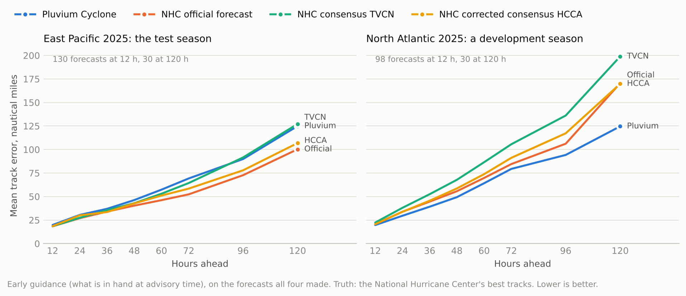

# Pluvium Cyclone against the National Hurricane Center's guidance

Pluvium Cyclone finds every tropical cyclone in six operational forecast systems (ECMWF ENS, NOAA GEFS, ECMWF HRES, ECMWF AIFS, NOAA GFS and NOAA GraphCast), follows it in every member, and combines the tracks into one forecast with a cone, passage chances for places and scenarios. The weights are learned as the season goes, from forecasts that have already verified.

This page scores it against what the US National Hurricane Center (NHC) had in hand for the same storms: its official forecast, its consensus aids, every model's own track, and Google DeepMind's cyclone model.

## The short version

- **Against single models it wins clearly.** On the test season it had lower error at 8 of 8 leads, 8 with 95% confidence against ECMWF HRES and lower error at 8 of 8 leads, 5 with 95% confidence against NOAA GFS, as tracked by the NHC.
- **Against the NHC's own consensus it is level.** On the test season: lower error at 2 of 8 leads; higher with 95% confidence at 1 against TVCN.
- **Against the official forecast it lost on the test season.** Lower error at 0 of 8 leads; higher with 95% confidence at 4 (30 against 27 at 24 h, 46 against 40 at 48 h, 69 against 52 at 72 h, 125 against 100 at 120 h nautical miles). On the development season in the Atlantic it was ahead (lower error at 8 of 8 leads, 2 with 95% confidence), but its settings were chosen with that season in view, so the test season is the result to trust.
- **Google DeepMind's model is better.** On the test season Pluvium Cyclone had lower error at 0 of 8 leads; higher with 95% confidence at 2 against it. Its published track can be added as a seventh member (Pluvium Cyclone+ below).
- **The uncertainty products are honest.** On the test season the cone held the centre 70% of the time against a target of 67%, and the passage chances beat both a yes/no read off the track and the raw cloud of ensemble members.



## How it was tested

Four seasons were used, with two roles.

| Season | Role | Forecasts | Storms |
|---|---|---|---|
| North Atlantic 2024 | develop | 81 | 17 |
| East Pacific 2024 | develop | 46 | 14 |
| North Atlantic 2025 | develop | 118 | 13 |
| East Pacific 2025 | test | 167 | 18 |

- **Development seasons** were used to choose between five ways of learning the weights. The choice was made by error relative to an equal-weight mean of the six systems.
- **The test season** was scored once, after that choice. Nothing about it entered any decision.
- In every season the weights, the cone and the in-storm memory were learned causally: a forecast is learned from only after its valid time, and against the position known in real time, not the best track written afterwards.
- Storms are tracked from the real-time position (the `CARQ` record), at 00 and 12 UTC (00 UTC only in 2024).

Two comparisons are made, as the NHC makes them.

- **Late guidance**: Pluvium Cyclone from a run against the models' own tracks from the same run.
- **Early guidance**: what a forecaster has at advisory time. A model run is not finished when the advisory is written, so the previous run is used, read 12 hours further along and slid to the storm's observed position. The official forecast and the consensus aids are early guidance.

One handicap is worth knowing. Pluvium Cyclone reads the 00 and 12 UTC runs only, so its early guidance comes from runs 12 hours old. The NHC's early aids use runs 6 hours old where they exist. The last 12 hours of the early forecast are filled by carrying the track on at its final motion.

## Early guidance on the forecasts all four made

Mean track error in nautical miles. Bold is the lowest in the column.

**East Pacific 2025, the test season**

| | 12 h | 24 h | 36 h | 48 h | 60 h | 72 h | 96 h | 120 h |
|---|---|---|---|---|---|---|---|---|
| Pluvium Cyclone | 20 | 30 | 37 | 46 | 57 | 69 | 90 | 125 |
| NHC official forecast | **18** | **27** | 34 | **40** | **46** | **52** | **73** | **100** |
| NHC consensus TVCN | 19 | 27 | 35 | 43 | 53 | 64 | 92 | 127 |
| NHC corrected consensus HCCA | 19 | 30 | **34** | 43 | 51 | 58 | 78 | 107 |
| Forecasts | 130 | 110 | 92 | 76 | 64 | 53 | 39 | 30 |

**North Atlantic 2025, a development season**

| | 12 h | 24 h | 36 h | 48 h | 60 h | 72 h | 96 h | 120 h |
|---|---|---|---|---|---|---|---|---|
| Pluvium Cyclone | **20** | **30** | **39** | **49** | **64** | **79** | **94** | **125** |
| NHC official forecast | 21 | 34 | 45 | 56 | 70 | 85 | 106 | 170 |
| NHC consensus TVCN | 22 | 38 | 53 | 68 | 86 | 106 | 136 | 199 |
| NHC corrected consensus HCCA | 21 | 34 | 46 | 59 | 74 | 91 | 117 | 170 |
| Forecasts | 98 | 86 | 76 | 66 | 58 | 51 | 38 | 30 |

## Which learner, and what each one was worth

Error relative to the equal-weight mean of the six systems (below 1 is better), season by season. The learner chosen on the development seasons was **minimum-variance weights + storm memory**.

| Learner | North Atlantic 2024 | East Pacific 2024 | North Atlantic 2025 | East Pacific 2025 |
|---|---|---|---|---|
| minimum-variance weights | 0.963 | 0.988 | 0.927 | 0.960 |
| gradient weights | 0.975 | 0.992 | 0.906 | 0.980 |
| minimum-variance weights + storm memory | 0.960 | 0.992 | 0.882 | 0.967 |
| gradient weights + storm memory | 0.973 | 0.996 | 0.867 | 0.987 |
| minimum-variance weights + online bias | 0.941 | 1.110 | 0.959 | 0.948 |

Reading the table:

- On the test season the chosen learner was 3% better than the equal-weight mean; 2 of the other four did slightly better.
- **Correcting each system's bias as the season goes was erratic.** It was the best learner in North Atlantic 2024 and East Pacific 2025 and the worst in East Pacific 2024 and North Atlantic 2025; in East Pacific 2024 it was 11% worse than the plain mean. A bias measured on some storms is mostly their steering.
- Weights from the running error covariance beat weights from gradient steps in 6 of 8 comparisons, and need no step size.
- Remembering how each system has done on the storm so far helped in North Atlantic 2024 and North Atlantic 2025 and cost a little elsewhere.

## Weights at the end of 2025

| Leads | ECMWF ENS | NOAA GEFS | ECMWF HRES | ECMWF AIFS | NOAA GFS | NOAA GraphCast |
|---|---|---|---|---|---|---|
| short | 0.16 | 0.11 | 0.13 | 0.31 | 0.14 | 0.15 |
| long | 0.11 | 0.14 | 0.15 | 0.35 | 0.11 | 0.14 |

ECMWF's AIFS earned about a third of the weight. No system was written off.

## Hurricane Melissa, forecast by forecast

Melissa crossed western Jamaica on 28 October 2025 as a category 5 hurricane. It is an Atlantic storm, so it belongs to a development season. The table follows every forecast: the chance given that the centre would pass within 150 km of each place in the next five days (in brackets, whether it then did), the track error, and the radius of the two-in-three circle.

| Forecast from | Kingston | Montego Bay | Santiago de Cuba | Track error at 48 / 72 / 96 h, nm | Circle at 72 h, nm |
|---|---|---|---|---|---|
| 2025-10-21 12 UTC | 13% (no) | 5% (no) | 3% (no) | 38 / 81 / 101 | 104 |
| 2025-10-22 00 UTC | 24% (no) | 7% (no) | 3% (no) | 32 / 37 / 50 | 110 |
| 2025-10-22 12 UTC | 32% (no) | 16% (no) | 7% (no) | 21 / 27 / 45 | 93 |
| 2025-10-23 00 UTC | 34% (no) | 20% (no) | 11% (no) | 20 / 44 / 61 | 120 |
| 2025-10-23 12 UTC | 42% (yes) | 24% (yes) | 11% (no) | 12 / 55 / 77 | 96 |
| 2025-10-24 00 UTC | 46% (yes) | 33% (yes) | 18% (no) | 21 / 21 / 15 | 75 |
| 2025-10-24 12 UTC | 67% (yes) | 63% (yes) | 46% (yes) | 11 / 16 / 7 | 73 |
| 2025-10-25 00 UTC | 79% (yes) | 65% (yes) | 67% (yes) | 35 / 76 / 56 | 81 |
| 2025-10-25 12 UTC | 90% (yes) | 81% (yes) | 83% (yes) | 36 / 45 / 44 | 62 |
| 2025-10-26 00 UTC | 89% (yes) | 90% (yes) | 90% (yes) | 44 / 57 / 82 | 88 |
| 2025-10-26 12 UTC | 91% (yes) | 97% (yes) | 93% (yes) | 26 / 23 / 70 | 74 |
| 2025-10-27 00 UTC | 92% (yes) | 99% (yes) | 95% (yes) | 23 / 64 / 137 | 81 |
| 2025-10-27 12 UTC | 96% (yes) | 100% (yes) | 98% (yes) | 41 / 102 / - | 72 |
| 2025-10-28 00 UTC | 96% (yes) | 100% (yes) | 97% (yes) | 47 / 97 / - | 84 |
| 2025-10-28 12 UTC | 100% (yes) | 100% (yes) | 99% (yes) | 37 / - / - | 66 |
| 2025-10-29 00 UTC | 100% (yes) | 100% (yes) | 100% (yes) | 35 / - / - | 74 |
| 2025-10-29 12 UTC | 0% (no) | 0% (no) | 100% (yes) | - / - / - | 84 |
| 2025-10-30 00 UTC | 0% (no) | 0% (no) | 0% (no) | - / - / - | 71 |
| 2025-10-30 12 UTC | 0% (no) | 0% (no) | 0% (no) | - / - / - | 67 |

The chance for Kingston passed 40% five days before the centre arrived and 90% three days before. Early forecasts gave chances of 13% to 34% for five-day windows in which the centre did not yet arrive: the storm moved more slowly than every system expected.

## The test season in full

Each cell: Pluvium's mean error / the other's mean error in nautical miles on the forecasts both made (number of forecasts). **Bold**: Pluvium better with 95% confidence (bootstrap over storms). *Italic*: worse with 95% confidence.

Scored once, after every setting was fixed. Storms: Alvin, Barbara, Cosme, Dalila, Erick, Flossie, Gil, Henriette, Ivo, Juliette, Kiko, Lorena, Mario, Narda, Octave, Priscilla, Raymond, Sonia. 167 forecasts.

### Early guidance: what is in hand at advisory time

**Pluvium Cyclone (six public systems)**

| Against | 12 h | 24 h | 36 h | 48 h | 60 h | 72 h | 96 h | 120 h |
|---|---|---|---|---|---|---|---|---|
| NHC official forecast | *20 / 18 (130)* | *30 / 27 (110)* | 37 / 34 (92) | 46 / 40 (76) | 57 / 46 (64) | 69 / 52 (53) | *90 / 73 (39)* | *125 / 100 (30)* |
| NHC consensus TVCN | 20 / 19 (130) | *30 / 27 (110)* | 37 / 35 (92) | 46 / 43 (76) | 57 / 53 (64) | 69 / 64 (53) | 90 / 92 (39) | 125 / 127 (30) |
| NHC corrected consensus HCCA | 20 / 19 (130) | 30 / 30 (110) | 37 / 34 (92) | 46 / 43 (76) | 57 / 51 (64) | 69 / 58 (53) | 90 / 78 (39) | 125 / 107 (30) |
| Google DeepMind (early) | 18 / 17 (84) | 28 / 27 (74) | 34 / 32 (64) | 40 / 38 (56) | 46 / 42 (48) | 52 / 43 (39) | 83 / 54 (27) | 136 / 95 (19) |
| NOAA GFS (early) | 20 / 20 (129) | 30 / 32 (108) | 37 / 42 (91) | 46 / 53 (75) | 57 / 63 (63) | 68 / 77 (52) | 88 / 112 (38) | 122 / 138 (29) |
| Florida State superensemble | 20 / 19 (128) | 31 / 29 (109) | 37 / 35 (91) | 46 / 43 (76) | 55 / 53 (63) | 66 / 62 (52) | 83 / 80 (38) | 125 / 122 (30) |

**Pluvium Cyclone+ (with Google DeepMind's published track as a seventh member)**

| Against | 12 h | 24 h | 36 h | 48 h | 60 h | 72 h | 96 h | 120 h |
|---|---|---|---|---|---|---|---|---|
| NHC official forecast | 19 / 18 (130) | *29 / 27 (110)* | 35 / 34 (92) | 44 / 40 (76) | 53 / 46 (64) | 63 / 52 (53) | 78 / 73 (39) | 112 / 100 (30) |
| NHC consensus TVCN | 19 / 19 (130) | 29 / 27 (110) | 35 / 35 (92) | 44 / 43 (76) | 53 / 53 (64) | 63 / 64 (53) | **78 / 92 (39)** | 112 / 127 (30) |
| NHC corrected consensus HCCA | 19 / 19 (130) | 29 / 30 (110) | 35 / 34 (92) | 44 / 43 (76) | 53 / 51 (64) | 63 / 58 (53) | 78 / 78 (39) | 112 / 107 (30) |
| Google DeepMind (early) | 17 / 17 (84) | 26 / 27 (74) | 32 / 32 (64) | 37 / 38 (56) | 42 / 42 (48) | 46 / 43 (39) | 71 / 54 (27) | 124 / 95 (19) |
| NOAA GFS (early) | 19 / 20 (129) | 29 / 32 (108) | **35 / 42 (91)** | 44 / 53 (75) | 52 / 63 (63) | 62 / 77 (52) | **77 / 112 (38)** | 111 / 138 (29) |
| Florida State superensemble | 19 / 19 (128) | 29 / 29 (109) | 35 / 35 (91) | 44 / 43 (76) | 51 / 53 (63) | 60 / 62 (52) | 73 / 80 (38) | 112 / 122 (30) |

### Late guidance: the same run

**Pluvium Cyclone (six public systems)**

| Against | 12 h | 24 h | 36 h | 48 h | 60 h | 72 h | 96 h | 120 h |
|---|---|---|---|---|---|---|---|---|
| Google DeepMind (late) | *18 / 15 (124)* | *26 / 23 (109)* | 33 / 30 (94) | 38 / 35 (81) | 41 / 39 (68) | 51 / 44 (60) | 67 / 49 (44) | 95 / 72 (33) |
| ECMWF HRES (NHC tracker) | **18 / 22 (147)** | **25 / 33 (128)** | **33 / 44 (110)** | **40 / 54 (92)** | **43 / 61 (74)** | **51 / 74 (61)** | **67 / 91 (44)** | **98 / 124 (35)** |
| ECMWF ENS mean (NHC tracker) | **18 / 22 (143)** | **24 / 31 (123)** | **32 / 41 (105)** | **39 / 49 (87)** | **41 / 57 (71)** | **47 / 68 (58)** | **63 / 86 (39)** | **91 / 124 (32)** |
| NOAA GFS (NHC tracker) | **18 / 26 (149)** | **26 / 36 (130)** | **34 / 48 (111)** | **44 / 56 (94)** | 55 / 68 (78) | 67 / 78 (66) | 85 / 110 (46) | **98 / 138 (35)** |
| NOAA GEFS mean (NHC tracker) | **18 / 26 (149)** | **26 / 35 (129)** | **34 / 46 (111)** | 44 / 55 (94) | 49 / 65 (77) | 60 / 75 (65) | **71 / 111 (45)** | **98 / 142 (35)** |
| GraphCast (NHC tracker) | **16 / 18 (107)** | 22 / 31 (93) | 29 / 36 (79) | 35 / 41 (67) | 40 / 48 (56) | 48 / 60 (44) | 56 / 58 (27) | 84 / 79 (17) |
| Canadian global model | **18 / 31 (149)** | **26 / 44 (129)** | **33 / 57 (110)** | **40 / 68 (91)** | **50 / 81 (75)** | **60 / 101 (64)** | 85 / 145 (46) | **98 / 180 (35)** |
| NOAA HAFS-A hurricane model | **18 / 28 (149)** | **26 / 37 (130)** | **34 / 43 (111)** | 44 / 53 (94) | 55 / 65 (78) | 67 / 78 (66) | 85 / 100 (46) | **98 / 135 (35)** |
| NOAA HWRF hurricane model | **18 / 27 (145)** | **26 / 40 (126)** | **34 / 50 (107)** | **44 / 62 (91)** | 56 / 78 (75) | 68 / 92 (63) | 86 / 123 (45) | **98 / 156 (35)** |

**Pluvium Cyclone+**

| Against | 12 h | 24 h | 36 h | 48 h | 60 h | 72 h | 96 h | 120 h |
|---|---|---|---|---|---|---|---|---|
| Google DeepMind (late) | 16 / 15 (124) | 24 / 23 (109) | 31 / 30 (94) | 35 / 35 (81) | 38 / 39 (68) | 46 / 44 (60) | 56 / 49 (44) | 83 / 72 (33) |
| ECMWF HRES (NHC tracker) | **16 / 22 (147)** | **24 / 33 (128)** | **32 / 44 (110)** | **38 / 54 (92)** | **41 / 61 (74)** | **47 / 74 (61)** | **58 / 91 (44)** | **87 / 124 (35)** |
| ECMWF ENS mean (NHC tracker) | **16 / 22 (143)** | **23 / 31 (123)** | **30 / 41 (105)** | **36 / 49 (87)** | **39 / 57 (71)** | **44 / 68 (58)** | **53 / 86 (39)** | **80 / 124 (32)** |
| NOAA GFS (NHC tracker) | **17 / 26 (149)** | **24 / 36 (130)** | **32 / 48 (111)** | **41 / 56 (94)** | 53 / 68 (78) | 63 / 78 (66) | 75 / 110 (46) | **87 / 138 (35)** |
| NOAA GEFS mean (NHC tracker) | **17 / 26 (149)** | **24 / 35 (129)** | **32 / 46 (111)** | **41 / 55 (94)** | 47 / 65 (77) | 56 / 75 (65) | **60 / 111 (45)** | **87 / 142 (35)** |
| GraphCast (NHC tracker) | **14 / 18 (107)** | 21 / 31 (93) | 28 / 36 (79) | 33 / 41 (67) | 39 / 48 (56) | 46 / 60 (44) | 49 / 58 (27) | 74 / 79 (17) |
| Canadian global model | **17 / 31 (149)** | **24 / 44 (129)** | **32 / 57 (110)** | **38 / 68 (91)** | **48 / 81 (75)** | **56 / 101 (64)** | **75 / 145 (46)** | **87 / 180 (35)** |
| NOAA HAFS-A hurricane model | **17 / 28 (149)** | **24 / 37 (130)** | **32 / 43 (111)** | **41 / 53 (94)** | 53 / 65 (78) | 63 / 78 (66) | 75 / 100 (46) | **87 / 135 (35)** |
| NOAA HWRF hurricane model | **17 / 27 (145)** | **24 / 40 (126)** | **33 / 50 (107)** | **41 / 62 (91)** | 53 / 78 (75) | 63 / 92 (63) | 76 / 123 (45) | **87 / 156 (35)** |

### Pluvium Cyclone against its own ingredients

The same tracker on each system, and the consensus under each learner.

| Against | 12 h | 24 h | 36 h | 48 h | 60 h | 72 h | 96 h | 120 h |
|---|---|---|---|---|---|---|---|---|
| ECMWF ENS (Pluvium's tracker) | **18 / 22 (149)** | **26 / 32 (130)** | **34 / 45 (111)** | **44 / 56 (94)** | 55 / 69 (78) | 67 / 85 (66) | 85 / 106 (46) | **98 / 132 (35)** |
| NOAA GEFS (Pluvium's tracker) | **18 / 33 (149)** | **25 / 39 (128)** | **33 / 49 (110)** | **44 / 58 (94)** | **55 / 73 (78)** | 59 / 78 (64) | **67 / 114 (44)** | **98 / 145 (35)** |
| ECMWF HRES (Pluvium's tracker) | **18 / 23 (148)** | **25 / 35 (129)** | **33 / 46 (110)** | **42 / 58 (92)** | **53 / 84 (76)** | **57 / 90 (63)** | **66 / 99 (43)** | **93 / 119 (34)** |
| ECMWF AIFS (Pluvium's tracker) | 18 / 18 (148) | 25 / 25 (129) | 33 / 33 (110) | 42 / 44 (93) | 53 / 56 (77) | 65 / 68 (65) | 81 / 84 (45) | 93 / 106 (34) |
| NOAA GFS (Pluvium's tracker) | **18 / 29 (149)** | **26 / 38 (130)** | **34 / 50 (111)** | **44 / 60 (94)** | **55 / 74 (78)** | **67 / 89 (66)** | **85 / 131 (46)** | **98 / 140 (35)** |
| NOAA GraphCast (Pluvium's tracker) | **18 / 28 (149)** | **26 / 36 (130)** | **34 / 46 (110)** | **44 / 61 (93)** | **56 / 70 (76)** | **68 / 94 (64)** | **88 / 129 (42)** | 98 / 132 (27) |
| consensus: equal | **18 / 20 (149)** | 26 / 27 (130) | 34 / 35 (111) | 44 / 44 (94) | 55 / 55 (78) | 67 / 68 (66) | 85 / 91 (46) | 98 / 104 (35) |
| consensus: minimum-variance weights | **18 / 19 (149)** | 26 / 26 (130) | 34 / 34 (111) | 44 / 43 (94) | 55 / 54 (78) | 67 / 66 (66) | 85 / 84 (46) | 98 / 97 (35) |
| consensus: gradient weights | 18 / 19 (149) | 26 / 26 (130) | 34 / 34 (111) | 44 / 43 (94) | 55 / 55 (78) | 67 / 67 (66) | 85 / 88 (46) | 98 / 104 (35) |
| consensus: minimum-variance weights + storm memory | 18 / 18 (149) | 26 / 26 (130) | 34 / 34 (111) | 44 / 44 (94) | 55 / 55 (78) | 67 / 67 (66) | 85 / 85 (46) | 98 / 98 (35) |
| consensus: gradient weights + storm memory | 18 / 18 (149) | 26 / 26 (130) | 34 / 34 (111) | 44 / 44 (94) | **55 / 57 (78)** | 67 / 68 (66) | 85 / 88 (46) | 98 / 104 (35) |
| consensus: minimum-variance weights + online bias | **18 / 19 (149)** | 26 / 26 (130) | 34 / 34 (111) | 44 / 43 (94) | 55 / 54 (78) | 67 / 66 (66) | *85 / 80 (46)* | 98 / 92 (35) |
| Pluvium Cyclone+ (late) | *18 / 17 (149)* | *26 / 24 (130)* | *34 / 32 (111)* | *44 / 41 (94)* | 55 / 53 (78) | *67 / 63 (66)* | *85 / 75 (46)* | *98 / 87 (35)* |

## North Atlantic 2025 in full (a development season)

A development season: the learner's settings were chosen on it. Its weights were still learned causally. Storms: Andrea, Barry, Chantal, Dexter, Erin, Fernand, Gabrielle, Humberto, Imelda, Jerry, Karen, Lorenzo, Melissa. 118 forecasts.

### Early guidance: what is in hand at advisory time

**Pluvium Cyclone (six public systems)**

| Against | 12 h | 24 h | 36 h | 48 h | 60 h | 72 h | 96 h | 120 h |
|---|---|---|---|---|---|---|---|---|
| NHC official forecast | 20 / 21 (98) | **30 / 34 (86)** | **39 / 45 (76)** | 49 / 56 (66) | 64 / 70 (58) | 79 / 85 (51) | 94 / 106 (38) | 125 / 170 (30) |
| NHC consensus TVCN | **20 / 22 (99)** | **30 / 38 (86)** | **39 / 53 (76)** | **49 / 68 (66)** | **64 / 86 (58)** | **79 / 106 (51)** | **94 / 136 (38)** | **125 / 199 (30)** |
| NHC corrected consensus HCCA | 20 / 21 (99) | **30 / 34 (86)** | **39 / 46 (76)** | **49 / 59 (66)** | **64 / 74 (58)** | 79 / 91 (51) | **94 / 117 (38)** | **125 / 170 (30)** |
| Google DeepMind (early) | 19 / 20 (84) | 30 / 28 (76) | 41 / 36 (69) | 51 / 45 (59) | *64 / 53 (54)* | 80 / 70 (47) | 95 / 112 (36) | 128 / 182 (29) |
| NOAA GFS (early) | **20 / 27 (99)** | **30 / 48 (86)** | **39 / 65 (76)** | **49 / 85 (66)** | **64 / 102 (58)** | 79 / 127 (51) | **94 / 205 (38)** | **125 / 342 (30)** |
| Florida State superensemble | **20 / 23 (97)** | **30 / 38 (85)** | **39 / 50 (75)** | **49 / 64 (65)** | **64 / 79 (57)** | **79 / 96 (50)** | **94 / 136 (37)** | **125 / 222 (29)** |

**Pluvium Cyclone+ (with Google DeepMind's published track as a seventh member)**

| Against | 12 h | 24 h | 36 h | 48 h | 60 h | 72 h | 96 h | 120 h |
|---|---|---|---|---|---|---|---|---|
| NHC official forecast | **19 / 21 (98)** | **28 / 34 (86)** | **36 / 45 (76)** | 47 / 56 (66) | **60 / 70 (58)** | 77 / 85 (51) | 97 / 106 (38) | 128 / 170 (30) |
| NHC consensus TVCN | **19 / 22 (99)** | **28 / 38 (86)** | **36 / 53 (76)** | **47 / 68 (66)** | **60 / 86 (58)** | **77 / 106 (51)** | **97 / 136 (38)** | **128 / 199 (30)** |
| NHC corrected consensus HCCA | 19 / 21 (99) | **28 / 34 (86)** | **36 / 46 (76)** | **47 / 59 (66)** | **60 / 74 (58)** | **77 / 91 (51)** | **97 / 117 (38)** | **128 / 170 (30)** |
| Google DeepMind (early) | 18 / 20 (84) | 28 / 28 (76) | 37 / 36 (69) | 48 / 45 (59) | *60 / 53 (54)* | 78 / 70 (47) | 99 / 112 (36) | **132 / 182 (29)** |
| NOAA GFS (early) | **19 / 27 (99)** | **28 / 48 (86)** | **36 / 65 (76)** | **47 / 85 (66)** | **60 / 102 (58)** | 77 / 127 (51) | **97 / 205 (38)** | **128 / 342 (30)** |
| Florida State superensemble | **19 / 23 (97)** | **28 / 38 (85)** | **36 / 50 (75)** | **47 / 64 (65)** | **60 / 79 (57)** | **77 / 96 (50)** | **97 / 136 (37)** | **129 / 222 (29)** |

### Late guidance: the same run

**Pluvium Cyclone (six public systems)**

| Against | 12 h | 24 h | 36 h | 48 h | 60 h | 72 h | 96 h | 120 h |
|---|---|---|---|---|---|---|---|---|
| Google DeepMind (late) | 15 / 14 (97) | 23 / 21 (89) | 31 / 28 (76) | 39 / 35 (67) | 50 / 43 (58) | *66 / 54 (51)* | 90 / 92 (39) | **121 / 142 (30)** |
| ECMWF HRES (NHC tracker) | **16 / 19 (109)** | **24 / 30 (99)** | **31 / 46 (86)** | **40 / 61 (76)** | **52 / 77 (66)** | **67 / 97 (58)** | **88 / 114 (44)** | **116 / 157 (34)** |
| ECMWF ENS mean (NHC tracker) | **16 / 19 (108)** | **24 / 28 (98)** | **31 / 43 (85)** | **40 / 57 (75)** | **52 / 73 (65)** | **68 / 91 (57)** | **89 / 121 (43)** | **119 / 161 (33)** |
| NOAA GFS (NHC tracker) | **16 / 28 (109)** | **24 / 45 (99)** | **31 / 62 (86)** | **40 / 79 (76)** | **49 / 94 (65)** | **67 / 127 (58)** | **88 / 189 (44)** | **116 / 315 (34)** |
| NOAA GEFS mean (NHC tracker) | **16 / 23 (109)** | **23 / 37 (98)** | **31 / 50 (86)** | **37 / 62 (75)** | **47 / 73 (64)** | **64 / 92 (57)** | **88 / 129 (44)** | 116 / 170 (34) |
| GraphCast (NHC tracker) | **16 / 18 (90)** | 22 / 25 (81) | 29 / 33 (70) | 35 / 38 (62) | 47 / 46 (56) | 64 / 57 (50) | 90 / 94 (39) | 121 / 128 (30) |
| Canadian global model | **16 / 27 (109)** | **23 / 46 (98)** | **29 / 67 (84)** | **36 / 87 (74)** | **47 / 104 (64)** | **61 / 120 (56)** | **88 / 144 (44)** | 116 / 174 (34) |
| NOAA HAFS-A hurricane model | **16 / 27 (108)** | **23 / 43 (97)** | **31 / 55 (86)** | **40 / 70 (75)** | **51 / 87 (64)** | **67 / 98 (56)** | **91 / 131 (42)** | **121 / 166 (32)** |
| NOAA HWRF hurricane model | **16 / 25 (107)** | **24 / 43 (98)** | **31 / 58 (86)** | **40 / 77 (76)** | **52 / 100 (66)** | **67 / 130 (58)** | **88 / 192 (44)** | **116 / 282 (34)** |

**Pluvium Cyclone+**

| Against | 12 h | 24 h | 36 h | 48 h | 60 h | 72 h | 96 h | 120 h |
|---|---|---|---|---|---|---|---|---|
| Google DeepMind (late) | 14 / 14 (97) | 21 / 21 (89) | 28 / 28 (76) | 35 / 35 (67) | 45 / 43 (58) | 60 / 54 (51) | 89 / 92 (39) | **127 / 142 (30)** |
| ECMWF HRES (NHC tracker) | **15 / 19 (109)** | **22 / 30 (99)** | **29 / 46 (86)** | **36 / 61 (76)** | **48 / 77 (66)** | **62 / 97 (58)** | **88 / 114 (44)** | **122 / 157 (34)** |
| ECMWF ENS mean (NHC tracker) | **14 / 19 (108)** | **22 / 28 (98)** | **28 / 43 (85)** | **36 / 57 (75)** | **48 / 73 (65)** | **63 / 91 (57)** | **89 / 121 (43)** | **125 / 161 (33)** |
| NOAA GFS (NHC tracker) | **15 / 28 (109)** | **22 / 45 (99)** | **29 / 62 (86)** | **36 / 79 (76)** | **46 / 94 (65)** | **62 / 127 (58)** | **88 / 189 (44)** | **122 / 315 (34)** |
| NOAA GEFS mean (NHC tracker) | **15 / 23 (109)** | **21 / 37 (98)** | **29 / 50 (86)** | **34 / 62 (75)** | **44 / 73 (64)** | **59 / 92 (57)** | **88 / 129 (44)** | 122 / 170 (34) |
| GraphCast (NHC tracker) | **14 / 18 (90)** | **20 / 25 (81)** | 27 / 33 (70) | 31 / 38 (62) | 43 / 46 (56) | 59 / 57 (50) | 89 / 94 (39) | 127 / 128 (30) |
| Canadian global model | **15 / 27 (109)** | **21 / 46 (98)** | **27 / 67 (84)** | **33 / 87 (74)** | **44 / 104 (64)** | **58 / 120 (56)** | **88 / 144 (44)** | 122 / 174 (34) |
| NOAA HAFS-A hurricane model | **15 / 27 (108)** | **21 / 43 (97)** | **29 / 55 (86)** | **36 / 70 (75)** | **48 / 87 (64)** | **62 / 98 (56)** | **90 / 131 (42)** | **126 / 166 (32)** |
| NOAA HWRF hurricane model | **15 / 25 (107)** | **22 / 43 (98)** | **29 / 58 (86)** | **36 / 77 (76)** | **48 / 100 (66)** | **62 / 130 (58)** | **88 / 192 (44)** | **122 / 282 (34)** |

### Pluvium Cyclone against its own ingredients

The same tracker on each system, and the consensus under each learner.

| Against | 12 h | 24 h | 36 h | 48 h | 60 h | 72 h | 96 h | 120 h |
|---|---|---|---|---|---|---|---|---|
| ECMWF ENS (Pluvium's tracker) | **16 / 18 (109)** | **24 / 28 (99)** | **31 / 43 (86)** | **40 / 56 (76)** | **52 / 72 (66)** | **67 / 92 (58)** | **88 / 118 (44)** | 116 / 153 (34) |
| NOAA GEFS (Pluvium's tracker) | **16 / 28 (109)** | **24 / 39 (98)** | **30 / 47 (84)** | **36 / 58 (73)** | **47 / 71 (64)** | **64 / 89 (57)** | **88 / 126 (44)** | 116 / 166 (34) |
| ECMWF HRES (Pluvium's tracker) | **16 / 20 (109)** | **24 / 31 (99)** | **31 / 49 (86)** | **40 / 63 (76)** | **52 / 78 (66)** | **67 / 98 (58)** | **88 / 116 (44)** | **116 / 157 (34)** |
| ECMWF AIFS (Pluvium's tracker) | 16 / 17 (109) | 24 / 24 (98) | 31 / 32 (85) | 40 / 39 (75) | 52 / 50 (66) | 67 / 62 (58) | 88 / 89 (44) | 116 / 119 (34) |
| NOAA GFS (Pluvium's tracker) | **16 / 28 (109)** | **24 / 44 (97)** | **31 / 61 (84)** | **40 / 80 (74)** | **52 / 98 (64)** | **64 / 118 (55)** | **89 / 187 (42)** | **115 / 294 (30)** |
| NOAA GraphCast (Pluvium's tracker) | **16 / 25 (109)** | **24 / 34 (99)** | **31 / 40 (85)** | **39 / 51 (75)** | 47 / 61 (63) | 61 / 77 (56) | 88 / 126 (44) | 116 / 160 (34) |
| consensus: equal | **16 / 17 (109)** | **24 / 26 (99)** | **31 / 34 (86)** | **40 / 46 (76)** | **52 / 59 (66)** | **67 / 77 (58)** | **88 / 104 (44)** | **116 / 135 (34)** |
| consensus: minimum-variance weights | **16 / 17 (109)** | **24 / 25 (99)** | 31 / 32 (86) | **40 / 42 (76)** | **52 / 54 (66)** | **67 / 71 (58)** | **88 / 95 (44)** | **116 / 126 (34)** |
| consensus: gradient weights | **16 / 17 (109)** | **24 / 25 (99)** | 31 / 32 (86) | **40 / 41 (76)** | 52 / 53 (66) | 67 / 68 (58) | 88 / 91 (44) | 116 / 116 (34) |
| consensus: minimum-variance weights + storm memory | 16 / 16 (109) | 24 / 24 (99) | 31 / 31 (86) | 40 / 40 (76) | 52 / 52 (66) | 67 / 67 (58) | 88 / 88 (44) | 116 / 116 (34) |
| consensus: gradient weights + storm memory | **16 / 16 (109)** | 24 / 24 (99) | 31 / 31 (86) | 40 / 40 (76) | 52 / 51 (66) | 67 / 66 (58) | 88 / 85 (44) | 116 / 109 (34) |
| consensus: minimum-variance weights + online bias | **16 / 17 (109)** | **24 / 25 (99)** | **31 / 32 (86)** | **40 / 43 (76)** | **52 / 56 (66)** | **67 / 73 (58)** | **88 / 100 (44)** | **116 / 142 (34)** |
| Pluvium Cyclone+ (late) | *16 / 15 (109)* | *24 / 22 (99)* | *31 / 29 (86)* | *40 / 36 (76)* | *52 / 48 (66)* | *67 / 62 (58)* | 88 / 88 (44) | 116 / 122 (34) |

## The uncertainty products

Everything below was learned causally, from forecasts that had verified before each forecast was made. The cone's dependence on spread ended at a slope of 0.48 (0 would be a static cone).

### East Pacific 2025 (test)

**Cone.** Share of forecasts whose centre fell inside the two-in-three circle (target 67%), and the circle's mean radius in nautical miles.

| | 12 h | 24 h | 36 h | 48 h | 60 h | 72 h | 96 h | 120 h |
|---|---|---|---|---|---|---|---|---|
| Inside, cone that follows spread | 70% | 68% | 69% | 69% | 72% | 68% | 72% | 66% |
| Inside, static cone | 64% | 65% | 68% | 70% | 78% | 77% | 78% | 69% |
| Radius, cone that follows spread | 21 | 30 | 39 | 46 | 59 | 67 | 95 | 127 |
| Radius, static cone | 19 | 28 | 37 | 44 | 60 | 70 | 98 | 136 |
| Correlation of spread with error | +0.52 | +0.44 | +0.40 | +0.71 | +0.83 | +0.80 | +0.76 | +0.16 |

**Passage chances.** 1945 forecasts for places within 2,000 km; the centre came within 150 km in 101 (5.2%). Brier skill against that base rate: Pluvium's cloud +0.465 (the mixture before resizing +0.485), raw member cloud +0.418, yes/no from the consensus track -0.149.

| Chance given | Forecasts | Mean chance | Happened |
|---|---|---|---|
| 0-2% | 1507 | 0% | 0% |
| 2-10% | 170 | 5% | 4% |
| 10-25% | 103 | 16% | 5% |
| 25-50% | 62 | 36% | 31% |
| 50-75% | 37 | 62% | 49% |
| 75-100% | 66 | 90% | 73% |

**Scenarios.** The cloud split into more than one scenario in 5 of 151 forecasts. In those, the main scenario held 60% of the weight on average and was the one nearest the truth 60% of the time. The consensus was 63 nm off at the longest lead; the nearest scenario's mean track 85 nm (the nearest of several is flattered by being picked afterwards).

### East Pacific 2024 (develop)

**Cone.** Share of forecasts whose centre fell inside the two-in-three circle (target 67%), and the circle's mean radius in nautical miles.

| | 12 h | 24 h | 36 h | 48 h | 60 h | 72 h | 96 h | 120 h |
|---|---|---|---|---|---|---|---|---|
| Inside, cone that follows spread | 65% | 75% | 62% | 74% | 90% | 88% | 91% | 86% |
| Inside, static cone | 74% | 69% | 75% | 87% | 76% | 88% | 91% | 86% |
| Radius, cone that follows spread | 20 | 30 | 40 | 49 | 71 | 71 | 110 | 156 |
| Radius, static cone | 20 | 28 | 36 | 44 | 63 | 68 | 110 | 152 |
| Correlation of spread with error | - | +0.68 | +0.65 | +0.74 | +0.91 | +0.94 | +0.34 | - |

**Passage chances.** 498 forecasts for places within 2,000 km; the centre came within 150 km in 28 (5.6%). Brier skill against that base rate: Pluvium's cloud +0.656 (the mixture before resizing +0.650), raw member cloud +0.657, yes/no from the consensus track +0.357.

| Chance given | Forecasts | Mean chance | Happened |
|---|---|---|---|
| 0-2% | 423 | 0% | 0% |
| 2-10% | 20 | 5% | 0% |
| 10-25% | 11 | 18% | 9% |
| 25-50% | 17 | 41% | 12% |
| 50-75% | 9 | 58% | 67% |
| 75-100% | 18 | 97% | 94% |

**Scenarios.** The cloud split into more than one scenario in 0 of 43 forecasts.

### North Atlantic 2024 (develop)

**Cone.** Share of forecasts whose centre fell inside the two-in-three circle (target 67%), and the circle's mean radius in nautical miles.

| | 12 h | 24 h | 36 h | 48 h | 60 h | 72 h | 96 h | 120 h |
|---|---|---|---|---|---|---|---|---|
| Inside, cone that follows spread | 80% | 75% | 66% | 69% | 78% | 72% | 83% | 85% |
| Inside, static cone | 83% | 76% | 69% | 75% | 80% | 75% | 83% | 85% |
| Radius, cone that follows spread | 20 | 29 | 37 | 46 | 61 | 69 | 114 | 173 |
| Radius, static cone | 20 | 28 | 37 | 46 | 64 | 72 | 117 | 176 |
| Correlation of spread with error | +0.32 | +0.48 | +0.34 | +0.03 | +0.08 | +0.16 | -0.11 | +0.23 |

**Passage chances.** 1287 forecasts for places within 2,000 km; the centre came within 150 km in 66 (5.1%). Brier skill against that base rate: Pluvium's cloud +0.821 (the mixture before resizing +0.800), raw member cloud +0.794, yes/no from the consensus track +0.713.

| Chance given | Forecasts | Mean chance | Happened |
|---|---|---|---|
| 0-2% | 1132 | 0% | 0% |
| 2-10% | 46 | 5% | 0% |
| 10-25% | 22 | 18% | 9% |
| 25-50% | 20 | 35% | 25% |
| 50-75% | 18 | 65% | 56% |
| 75-100% | 49 | 94% | 100% |

**Scenarios.** The cloud split into more than one scenario in 6 of 76 forecasts. In those, the main scenario held 68% of the weight on average and was the one nearest the truth 67% of the time. The consensus was 42 nm off at the longest lead; the nearest scenario's mean track 54 nm (the nearest of several is flattered by being picked afterwards).

### North Atlantic 2025 (develop)

**Cone.** Share of forecasts whose centre fell inside the two-in-three circle (target 67%), and the circle's mean radius in nautical miles.

| | 12 h | 24 h | 36 h | 48 h | 60 h | 72 h | 96 h | 120 h |
|---|---|---|---|---|---|---|---|---|
| Inside, cone that follows spread | 68% | 74% | 67% | 71% | 71% | 57% | 61% | 76% |
| Inside, static cone | 69% | 66% | 67% | 68% | 64% | 57% | 61% | 74% |
| Radius, cone that follows spread | 20 | 30 | 40 | 49 | 62 | 70 | 104 | 162 |
| Radius, static cone | 20 | 28 | 37 | 44 | 60 | 69 | 95 | 139 |
| Correlation of spread with error | +0.45 | +0.40 | +0.02 | +0.14 | +0.07 | -0.14 | +0.11 | +0.41 |

**Passage chances.** 2065 forecasts for places within 2,000 km; the centre came within 150 km in 71 (3.4%). Brier skill against that base rate: Pluvium's cloud +0.807 (the mixture before resizing +0.796), raw member cloud +0.782, yes/no from the consensus track +0.665.

| Chance given | Forecasts | Mean chance | Happened |
|---|---|---|---|
| 0-2% | 1898 | 0% | 0% |
| 2-10% | 53 | 5% | 0% |
| 10-25% | 37 | 18% | 19% |
| 25-50% | 17 | 37% | 53% |
| 50-75% | 13 | 65% | 62% |
| 75-100% | 47 | 94% | 100% |

**Scenarios.** The cloud split into more than one scenario in 3 of 109 forecasts. In those, the main scenario held 65% of the weight on average and was the one nearest the truth 100% of the time. The consensus was 18 nm off at the longest lead; the nearest scenario's mean track 21 nm (the nearest of several is flattered by being picked afterwards).

## What did not work

- **Bias correction.** See the learner table: best in some seasons, worst in others.
- **Counting a single run as one point in the cloud.** Weighted that way, a third of the chance sat on one line, and passage chances were worse than the raw member cloud. Giving every system's track the ensembles' perturbations fixed it.
- **Choosing settings on one season.** With 81 forecasts from 17 storms, differences of 2% between learners are noise. The 2024 season alone would have chosen the bias-corrected learner.
- **Beating the official forecast everywhere.** It held on the development season and failed on the test season.

## Limits

- Track only. Nothing here forecasts wind, surge or rain.
- Two basins and two seasons. The test season has 18 storms.
- Runs at 00 and 12 UTC only, so early guidance is 12 hours old.
- The six systems are global models at about a quarter of a degree. Google DeepMind's model is better than all of them, and than their combination.

## Run it

```bash
pip install pluvium
pluvium cyclone --root storms                       # every storm alive now: track, cone, passage chances
pluvium cyclone --root storms --time 2025-10-25T22  # as it would have been issued then
```

To repeat the benchmark, stage the decks and pressure fields, then:

```bash
python -m pluvium.benchmarks.cyclone_bench --decks decks --fields pressure --out cyclone_out
python scripts/doc_cyclone.py cyclone_out/cyclone.json melissa.json docs/CYCLONE_BENCHMARK.md
```
