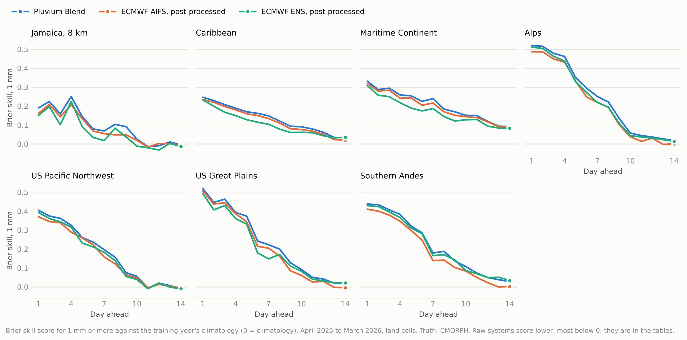

# Pluvium against the operational systems: a full year, 14 days, around the world

The full-year benchmark scores every forecast from real, archived 00 UTC runs only, with no reanalysis anywhere:
* ECMWF ENS (51 members), NOAA GEFS (31), ECMWF HRES, ECMWF AIFS, NOAA GraphCast (to day 10) and NOAA GFS;
* Pluvium Blend, which pools all six and, in Jamaica, Pluvium's own network as well.

Each system is scored twice: as published (raw), and after the same post-processing Pluvium Blend's components get
(the same network, trained on that system's inputs alone). Beating a raw global model is easy; beating it after equal
treatment is the real test.

* **Pluvium Blend.** Two layers.
  * Each system post-processed on its own, plus one network over all of them.
  * A pool that weighs those forecasts by threshold band and lead, with about 70 weights. They are fitted on forecasts
    each component made for alternate weeks it was not trained on.
* **Training and test.** Everything is trained on April 2024 to March 2025 and scored on April 2025 to March 2026, every
  season. Every model is refitted each quarter on everything verified by then: an expanding window that never sees a
  future day.
* **How the design was chosen.** On a validation split inside the training year: fit on April to December 2024, scored
  on January to March 2025.
  * One network over all six systems lost to the best single system there.
  * Bagging, hiding systems in training and separate networks by lead gave mixed or worse results.
  * The pool beat that network in about 20 of 24 comparisons, and was chosen.
  * A first check on April and May 2025, inside the test year, found the climatology gap that had hurt the dry runs.
    It informed no other choice.
* **Lead times.** Days 1 to 3 from runs every second day; days 1 to 14 from runs every fourth day.
* **Places.** Six regions at the systems' own 0.25-degree grid (up to 1,500 land cells each; the Alps box holds 907
  and the Pacific Northwest 1,378), and Jamaica's 450 land cells at 8 km.
* **Truth.** CMORPH, satellite rain adjusted to rain gauges, summed over each UTC day.
* **Scores.**
  * Brier skill for at least 1, 10, 25 and 50 mm, against the climatology of the training year. That climatology pools
    the months either side and each cell's eight neighbours.
  * CSI, with the chance cut chosen on training data.
  * CRPS, RMSE and anomaly correlation (ACC) of the daily amount.
  * ROC area.
  * Sharpness: the spatial spread of the expected rain field over the observed one, pooled over every day. A value
    falling with lead means smoothing. That is expected of any expected value as uncertainty grows; a single run
    should stay level.
  * A block bootstrap over runs for Pluvium Blend against each post-processed system.

## Results in brief

The six regions come first; Jamaica, with Pluvium's network, follows. The scoreboard below counts all seven places.

**Rain of 1 mm or more, six regions.** Pluvium Blend had the highest Brier skill of all twelve forecasts (six systems,
raw and post-processed) in all six regions on days 1 to 10. On days 11 to 14 it led in 5 of 6; in the southern Andes,
post-processed ECMWF ENS was ahead.

Each system after the same post-processing was its strongest form. Against each of those, in the six regions,
Pluvium Blend was better with 95% confidence in:
* all 36 comparisons on days 1 to 3;
* all 36 on days 4 to 7;
* 34 of 36 on days 8 to 10;
* 21 of 30 on days 11 to 14 (GraphCast stops at day 10).

It was never worse with 95% confidence, at 1 mm or at 10 mm.

**Every other score, days 1 to 10** (6 regions x 3 lead ranges = 18 contests). Pluvium Blend was the best of every
system in:
* 18 of 18 for Brier skill at 10 mm, CSI at 1 and 10 mm, ROC area and CRPS;
* 17 of 18 for Brier skill at 25 mm;
* 16 of 18 for RMSE;
* 14 of 18 for anomaly correlation (ACC);
* 9 of 18 for Brier skill at 50 mm.

It beat a forecast that never says rain at 25 mm everywhere, and at 50 mm in all but one contest.

**Where it does not lead.**
* **50 mm.** Post-processed ECMWF AIFS was ahead on days 1 to 7 in the Alps, the Caribbean and the Great Plains, and
  on days 8 to 10 in the Alps.
  * Outside the Maritime Continent, 50 mm falls on 0.3% to 0.8% of days, so a handful of storms decide these.
  * Pluvium Blend led at 50 mm at every range in the Maritime Continent and the southern Andes, at all but days 8 to 10
    in the Pacific Northwest, and in 5 of 6 regions on days 11 to 14.
* **Anomaly correlation beyond a week in the mid-latitudes.** Raw ensembles and raw AIFS keep a higher ACC (Alps, days
  11 to 14: 0.04 for Pluvium Blend against 0.26 for raw ENS).
  * Every post-processed system falls short of the raw ones there too (Alps, days 11 to 14: 0.08 at best).
  * Calibration shrinks a forecast towards climatology as skill fades. The small anomalies left then most likely
    carry systematic patterns, which ACC punishes.
  * CRPS, RMSE and the Brier scores judge the amounts and chances people act on. They favour Pluvium Blend there.
* **Days 11 to 14.** Skill at 1 mm is small for everyone: 0.003 to 0.11 for Pluvium Blend. The lead changes hands
  more often (CSI at 1 mm: 2 of 6).
* **Winter, days 1 to 3.** From December to February Pluvium Blend led at 1 mm in 2 of 6 regions.
  * It was within 0.004 of the leader in three more.
  * It was 0.025 behind post-processed ENS in the Great Plains, where satellite truth sees winter snow poorly.
  * In spring, summer and autumn it led in all 6.
* **RMSE, days 1 to 3.** Post-processed AIFS was ahead by 0.01 mm in the Caribbean, and raw AIFS by 0.03 mm in the
  Great Plains.
* **Heavy rain within one season.** Over the whole year Pluvium Blend led at 25 mm on days 1 to 3 in all 6 regions.
  Season by season it led in only 3 or 4 of 6, and at 50 mm in 1 to 3 of 6. A season holds few heavy-rain days, and
  the systems take turns.

**Raw against post-processed.** Against this truth, raw global models forecast light rain far too often. On days 1 to
3 most score below climatology at 1 mm: -0.78 to -1.39 in the Caribbean. Post-processing, any of it, repairs most of
that. Pluvium Blend's CRPS on days 1 to 3 was 12% (Great Plains) to 56% (southern Andes) lower than raw ECMWF ENS's,
and 0.5% to 3% lower than the best post-processed system's.

**The pool and its own network.** On days 1 to 3 the single network over all six systems was ahead of the pool by
0.001 to 0.003 at 1 mm, significantly so in four regions. From day 8 the pool was ahead in 11 of 12 contests, by up to
0.015. The pool was chosen because it held up in the validation split, while the network alone did not.

**Blurring.** See *Does it blur with lead?* below.
* Pluvium Blend's expected rain smooths out with lead, as the ENS mean does, because it averages over the places
  storms might be. In the six regions its sharpness falls from 0.43 to 0.82 on days 1 to 3 to 0.24 to 0.55 on days 11
  to 14; in Jamaica, from 0.27 to 0.12.
* In the six regions, single runs keep their structure at every lead.
  * ECMWF HRES and NOAA GFS stay level.
  * NOAA GraphCast does not blur either; in the mid-latitudes its fields grow more varied than reality by days 8 to 10.
  * ECMWF AIFS is no sharper than HRES anywhere (Great Plains: 0.6 against 0.9) but does not blur further with lead.
* In Jamaica every field, single runs included, loses structure with lead (HRES: 1.23 on days 1 to 3, 0.60 on days 11
  to 14). Hurricane Melissa's rain dominates the year's spatial variance there, and only the short-range runs placed
  the storm.
* A single run's sharp storm is often in the wrong place at long range, which is why the scores above favour the
  smoother forecasts. To see where a storm could hit at long range, read Pluvium Blend's chance maps, not its expected
  amounts.

**Jamaica at 8 km, with Pluvium's network as a seventh component.**
* **Rain of 1 mm or more.** Pluvium Blend led on days 1 to 7: +0.192 against +0.179 for post-processed GraphCast on
  days 1 to 3, and +0.138 against +0.118 on days 4 to 7.
  * On days 1 to 3 it was better with 95% confidence than ENS, GEFS, HRES, AIFS and GFS after the same treatment, and
    level with GraphCast within the uncertainty.
  * Post-processed GraphCast led on days 8 to 10 (+0.085 against +0.074).
* **Pluvium's network.** On its own, post-processed, it scored +0.137 on days 1 to 3. That is behind GraphCast (+0.179)
  and AIFS (+0.172) after the same treatment. As a component it helps a little: one network over all seven systems
  scored +0.193, against +0.181 without Pluvium's network.
* **Amounts.** Hurricane Melissa decides the amount scores. In autumn the Blend's CRPS on days 1 to 3 was 3.41 against
  2.93 for post-processed GraphCast, and its RMSE 13.9 mm against 10.7 mm for raw ENS. In the other three seasons its
  CRPS was best or within 0.01 of the best, and its RMSE within 0.4 mm of the best.
* **Spring.** March to May was its weakest season at 1 mm on days 1 to 3: +0.25 against +0.33 for the best system.

**Hurricane Melissa: the clearest failure.** On 28 October 2025, CMORPH measured 154 mm on average over Jamaica's
cells, and up to 447 mm.
* **Two days ahead.** Every raw system gave an 83% to 100% chance of 50 mm or more over the island. The Blend's network
  over the six systems gave 93%. Pluvium Blend gave 66%, with 63 mm expected against 154 mm observed.
* **Four days ahead.** Raw AIFS gave 100% (199 mm expected) and the network over the six 82%. Pluvium Blend gave 42%.
* **Why.** Post-processing trained on a year without such a storm pulls a record forecast back towards normal. Every
  single-system post-processing shrank it, and the pool averaged the network with them.
* **What changed.** For every place and day, the daily table (`pluvium blend forecast`) now reports how many raw systems
  call for 50 mm or more, and the wettest system's mean (`raw_systems_ge_50mm`, `raw_wettest_mm`). A record storm the
  systems agree on is no longer hidden by calibration.
* **Next.** Making the pool itself keep a record forecast the systems agree on.

## What this benchmark does not cover

* **Polar regions.** CMORPH stops at 60 degrees of latitude.
* **Temperature, heat waves and cyclone tracks.** Pluvium forecasts rain. For those it relies on the driving models.
  Cyclone rain is covered: Hurricane Melissa, which struck Jamaica on 28 October 2025, is a case study below.
* **Pluvium's network outside Jamaica.** In this run it was trained for Jamaica only. The other regions show Pluvium
  Blend without it. Any country can train one (`pluvium program --country XX`), with a GPU.
* **Resolution finer than 8 km.** The regions are scored on the systems' 0.25-degree grid and Jamaica at 8 km. The
  truth (CMORPH) has no finer detail to score against.

## Headline: rain of 1 mm or more

Brier skill score of Pluvium Blend, then in brackets the best of every other system, raw or post-processed, and which it was. Bold where Pluvium Blend is ahead. 0 is the climatology of the training year.

| Place | days 1-3 | days 4-7 | days 8-10 | days 11-14 |
|---|---|---|---|---|
| Jamaica at 8 km (with Pluvium's network) | **+0.192** (+0.179, NOAA GraphCast) | **+0.138** (+0.118, ECMWF AIFS) | +0.074 (+0.085, NOAA GraphCast) | **-0.004** (-0.004, ECMWF AIFS) |
| Caribbean (tropical islands and coasts) | **+0.228** (+0.218, ECMWF AIFS) | **+0.167** (+0.156, ECMWF AIFS) | **+0.102** (+0.089, ECMWF AIFS) | **+0.052** (+0.043, ECMWF ENS) |
| Maritime Continent (tropical, deep convection) | **+0.304** (+0.294, ECMWF AIFS) | **+0.244** (+0.226, ECMWF AIFS) | **+0.169** (+0.155, ECMWF AIFS) | **+0.114** (+0.109, ECMWF AIFS) |
| Alps (mid-latitude mountains) | **+0.504** (+0.493, ECMWF ENS) | **+0.340** (+0.315, ECMWF ENS) | **+0.139** (+0.117, ECMWF ENS) | **+0.032** (+0.027, ECMWF ENS) |
| US Pacific Northwest (mid-latitude coast and mountains) | **+0.380** (+0.366, ECMWF ENS) | **+0.254** (+0.235, ECMWF ENS) | **+0.096** (+0.078, ECMWF ENS) | **+0.003** (+0.002, ECMWF AIFS) |
| US Great Plains (mid-latitude storms) | **+0.476** (+0.463, ECMWF AIFS) | **+0.310** (+0.290, ECMWF AIFS) | **+0.140** (+0.121, ECMWF ENS) | **+0.032** (+0.028, ECMWF ENS) |
| Southern Andes and Chile (southern mid-latitudes) | **+0.426** (+0.417, ECMWF ENS) | **+0.291** (+0.280, ECMWF ENS) | **+0.144** (+0.132, ECMWF ENS) | +0.047 (+0.051, ECMWF ENS) |

## Scoreboard

In how many of the 7 places Pluvium Blend beat every other system, raw and post-processed, on each score (Pluvium Blend with Pluvium's network in Jamaica). The last two rows compare it with a forecast that never says rain.

| Score | days 1-3 | days 4-7 | days 8-10 | days 11-14 |
|---|---|---|---|---|
| Brier skill, 1 mm | 7 of 7 | 7 of 7 | 6 of 7 | 6 of 7 |
| Brier skill, 10 mm | 7 of 7 | 7 of 7 | 7 of 7 | 3 of 7 |
| Brier skill, 25 mm | 6 of 7 | 6 of 7 | 7 of 7 | 4 of 7 |
| Brier skill, 50 mm | 3 of 7 | 3 of 7 | 3 of 7 | 5 of 7 |
| CSI, 1 mm | 7 of 7 | 6 of 7 | 6 of 7 | 2 of 7 |
| CSI, 10 mm | 6 of 7 | 6 of 7 | 7 of 7 | 3 of 7 |
| ROC area, 1 mm | 7 of 7 | 7 of 7 | 6 of 7 | 4 of 7 |
| CRPS | 6 of 7 | 7 of 7 | 7 of 7 | 3 of 7 |
| RMSE | 4 of 7 | 6 of 7 | 6 of 7 | 4 of 7 |
| ACC | 6 of 7 | 5 of 7 | 3 of 7 | 2 of 7 |
| Better than never saying rain, 25 mm | 7 of 7 | 7 of 7 | 7 of 7 | 7 of 7 |
| Better than never saying rain, 50 mm | 7 of 7 | 7 of 7 | 7 of 7 | 6 of 7 |

**By season, days 1 to 3** (December to February, March to May, June to August, September to November; the seasons of the northern hemisphere, so the southern Andes' summer is DJF)

| Score | DJF | MAM | JJA | SON |
|---|---|---|---|---|
| Brier skill, 1 mm | 3 of 7 | 6 of 7 | 7 of 7 | 7 of 7 |
| Brier skill, 10 mm | 3 of 7 | 7 of 7 | 5 of 7 | 6 of 7 |
| Brier skill, 25 mm | 4 of 7 | 3 of 7 | 4 of 7 | 3 of 7 |
| Brier skill, 50 mm | 3 of 7 | 1 of 7 | 1 of 7 | 2 of 7 |
| CSI, 1 mm | 4 of 7 | 5 of 7 | 6 of 7 | 7 of 7 |
| CSI, 10 mm | 3 of 7 | 4 of 7 | 4 of 7 | 5 of 7 |
| ROC area, 1 mm | 3 of 7 | 6 of 7 | 7 of 7 | 7 of 7 |
| CRPS | 5 of 7 | 6 of 7 | 5 of 7 | 6 of 7 |
| RMSE | 4 of 7 | 4 of 7 | 2 of 7 | 3 of 7 |
| ACC | 4 of 7 | 6 of 7 | 4 of 7 | 7 of 7 |
| Better than never saying rain, 25 mm | 7 of 7 | 7 of 7 | 7 of 7 | 7 of 7 |
| Better than never saying rain, 50 mm | 6 of 7 | 7 of 7 | 6 of 7 | 6 of 7 |

## Hurricane Melissa over Jamaica, 28 October 2025

Melissa made landfall in south-western Jamaica on 28 October 2025 as a category 5 hurricane. Runs start every second day, so the day was forecast 2, 4, 8 and 12 days ahead. The chances are averaged over Jamaica's 450 land cells at 8 km.

Observed on 2025-10-28 (CMORPH): 154 mm on average over the cells, up to 447 mm; 100% of cells had 50 mm or more and 96% had 100 mm or more.

Each cell: the chance of 50 mm or more, averaged over the cells, then the expected rain (mm).

| System | 2 days ahead | 4 days ahead | 8 days ahead | 12 days ahead |
|---|---|---|---|---|
| ECMWF ENS (raw) | 90%, 141 mm | 48%, 71 mm | 14%, 23 mm | 8%, 17 mm |
| NOAA GEFS (raw) | 83%, 176 mm | 35%, 53 mm | 14%, 22 mm | 5%, 12 mm |
| ECMWF HRES (raw) | 94%, 145 mm | 56%, 88 mm | 81%, 89 mm | 100%, 172 mm |
| ECMWF AIFS (raw) | 100%, 225 mm | 100%, 199 mm | 0%, 12 mm | 0%, 3 mm |
| NOAA GFS (raw) | 98%, 239 mm | 0%, 2 mm | 0%, 4 mm | 0%, 1 mm |
| NOAA GraphCast (raw) | 97%, 115 mm | 41%, 50 mm | 0%, 16 mm | - |
| Pluvium network (raw) | 20%, 32 mm | - | - | - |
| ECMWF ENS (post-processed) | 66%, 64 mm | 30%, 35 mm | 12%, 18 mm | 3%, 7 mm |
| NOAA GEFS (post-processed) | 61%, 65 mm | 15%, 27 mm | 4%, 9 mm | 3%, 7 mm |
| ECMWF HRES (post-processed) | 49%, 50 mm | 29%, 34 mm | 23%, 29 mm | 13%, 18 mm |
| ECMWF AIFS (post-processed) | 81%, 84 mm | 77%, 82 mm | 6%, 12 mm | 0%, 3 mm |
| NOAA GFS (post-processed) | 48%, 61 mm | 1%, 3 mm | 1%, 3 mm | 1%, 3 mm |
| One network over the six (a Blend component) | 93%, 144 mm | 82%, 76 mm | 4%, 8 mm | 0%, 0 mm |
| One network over all seven (a Blend component) | 88%, 92 mm | 78%, 77 mm | 1%, 5 mm | 0%, 0 mm |
| Pluvium Blend (with Pluvium's network) | 66%, 63 mm | 42%, 50 mm | 9%, 16 mm | 2%, 5 mm |
| NOAA GraphCast (post-processed) | 84%, 106 mm | 41%, 55 mm | 9%, 17 mm | - |
| Pluvium network (post-processed) | 21%, 29 mm | - | - | - |

## Does it blur with lead?

Sharpness: the spatial variance of each system's expected rain field over the observed field's, root taken, summed over every day (1 is as varied as reality). An ensemble mean or a calibrated forecast is meant to smooth out as the forecast loses track of where storms will be: that is honest uncertainty, not lost resolution. A single deterministic run should stay near 1; one that falls with lead is blurring. In the six regions these use one fit on the training year (cheaper than the quarterly refits; a diagnostic).

| Place | System | days 1-3 | days 4-7 | days 8-10 | days 11-14 |
|---|---|---|---|---|---|
| Jamaica at 8 km | Pluvium Blend (with Pluvium's network) | 0.27 | 0.16 | 0.13 | 0.12 |
| Jamaica at 8 km | Pluvium network (raw samples' mean) | 0.67 | - | - | - |
| Jamaica at 8 km | ECMWF ENS (raw) | 0.56 | 0.29 | 0.25 | 0.22 |
| Jamaica at 8 km | ECMWF HRES (raw) | 1.23 | 0.78 | 0.63 | 0.60 |
| Jamaica at 8 km | ECMWF AIFS (raw) | 0.55 | 0.57 | 0.23 | 0.23 |
| Jamaica at 8 km | NOAA GraphCast (raw) | 0.68 | 0.62 | 0.50 | - |
| Jamaica at 8 km | NOAA GFS (raw) | 1.24 | 0.51 | 0.52 | 0.57 |
| Caribbean | Pluvium Blend | 0.54 | 0.45 | 0.35 | 0.32 |
| Caribbean | ECMWF ENS (raw) | 0.65 | 0.58 | 0.49 | 0.44 |
| Caribbean | ECMWF HRES (raw) | 0.77 | 0.74 | 0.72 | 0.75 |
| Caribbean | ECMWF AIFS (raw) | 0.68 | 0.67 | 0.61 | 0.65 |
| Caribbean | NOAA GraphCast (raw) | 0.73 | 0.73 | 0.75 | - |
| Caribbean | NOAA GFS (raw) | 0.83 | 0.90 | 0.92 | 0.88 |
| Maritime Continent | Pluvium Blend | 0.43 | 0.35 | 0.29 | 0.24 |
| Maritime Continent | ECMWF ENS (raw) | 0.33 | 0.23 | 0.19 | 0.17 |
| Maritime Continent | ECMWF HRES (raw) | 0.46 | 0.40 | 0.40 | 0.40 |
| Maritime Continent | ECMWF AIFS (raw) | 0.41 | 0.37 | 0.35 | 0.32 |
| Maritime Continent | NOAA GraphCast (raw) | 0.47 | 0.47 | 0.48 | - |
| Maritime Continent | NOAA GFS (raw) | 0.56 | 0.53 | 0.55 | 0.55 |
| Alps | Pluvium Blend | 0.65 | 0.51 | 0.34 | 0.29 |
| Alps | ECMWF ENS (raw) | 0.82 | 0.63 | 0.45 | 0.30 |
| Alps | ECMWF HRES (raw) | 0.95 | 0.93 | 1.00 | 1.00 |
| Alps | ECMWF AIFS (raw) | 0.79 | 0.77 | 0.80 | 0.78 |
| Alps | NOAA GraphCast (raw) | 0.93 | 0.98 | 1.23 | - |
| Alps | NOAA GFS (raw) | 0.91 | 0.86 | 1.02 | 0.93 |
| US Pacific Northwest | Pluvium Blend | 0.79 | 0.69 | 0.58 | 0.55 |
| US Pacific Northwest | ECMWF ENS (raw) | 0.87 | 0.76 | 0.64 | 0.53 |
| US Pacific Northwest | ECMWF HRES (raw) | 0.94 | 0.95 | 0.99 | 0.91 |
| US Pacific Northwest | ECMWF AIFS (raw) | 0.91 | 0.89 | 0.90 | 0.92 |
| US Pacific Northwest | NOAA GraphCast (raw) | 1.15 | 1.10 | 1.66 | - |
| US Pacific Northwest | NOAA GFS (raw) | 0.94 | 0.96 | 0.95 | 1.03 |
| US Great Plains | Pluvium Blend | 0.61 | 0.51 | 0.32 | 0.29 |
| US Great Plains | ECMWF ENS (raw) | 0.68 | 0.50 | 0.33 | 0.23 |
| US Great Plains | ECMWF HRES (raw) | 0.88 | 0.89 | 0.94 | 0.95 |
| US Great Plains | ECMWF AIFS (raw) | 0.63 | 0.61 | 0.61 | 0.65 |
| US Great Plains | NOAA GraphCast (raw) | 0.63 | 0.64 | 0.62 | - |
| US Great Plains | NOAA GFS (raw) | 0.86 | 0.87 | 0.96 | 0.87 |
| Southern Andes and Chile | Pluvium Blend | 0.82 | 0.68 | 0.45 | 0.36 |
| Southern Andes and Chile | ECMWF ENS (raw) | 1.21 | 1.05 | 0.80 | 0.73 |
| Southern Andes and Chile | ECMWF HRES (raw) | 1.28 | 1.26 | 1.21 | 1.16 |
| Southern Andes and Chile | ECMWF AIFS (raw) | 1.24 | 1.23 | 1.21 | 1.14 |
| Southern Andes and Chile | NOAA GraphCast (raw) | 1.36 | 1.36 | 1.32 | - |
| Southern Andes and Chile | NOAA GFS (raw) | 1.38 | 1.30 | 1.29 | 1.19 |

## Every place in detail

## Jamaica at 8 km (with Pluvium's network)

450 land cells.

**Brier skill score, 1 mm or more** (higher is better; 0 is climatology)

| System | days 1-3 | days 4-7 | days 8-10 | days 11-14 |
|---|---|---|---|---|
| ECMWF ENS (raw) | -1.266 | -1.193 | -1.029 | -1.145 |
| NOAA GEFS (raw) | -1.329 | -1.208 | -1.072 | -1.356 |
| ECMWF HRES (raw) | -1.892 | -1.939 | -1.742 | -1.992 |
| ECMWF AIFS (raw) | -1.946 | -1.980 | -1.852 | -2.169 |
| NOAA GraphCast (raw) | -1.664 | -1.579 | -1.306 | - |
| NOAA GFS (raw) | -2.030 | -2.115 | -2.004 | -2.394 |
| ECMWF ENS (post-processed) | +0.150 | +0.094 | +0.037 | -0.015 |
| NOAA GEFS (post-processed) | +0.145 | +0.092 | +0.028 | -0.028 |
| ECMWF HRES (post-processed) | +0.130 | +0.061 | +0.026 | -0.020 |
| ECMWF AIFS (post-processed) | +0.172 | +0.118 | +0.039 | -0.004 |
| NOAA GraphCast (post-processed) | +0.179 | +0.117 | **+0.085** | - |
| NOAA GFS (post-processed) | +0.139 | +0.032 | -0.016 | -0.035 |
| One network over the six (a Blend component) | +0.181 | +0.129 | +0.057 | -0.106 |
| Pluvium network (post-processed) | +0.137 | - | - | - |
| One network over all seven (a Blend component) | **+0.193** | +0.125 | +0.052 | -0.087 |
| Pluvium Blend (with Pluvium's network) | +0.192 | **+0.138** | +0.074 | **-0.004** |
| Pluvium network (raw) | +0.117 | - | - | - |
| *never says rain* | *-0.340* | *-0.336* | *-0.343* | *-0.339* |

**Brier skill score, 10 mm or more** (higher is better; 0 is climatology)

| System | days 1-3 | days 4-7 | days 8-10 | days 11-14 |
|---|---|---|---|---|
| ECMWF ENS (raw) | +0.045 | +0.062 | -0.012 | -0.066 |
| NOAA GEFS (raw) | +0.045 | +0.038 | -0.145 | -0.330 |
| ECMWF HRES (raw) | -0.407 | -0.471 | -0.634 | -0.842 |
| ECMWF AIFS (raw) | -0.154 | -0.391 | -0.333 | -0.832 |
| NOAA GraphCast (raw) | -0.669 | -0.747 | -0.717 | - |
| NOAA GFS (raw) | -0.373 | -0.839 | -1.452 | -1.529 |
| ECMWF ENS (post-processed) | +0.171 | +0.143 | +0.040 | -0.017 |
| NOAA GEFS (post-processed) | +0.170 | +0.112 | +0.018 | -0.030 |
| ECMWF HRES (post-processed) | +0.171 | +0.113 | +0.031 | **+0.006** |
| ECMWF AIFS (post-processed) | +0.198 | +0.098 | +0.044 | -0.044 |
| NOAA GraphCast (post-processed) | +0.152 | +0.108 | +0.044 | - |
| NOAA GFS (post-processed) | +0.184 | -0.002 | -0.047 | -0.048 |
| One network over the six (a Blend component) | +0.171 | +0.136 | +0.033 | -0.230 |
| Pluvium network (post-processed) | +0.119 | - | - | - |
| One network over all seven (a Blend component) | +0.138 | +0.124 | +0.030 | -0.130 |
| Pluvium Blend (with Pluvium's network) | **+0.201** | **+0.162** | **+0.080** | -0.024 |
| Pluvium network (raw) | +0.027 | - | - | - |
| *never says rain* | *-0.067* | *-0.067* | *-0.069* | *-0.068* |

**Brier skill score, 25 mm or more** (higher is better; 0 is climatology)

| System | days 1-3 | days 4-7 | days 8-10 | days 11-14 |
|---|---|---|---|---|
| ECMWF ENS (raw) | +0.261 | +0.205 | +0.052 | +0.045 |
| NOAA GEFS (raw) | +0.308 | +0.127 | -0.023 | -0.166 |
| ECMWF HRES (raw) | +0.106 | +0.022 | -0.355 | +0.013 |
| ECMWF AIFS (raw) | +0.184 | +0.011 | -0.084 | -0.237 |
| NOAA GraphCast (raw) | -0.035 | -0.259 | -0.533 | - |
| NOAA GFS (raw) | +0.246 | -0.248 | -0.981 | -0.823 |
| ECMWF ENS (post-processed) | +0.275 | +0.217 | +0.058 | +0.003 |
| NOAA GEFS (post-processed) | +0.289 | +0.149 | +0.028 | -0.013 |
| ECMWF HRES (post-processed) | +0.310 | +0.203 | +0.068 | **+0.085** |
| ECMWF AIFS (post-processed) | **+0.333** | +0.105 | +0.053 | -0.061 |
| NOAA GraphCast (post-processed) | +0.293 | +0.165 | +0.036 | - |
| NOAA GFS (post-processed) | +0.298 | -0.014 | -0.036 | -0.036 |
| One network over the six (a Blend component) | +0.288 | +0.180 | +0.043 | -0.192 |
| Pluvium network (post-processed) | +0.168 | - | - | - |
| One network over all seven (a Blend component) | +0.213 | +0.173 | +0.023 | -0.101 |
| Pluvium Blend (with Pluvium's network) | +0.310 | **+0.223** | **+0.104** | -0.018 |
| Pluvium network (raw) | +0.066 | - | - | - |
| *never says rain* | *-0.023* | *-0.024* | *-0.022* | *-0.024* |

**Other scores, days 1-3** (CSI at 1 and 10 mm, higher is better; CRPS and RMSE in mm, lower is better; ACC higher is better; sharpness = spatial spread of the expected field over the observed one)

| System | CSI 1 mm | CSI 10 mm | CRPS | RMSE | ACC | Sharpness |
|---|---|---|---|---|---|---|
| ECMWF ENS (raw) | 0.286 | 0.220 | 2.40 | 7.27 | 0.251 | 0.56 |
| NOAA GEFS (raw) | 0.284 | 0.222 | 2.46 | 7.41 | 0.296 | 0.62 |
| ECMWF HRES (raw) | 0.280 | 0.203 | 3.41 | 9.88 | 0.221 | 1.23 |
| ECMWF AIFS (raw) | 0.289 | **0.257** | 3.05 | 7.88 | 0.302 | 0.55 |
| NOAA GraphCast (raw) | 0.304 | 0.193 | 3.29 | 7.97 | 0.281 | 0.68 |
| NOAA GFS (raw) | 0.288 | 0.209 | 3.63 | 10.74 | 0.234 | 1.24 |
| ECMWF ENS (post-processed) | 0.334 | 0.240 | 1.74 | 8.47 | 0.378 | 0.33 |
| NOAA GEFS (post-processed) | 0.348 | 0.232 | 1.73 | 8.38 | 0.363 | 0.25 |
| ECMWF HRES (post-processed) | 0.332 | 0.232 | 1.76 | 8.71 | 0.364 | 0.33 |
| ECMWF AIFS (post-processed) | 0.348 | 0.256 | 1.66 | 7.81 | **0.403** | 0.31 |
| NOAA GraphCast (post-processed) | 0.378 | 0.209 | 1.62 | 7.36 | 0.368 | 0.49 |
| NOAA GFS (post-processed) | 0.339 | 0.222 | 1.72 | 8.40 | 0.359 | 0.30 |
| One network over the six (a Blend component) | 0.356 | 0.237 | **1.60** | **6.91** | 0.396 | 0.53 |
| Pluvium network (post-processed) | 0.337 | 0.181 | 1.92 | 9.97 | 0.304 | 0.29 |
| One network over all seven (a Blend component) | 0.373 | 0.235 | 1.72 | 8.09 | 0.398 | 0.39 |
| Pluvium Blend (with Pluvium's network) | **0.384** | 0.250 | 1.69 | 8.36 | 0.402 | 0.27 |
| Pluvium network (raw) | 0.259 | 0.153 | 2.04 | 10.33 | 0.324 | 0.67 |

**Lead by lead, 1 mm or more** (Brier skill score; the best post-processed system named)

| Day | Pluvium Blend | Best other (post-processed) | ECMWF ENS (raw) | Pluvium lead |
|---|---|---|---|---|
| 1 | +0.190 | +0.185 (NOAA GraphCast (post-processed)) | -1.286 | +0.005 |
| 2 | +0.224 | +0.215 (NOAA GraphCast (post-processed)) | -1.188 | +0.009 |
| 3 | +0.159 | +0.144 (ECMWF AIFS (post-processed)) | -1.328 | +0.015 |
| 4 | +0.250 | +0.229 (NOAA GraphCast (post-processed)) | -1.212 | +0.021 |
| 5 | +0.145 | +0.134 (ECMWF AIFS (post-processed)) | -1.025 | +0.011 |
| 6 | +0.079 | +0.071 (NOAA GraphCast (post-processed)) | -1.144 | +0.009 |
| 7 | +0.069 | +0.055 (ECMWF AIFS (post-processed)) | -1.423 | +0.014 |
| 8 | +0.104 | +0.120 (NOAA GraphCast (post-processed)) | -1.088 | -0.017 |
| 9 | +0.091 | +0.109 (NOAA GraphCast (post-processed)) | -0.919 | -0.018 |
| 10 | +0.025 | +0.024 (NOAA GraphCast (post-processed)) | -1.086 | +0.002 |
| 11 | -0.014 | -0.017 (ECMWF AIFS (post-processed)) | -1.402 | +0.003 |
| 12 | -0.009 | +0.003 (ECMWF AIFS (post-processed)) | -1.186 | -0.012 |
| 13 | +0.011 | +0.003 (ECMWF ENS (post-processed)) | -0.943 | +0.008 |
| 14 | -0.005 | -0.006 (ECMWF AIFS (post-processed)) | -1.082 | +0.002 |

**By season, days 1-3, 1 mm or more** (Brier skill score)

| Season | Pluvium Blend | Best other (post-processed) |
|---|---|---|
| DJF | +0.202 | +0.180 (ECMWF AIFS (post-processed)) |
| MAM | +0.250 | +0.326 (NOAA GraphCast (post-processed)) |
| JJA | +0.149 | +0.138 (NOAA GraphCast (post-processed)) |
| SON | +0.159 | +0.153 (ECMWF AIFS (post-processed)) |

**Pluvium Blend (with Pluvium's network) against each post-processed system**: Brier score difference at 1 mm (negative: Pluvium better), 95% block-bootstrap interval over runs. Bold when Pluvium is better with 95% confidence.

| Against | days 1-3 | days 4-7 | days 8-10 | days 11-14 |
|---|---|---|---|---|
| ECMWF AIFS (post-processed) | **-0.0035 [-0.0060, -0.0010]** | -0.0033 [-0.0069, +0.0006] | **-0.0066 [-0.0121, -0.0006]** | -0.0000 [-0.0039, +0.0038] |
| One network over all seven (a Blend component) | +0.0002 [-0.0018, +0.0022] | -0.0021 [-0.0056, +0.0011] | -0.0039 [-0.0096, +0.0007] | **-0.0148 [-0.0282, -0.0042]** |
| One network over the six (a Blend component) | -0.0018 [-0.0043, +0.0004] | -0.0015 [-0.0047, +0.0018] | -0.0030 [-0.0076, +0.0017] | **-0.0182 [-0.0362, -0.0057]** |
| ECMWF ENS (post-processed) | **-0.0072 [-0.0101, -0.0040]** | **-0.0087 [-0.0135, -0.0030]** | -0.0073 [-0.0177, +0.0002] | -0.0020 [-0.0065, +0.0017] |
| NOAA GEFS (post-processed) | **-0.0081 [-0.0112, -0.0051]** | **-0.0084 [-0.0131, -0.0047]** | **-0.0088 [-0.0133, -0.0042]** | -0.0039 [-0.0123, +0.0012] |
| NOAA GFS (post-processed) | **-0.0092 [-0.0141, -0.0054]** | **-0.0191 [-0.0312, -0.0107]** | **-0.0170 [-0.0253, -0.0093]** | **-0.0056 [-0.0093, -0.0021]** |
| NOAA GraphCast (post-processed) | -0.0021 [-0.0096, +0.0043] | -0.0033 [-0.0104, +0.0026] | +0.0025 [-0.0027, +0.0073] | - |
| ECMWF HRES (post-processed) | **-0.0109 [-0.0143, -0.0074]** | **-0.0150 [-0.0230, -0.0065]** | **-0.0091 [-0.0145, -0.0030]** | -0.0031 [-0.0078, +0.0036] |
| Pluvium network (post-processed) | **-0.0096 [-0.0149, -0.0048]** | - | - | - |

## Caribbean (tropical islands and coasts)

1,500 land cells.

**Brier skill score, 1 mm or more** (higher is better; 0 is climatology)

| System | days 1-3 | days 4-7 | days 8-10 | days 11-14 |
|---|---|---|---|---|
| ECMWF ENS (raw) | -0.817 | -0.828 | -0.813 | -0.814 |
| NOAA GEFS (raw) | -0.776 | -0.790 | -0.817 | -0.833 |
| ECMWF HRES (raw) | -1.292 | -1.393 | -1.491 | -1.565 |
| ECMWF AIFS (raw) | -1.387 | -1.585 | -1.660 | -1.804 |
| NOAA GraphCast (raw) | -1.195 | -1.270 | -1.395 | - |
| NOAA GFS (raw) | -1.179 | -1.380 | -1.537 | -1.611 |
| ECMWF ENS (post-processed) | +0.200 | +0.124 | +0.067 | +0.043 |
| NOAA GEFS (post-processed) | +0.166 | +0.097 | +0.042 | +0.024 |
| ECMWF HRES (post-processed) | +0.180 | +0.106 | +0.053 | +0.029 |
| ECMWF AIFS (post-processed) | +0.218 | +0.156 | +0.089 | +0.041 |
| NOAA GraphCast (post-processed) | +0.202 | +0.142 | +0.073 | - |
| NOAA GFS (post-processed) | +0.158 | +0.079 | +0.029 | +0.008 |
| One network over the six (a Blend component) | **+0.229** | **+0.168** | +0.102 | +0.052 |
| Pluvium Blend | +0.228 | +0.167 | **+0.102** | **+0.052** |
| *never says rain* | *-0.609* | *-0.601* | *-0.595* | *-0.599* |

**Brier skill score, 10 mm or more** (higher is better; 0 is climatology)

| System | days 1-3 | days 4-7 | days 8-10 | days 11-14 |
|---|---|---|---|---|
| ECMWF ENS (raw) | -0.220 | -0.269 | -0.266 | -0.244 |
| NOAA GEFS (raw) | -0.505 | -0.578 | -0.534 | -0.475 |
| ECMWF HRES (raw) | -1.212 | -1.408 | -1.408 | -1.520 |
| ECMWF AIFS (raw) | -0.984 | -1.163 | -1.377 | -1.626 |
| NOAA GraphCast (raw) | -1.001 | -1.078 | -1.418 | - |
| NOAA GFS (raw) | -1.217 | -1.659 | -1.809 | -1.894 |
| ECMWF ENS (post-processed) | +0.138 | +0.081 | +0.042 | +0.028 |
| NOAA GEFS (post-processed) | +0.111 | +0.062 | +0.025 | +0.014 |
| ECMWF HRES (post-processed) | +0.121 | +0.067 | +0.035 | +0.018 |
| ECMWF AIFS (post-processed) | +0.155 | +0.107 | +0.060 | +0.028 |
| NOAA GraphCast (post-processed) | +0.133 | +0.089 | +0.043 | - |
| NOAA GFS (post-processed) | +0.111 | +0.053 | +0.019 | +0.006 |
| One network over the six (a Blend component) | +0.160 | +0.110 | +0.063 | +0.035 |
| Pluvium Blend | **+0.160** | **+0.111** | **+0.065** | **+0.037** |
| *never says rain* | *-0.143* | *-0.141* | *-0.137* | *-0.141* |

**Brier skill score, 25 mm or more** (higher is better; 0 is climatology)

| System | days 1-3 | days 4-7 | days 8-10 | days 11-14 |
|---|---|---|---|---|
| ECMWF ENS (raw) | +0.000 | -0.017 | -0.032 | -0.036 |
| NOAA GEFS (raw) | -0.045 | -0.118 | -0.131 | -0.113 |
| ECMWF HRES (raw) | -0.548 | -0.616 | -0.614 | -0.666 |
| ECMWF AIFS (raw) | -0.197 | -0.216 | -0.287 | -0.427 |
| NOAA GraphCast (raw) | -0.379 | -0.377 | -0.517 | - |
| NOAA GFS (raw) | -0.468 | -0.769 | -0.876 | -0.816 |
| ECMWF ENS (post-processed) | +0.100 | +0.058 | +0.030 | +0.020 |
| NOAA GEFS (post-processed) | +0.079 | +0.042 | +0.014 | +0.009 |
| ECMWF HRES (post-processed) | +0.085 | +0.047 | +0.025 | +0.013 |
| ECMWF AIFS (post-processed) | +0.113 | +0.077 | +0.040 | +0.018 |
| NOAA GraphCast (post-processed) | +0.090 | +0.059 | +0.021 | - |
| NOAA GFS (post-processed) | +0.079 | +0.039 | +0.010 | +0.003 |
| One network over the six (a Blend component) | **+0.115** | +0.078 | +0.041 | +0.025 |
| Pluvium Blend | +0.115 | **+0.079** | **+0.043** | **+0.026** |
| *never says rain* | *-0.047* | *-0.047* | *-0.045* | *-0.047* |

**Other scores, days 1-3** (CSI at 1 and 10 mm, higher is better; CRPS and RMSE in mm, lower is better; ACC higher is better; sharpness = spatial spread of the expected field over the observed one)

| System | CSI 1 mm | CSI 10 mm | CRPS | RMSE | ACC | Sharpness |
|---|---|---|---|---|---|---|
| ECMWF ENS (raw) | 0.398 | 0.232 | 3.10 | 8.72 | 0.370 | 0.65 |
| NOAA GEFS (raw) | 0.404 | 0.217 | 3.43 | 8.99 | 0.362 | 0.65 |
| ECMWF HRES (raw) | 0.393 | 0.207 | 4.67 | 9.46 | 0.312 | 0.77 |
| ECMWF AIFS (raw) | 0.394 | 0.251 | 4.35 | 8.50 | 0.408 | 0.68 |
| NOAA GraphCast (raw) | 0.408 | 0.226 | 4.40 | 9.33 | 0.329 | 0.73 |
| NOAA GFS (raw) | 0.403 | 0.211 | 4.68 | 9.75 | 0.343 | 0.83 |
| ECMWF ENS (post-processed) | 0.476 | 0.250 | 2.08 | 8.07 | 0.427 | 0.46 |
| NOAA GEFS (post-processed) | 0.456 | 0.234 | 2.14 | 8.24 | 0.395 | 0.42 |
| ECMWF HRES (post-processed) | 0.466 | 0.240 | 2.12 | 8.19 | 0.398 | 0.45 |
| ECMWF AIFS (post-processed) | 0.485 | 0.264 | 2.04 | 7.93 | 0.445 | 0.48 |
| NOAA GraphCast (post-processed) | 0.477 | 0.247 | 2.09 | 8.13 | 0.402 | 0.50 |
| NOAA GFS (post-processed) | 0.452 | 0.236 | 2.15 | 8.24 | 0.385 | 0.42 |
| One network over the six (a Blend component) | **0.491** | **0.269** | **2.03** | **7.92** | **0.456** | 0.49 |
| Pluvium Blend | 0.491 | 0.268 | 2.03 | 7.94 | 0.454 | 0.54 |

**Lead by lead, 1 mm or more** (Brier skill score; the best post-processed system named)

| Day | Pluvium Blend | Best other (post-processed) | ECMWF ENS (raw) | Pluvium lead |
|---|---|---|---|---|
| 1 | +0.247 | +0.235 (ECMWF AIFS (post-processed)) | -0.778 | +0.012 |
| 2 | +0.229 | +0.220 (ECMWF AIFS (post-processed)) | -0.835 | +0.009 |
| 3 | +0.208 | +0.198 (ECMWF AIFS (post-processed)) | -0.838 | +0.010 |
| 4 | +0.189 | +0.180 (ECMWF AIFS (post-processed)) | -0.826 | +0.009 |
| 5 | +0.170 | +0.160 (ECMWF AIFS (post-processed)) | -0.805 | +0.010 |
| 6 | +0.162 | +0.151 (ECMWF AIFS (post-processed)) | -0.857 | +0.011 |
| 7 | +0.149 | +0.134 (ECMWF AIFS (post-processed)) | -0.824 | +0.015 |
| 8 | +0.121 | +0.111 (ECMWF AIFS (post-processed)) | -0.824 | +0.010 |
| 9 | +0.094 | +0.081 (ECMWF AIFS (post-processed)) | -0.798 | +0.013 |
| 10 | +0.091 | +0.076 (ECMWF AIFS (post-processed)) | -0.818 | +0.015 |
| 11 | +0.079 | +0.068 (ECMWF AIFS (post-processed)) | -0.811 | +0.012 |
| 12 | +0.062 | +0.051 (ECMWF AIFS (post-processed)) | -0.817 | +0.010 |
| 13 | +0.034 | +0.032 (ECMWF ENS (post-processed)) | -0.798 | +0.002 |
| 14 | +0.033 | +0.036 (ECMWF ENS (post-processed)) | -0.831 | -0.002 |

**By season, days 1-3, 1 mm or more** (Brier skill score)

| Season | Pluvium Blend | Best other (post-processed) |
|---|---|---|
| DJF | +0.222 | +0.211 (ECMWF ENS (post-processed)) |
| MAM | +0.219 | +0.218 (ECMWF AIFS (post-processed)) |
| JJA | +0.250 | +0.236 (ECMWF AIFS (post-processed)) |
| SON | +0.214 | +0.202 (ECMWF AIFS (post-processed)) |

**Pluvium Blend against each post-processed system**: Brier score difference at 1 mm (negative: Pluvium better), 95% block-bootstrap interval over runs. Bold when Pluvium is better with 95% confidence.

| Against | days 1-3 | days 4-7 | days 8-10 | days 11-14 |
|---|---|---|---|---|
| ECMWF AIFS (post-processed) | **-0.0018 [-0.0024, -0.0013]** | **-0.0021 [-0.0027, -0.0013]** | **-0.0023 [-0.0036, -0.0009]** | **-0.0021 [-0.0033, -0.0010]** |
| One network over the six (a Blend component) | +0.0001 [+0.0001, +0.0002] | +0.0000 [-0.0001, +0.0002] | -0.0001 [-0.0004, +0.0002] | -0.0001 [-0.0004, +0.0002] |
| ECMWF ENS (post-processed) | **-0.0050 [-0.0061, -0.0038]** | **-0.0078 [-0.0101, -0.0053]** | **-0.0063 [-0.0094, -0.0038]** | **-0.0017 [-0.0031, -0.0002]** |
| NOAA GEFS (post-processed) | **-0.0111 [-0.0136, -0.0087]** | **-0.0126 [-0.0160, -0.0098]** | **-0.0109 [-0.0149, -0.0077]** | **-0.0052 [-0.0080, -0.0027]** |
| NOAA GFS (post-processed) | **-0.0124 [-0.0149, -0.0101]** | **-0.0159 [-0.0198, -0.0123]** | **-0.0132 [-0.0176, -0.0095]** | **-0.0081 [-0.0116, -0.0049]** |
| NOAA GraphCast (post-processed) | **-0.0046 [-0.0056, -0.0034]** | **-0.0045 [-0.0055, -0.0033]** | **-0.0052 [-0.0067, -0.0037]** | - |
| ECMWF HRES (post-processed) | **-0.0086 [-0.0102, -0.0070]** | **-0.0112 [-0.0137, -0.0085]** | **-0.0089 [-0.0115, -0.0062]** | **-0.0043 [-0.0068, -0.0019]** |

## Maritime Continent (tropical, deep convection)

1,500 land cells.

**Brier skill score, 1 mm or more** (higher is better; 0 is climatology)

| System | days 1-3 | days 4-7 | days 8-10 | days 11-14 |
|---|---|---|---|---|
| ECMWF ENS (raw) | -0.063 | -0.143 | -0.186 | -0.222 |
| NOAA GEFS (raw) | -0.163 | -0.147 | -0.151 | -0.143 |
| ECMWF HRES (raw) | -0.373 | -0.510 | -0.564 | -0.646 |
| ECMWF AIFS (raw) | -0.461 | -0.603 | -0.662 | -0.698 |
| NOAA GraphCast (raw) | -0.442 | -0.499 | -0.549 | - |
| NOAA GFS (raw) | -0.451 | -0.562 | -0.619 | -0.708 |
| ECMWF ENS (post-processed) | +0.272 | +0.192 | +0.131 | +0.098 |
| NOAA GEFS (post-processed) | +0.231 | +0.133 | +0.071 | +0.053 |
| ECMWF HRES (post-processed) | +0.239 | +0.154 | +0.099 | +0.064 |
| ECMWF AIFS (post-processed) | +0.294 | +0.226 | +0.155 | +0.109 |
| NOAA GraphCast (post-processed) | +0.262 | +0.207 | +0.123 | - |
| NOAA GFS (post-processed) | +0.201 | +0.102 | +0.058 | +0.031 |
| One network over the six (a Blend component) | **+0.306** | **+0.246** | +0.166 | +0.108 |
| Pluvium Blend | +0.304 | +0.244 | **+0.169** | **+0.114** |
| *never says rain* | *-1.231* | *-1.219* | *-1.218* | *-1.200* |

**Brier skill score, 10 mm or more** (higher is better; 0 is climatology)

| System | days 1-3 | days 4-7 | days 8-10 | days 11-14 |
|---|---|---|---|---|
| ECMWF ENS (raw) | +0.103 | +0.059 | +0.030 | +0.019 |
| NOAA GEFS (raw) | -0.083 | -0.080 | -0.091 | -0.068 |
| ECMWF HRES (raw) | -0.643 | -0.823 | -0.951 | -1.011 |
| ECMWF AIFS (raw) | -0.523 | -0.735 | -0.927 | -1.057 |
| NOAA GraphCast (raw) | -0.613 | -0.729 | -0.892 | - |
| NOAA GFS (raw) | -0.663 | -0.842 | -0.933 | -0.950 |
| ECMWF ENS (post-processed) | +0.181 | +0.114 | +0.077 | +0.058 |
| NOAA GEFS (post-processed) | +0.145 | +0.076 | +0.041 | +0.034 |
| ECMWF HRES (post-processed) | +0.160 | +0.093 | +0.055 | +0.035 |
| ECMWF AIFS (post-processed) | +0.208 | +0.141 | +0.092 | +0.059 |
| NOAA GraphCast (post-processed) | +0.161 | +0.116 | +0.065 | - |
| NOAA GFS (post-processed) | +0.124 | +0.053 | +0.029 | +0.018 |
| One network over the six (a Blend component) | **+0.213** | **+0.154** | +0.100 | +0.067 |
| Pluvium Blend | +0.213 | +0.153 | **+0.101** | **+0.068** |
| *never says rain* | *-0.278* | *-0.278* | *-0.273* | *-0.273* |

**Brier skill score, 25 mm or more** (higher is better; 0 is climatology)

| System | days 1-3 | days 4-7 | days 8-10 | days 11-14 |
|---|---|---|---|---|
| ECMWF ENS (raw) | +0.061 | +0.014 | -0.004 | -0.015 |
| NOAA GEFS (raw) | +0.028 | -0.022 | -0.045 | -0.046 |
| ECMWF HRES (raw) | -0.273 | -0.283 | -0.305 | -0.328 |
| ECMWF AIFS (raw) | -0.126 | -0.153 | -0.182 | -0.207 |
| NOAA GraphCast (raw) | -0.255 | -0.299 | -0.334 | - |
| NOAA GFS (raw) | -0.347 | -0.438 | -0.468 | -0.480 |
| ECMWF ENS (post-processed) | +0.113 | +0.064 | +0.042 | +0.032 |
| NOAA GEFS (post-processed) | +0.085 | +0.041 | +0.022 | +0.020 |
| ECMWF HRES (post-processed) | +0.098 | +0.050 | +0.029 | +0.017 |
| ECMWF AIFS (post-processed) | +0.132 | +0.082 | +0.052 | +0.032 |
| NOAA GraphCast (post-processed) | +0.090 | +0.062 | +0.030 | - |
| NOAA GFS (post-processed) | +0.070 | +0.027 | +0.014 | +0.011 |
| One network over the six (a Blend component) | **+0.136** | **+0.090** | +0.055 | +0.038 |
| Pluvium Blend | +0.135 | +0.090 | **+0.057** | **+0.039** |
| *never says rain* | *-0.100* | *-0.100* | *-0.097* | *-0.098* |

**Other scores, days 1-3** (CSI at 1 and 10 mm, higher is better; CRPS and RMSE in mm, lower is better; ACC higher is better; sharpness = spatial spread of the expected field over the observed one)

| System | CSI 1 mm | CSI 10 mm | CRPS | RMSE | ACC | Sharpness |
|---|---|---|---|---|---|---|
| ECMWF ENS (raw) | 0.609 | 0.299 | 5.78 | 15.32 | 0.390 | 0.33 |
| NOAA GEFS (raw) | 0.598 | 0.303 | 6.36 | 15.68 | 0.357 | 0.43 |
| ECMWF HRES (raw) | 0.601 | 0.296 | 8.28 | 15.99 | 0.327 | 0.46 |
| ECMWF AIFS (raw) | 0.600 | 0.362 | 7.88 | 14.93 | 0.441 | 0.41 |
| NOAA GraphCast (raw) | 0.600 | 0.317 | 8.35 | 16.03 | 0.350 | 0.47 |
| NOAA GFS (raw) | 0.593 | 0.293 | 8.69 | 16.59 | 0.311 | 0.56 |
| ECMWF ENS (post-processed) | 0.634 | 0.349 | 5.16 | 15.21 | 0.416 | 0.40 |
| NOAA GEFS (post-processed) | 0.621 | 0.325 | 5.34 | 15.63 | 0.358 | 0.36 |
| ECMWF HRES (post-processed) | 0.625 | 0.336 | 5.27 | 15.46 | 0.382 | 0.37 |
| ECMWF AIFS (post-processed) | 0.641 | 0.365 | 5.04 | 14.99 | 0.449 | 0.40 |
| NOAA GraphCast (post-processed) | 0.631 | 0.337 | 5.26 | 15.48 | 0.385 | 0.45 |
| NOAA GFS (post-processed) | 0.607 | 0.310 | 5.45 | 15.87 | 0.319 | 0.34 |
| One network over the six (a Blend component) | **0.645** | **0.370** | **4.99** | **14.83** | **0.455** | 0.43 |
| Pluvium Blend | 0.645 | 0.370 | 5.00 | 14.88 | 0.454 | 0.43 |

**Lead by lead, 1 mm or more** (Brier skill score; the best post-processed system named)

| Day | Pluvium Blend | Best other (post-processed) | ECMWF ENS (raw) | Pluvium lead |
|---|---|---|---|---|
| 1 | +0.332 | +0.319 (ECMWF AIFS (post-processed)) | -0.011 | +0.012 |
| 2 | +0.287 | +0.280 (ECMWF AIFS (post-processed)) | -0.077 | +0.008 |
| 3 | +0.295 | +0.284 (ECMWF AIFS (post-processed)) | -0.100 | +0.010 |
| 4 | +0.259 | +0.241 (ECMWF AIFS (post-processed)) | -0.156 | +0.017 |
| 5 | +0.254 | +0.243 (ECMWF AIFS (post-processed)) | -0.146 | +0.011 |
| 6 | +0.225 | +0.205 (ECMWF AIFS (post-processed)) | -0.124 | +0.020 |
| 7 | +0.239 | +0.216 (ECMWF AIFS (post-processed)) | -0.145 | +0.023 |
| 8 | +0.185 | +0.170 (ECMWF AIFS (post-processed)) | -0.209 | +0.014 |
| 9 | +0.170 | +0.152 (ECMWF AIFS (post-processed)) | -0.190 | +0.018 |
| 10 | +0.151 | +0.145 (ECMWF AIFS (post-processed)) | -0.160 | +0.007 |
| 11 | +0.150 | +0.139 (ECMWF AIFS (post-processed)) | -0.192 | +0.010 |
| 12 | +0.120 | +0.117 (ECMWF AIFS (post-processed)) | -0.261 | +0.002 |
| 13 | +0.094 | +0.091 (ECMWF AIFS (post-processed)) | -0.231 | +0.003 |
| 14 | +0.092 | +0.088 (ECMWF AIFS (post-processed)) | -0.203 | +0.004 |

**By season, days 1-3, 1 mm or more** (Brier skill score)

| Season | Pluvium Blend | Best other (post-processed) |
|---|---|---|
| DJF | +0.339 | +0.343 (ECMWF AIFS (post-processed)) |
| MAM | +0.296 | +0.287 (ECMWF AIFS (post-processed)) |
| JJA | +0.304 | +0.289 (ECMWF AIFS (post-processed)) |
| SON | +0.280 | +0.258 (ECMWF AIFS (post-processed)) |

**Pluvium Blend against each post-processed system**: Brier score difference at 1 mm (negative: Pluvium better), 95% block-bootstrap interval over runs. Bold when Pluvium is better with 95% confidence.

| Against | days 1-3 | days 4-7 | days 8-10 | days 11-14 |
|---|---|---|---|---|
| ECMWF AIFS (post-processed) | **-0.0025 [-0.0039, -0.0012]** | **-0.0044 [-0.0061, -0.0029]** | **-0.0032 [-0.0057, -0.0011]** | -0.0012 [-0.0042, +0.0014] |
| One network over the six (a Blend component) | +0.0004 [+0.0003, +0.0006] | +0.0003 [+0.0001, +0.0006] | -0.0007 [-0.0016, +0.0001] | **-0.0015 [-0.0032, -0.0001]** |
| ECMWF ENS (post-processed) | **-0.0080 [-0.0095, -0.0065]** | **-0.0129 [-0.0148, -0.0105]** | **-0.0092 [-0.0128, -0.0050]** | **-0.0039 [-0.0065, -0.0010]** |
| NOAA GEFS (post-processed) | **-0.0179 [-0.0200, -0.0157]** | **-0.0274 [-0.0313, -0.0241]** | **-0.0239 [-0.0296, -0.0190]** | **-0.0148 [-0.0219, -0.0099]** |
| NOAA GFS (post-processed) | **-0.0253 [-0.0284, -0.0221]** | **-0.0349 [-0.0400, -0.0307]** | **-0.0271 [-0.0350, -0.0201]** | **-0.0204 [-0.0290, -0.0136]** |
| NOAA GraphCast (post-processed) | **-0.0104 [-0.0130, -0.0080]** | **-0.0091 [-0.0118, -0.0068]** | **-0.0112 [-0.0160, -0.0073]** | - |
| ECMWF HRES (post-processed) | **-0.0161 [-0.0180, -0.0142]** | **-0.0224 [-0.0261, -0.0189]** | **-0.0170 [-0.0227, -0.0117]** | **-0.0122 [-0.0180, -0.0075]** |

## Alps (mid-latitude mountains)

907 land cells.

**Brier skill score, 1 mm or more** (higher is better; 0 is climatology)

| System | days 1-3 | days 4-7 | days 8-10 | days 11-14 |
|---|---|---|---|---|
| ECMWF ENS (raw) | +0.055 | +0.013 | -0.155 | -0.228 |
| NOAA GEFS (raw) | -0.105 | -0.136 | -0.281 | -0.324 |
| ECMWF HRES (raw) | -0.209 | -0.546 | -0.990 | -1.462 |
| ECMWF AIFS (raw) | -0.362 | -0.697 | -1.184 | -1.695 |
| NOAA GraphCast (raw) | -0.408 | -0.630 | -1.129 | - |
| NOAA GFS (raw) | -0.359 | -0.651 | -1.166 | -1.565 |
| ECMWF ENS (post-processed) | +0.493 | +0.315 | +0.117 | +0.027 |
| NOAA GEFS (post-processed) | +0.470 | +0.276 | +0.093 | +0.024 |
| ECMWF HRES (post-processed) | +0.470 | +0.262 | +0.069 | -0.001 |
| ECMWF AIFS (post-processed) | +0.474 | +0.309 | +0.112 | +0.011 |
| NOAA GraphCast (post-processed) | +0.445 | +0.277 | +0.081 | - |
| NOAA GFS (post-processed) | +0.460 | +0.244 | +0.063 | -0.008 |
| One network over the six (a Blend component) | **+0.507** | **+0.343** | **+0.141** | +0.030 |
| Pluvium Blend | +0.504 | +0.340 | +0.139 | **+0.032** |
| *never says rain* | *-0.323* | *-0.325* | *-0.318* | *-0.325* |

**Brier skill score, 10 mm or more** (higher is better; 0 is climatology)

| System | days 1-3 | days 4-7 | days 8-10 | days 11-14 |
|---|---|---|---|---|
| ECMWF ENS (raw) | +0.211 | +0.121 | -0.024 | -0.043 |
| NOAA GEFS (raw) | +0.202 | +0.061 | -0.106 | -0.113 |
| ECMWF HRES (raw) | -0.185 | -0.536 | -1.063 | -1.327 |
| ECMWF AIFS (raw) | -0.076 | -0.358 | -0.836 | -1.110 |
| NOAA GraphCast (raw) | -0.153 | -0.468 | -1.046 | - |
| NOAA GFS (raw) | -0.160 | -0.585 | -1.153 | -1.299 |
| ECMWF ENS (post-processed) | +0.412 | +0.228 | +0.068 | +0.013 |
| NOAA GEFS (post-processed) | +0.387 | +0.194 | +0.054 | +0.013 |
| ECMWF HRES (post-processed) | +0.387 | +0.181 | +0.031 | -0.010 |
| ECMWF AIFS (post-processed) | +0.407 | +0.229 | +0.074 | +0.004 |
| NOAA GraphCast (post-processed) | +0.364 | +0.196 | +0.040 | - |
| NOAA GFS (post-processed) | +0.387 | +0.165 | +0.050 | -0.006 |
| One network over the six (a Blend component) | **+0.426** | **+0.252** | **+0.089** | +0.012 |
| Pluvium Blend | +0.425 | +0.249 | +0.088 | **+0.018** |
| *never says rain* | *-0.091* | *-0.093* | *-0.089* | *-0.093* |

**Brier skill score, 25 mm or more** (higher is better; 0 is climatology)

| System | days 1-3 | days 4-7 | days 8-10 | days 11-14 |
|---|---|---|---|---|
| ECMWF ENS (raw) | +0.072 | +0.013 | -0.040 | -0.024 |
| NOAA GEFS (raw) | +0.086 | -0.011 | -0.071 | -0.076 |
| ECMWF HRES (raw) | -0.355 | -0.533 | -0.887 | -1.001 |
| ECMWF AIFS (raw) | -0.130 | -0.272 | -0.609 | -0.574 |
| NOAA GraphCast (raw) | -0.309 | -0.470 | -0.971 | - |
| NOAA GFS (raw) | -0.302 | -0.493 | -1.053 | -0.998 |
| ECMWF ENS (post-processed) | +0.249 | +0.099 | +0.025 | +0.003 |
| NOAA GEFS (post-processed) | +0.219 | +0.077 | +0.026 | +0.001 |
| ECMWF HRES (post-processed) | +0.231 | +0.080 | +0.008 | -0.012 |
| ECMWF AIFS (post-processed) | +0.252 | **+0.115** | +0.041 | -0.003 |
| NOAA GraphCast (post-processed) | +0.210 | +0.094 | -0.003 | - |
| NOAA GFS (post-processed) | +0.226 | +0.069 | +0.024 | -0.008 |
| One network over the six (a Blend component) | **+0.259** | +0.115 | **+0.044** | +0.000 |
| Pluvium Blend | +0.258 | +0.113 | +0.043 | **+0.004** |
| *never says rain* | *-0.025* | *-0.024* | *-0.020* | *-0.023* |

**Other scores, days 1-3** (CSI at 1 and 10 mm, higher is better; CRPS and RMSE in mm, lower is better; ACC higher is better; sharpness = spatial spread of the expected field over the observed one)

| System | CSI 1 mm | CSI 10 mm | CRPS | RMSE | ACC | Sharpness |
|---|---|---|---|---|---|---|
| ECMWF ENS (raw) | 0.496 | 0.391 | 1.78 | 5.61 | 0.618 | 0.82 |
| NOAA GEFS (raw) | 0.464 | 0.375 | 1.88 | 5.64 | 0.616 | 0.75 |
| ECMWF HRES (raw) | 0.482 | 0.362 | 2.52 | 6.22 | 0.574 | 0.95 |
| ECMWF AIFS (raw) | 0.470 | 0.403 | 2.38 | 5.45 | 0.634 | 0.79 |
| NOAA GraphCast (raw) | 0.456 | 0.359 | 2.65 | 6.53 | 0.575 | 0.93 |
| NOAA GFS (raw) | 0.462 | 0.375 | 2.55 | 5.98 | 0.602 | 0.91 |
| ECMWF ENS (post-processed) | 0.569 | 0.419 | 1.25 | 4.95 | 0.683 | 0.64 |
| NOAA GEFS (post-processed) | 0.554 | 0.402 | 1.30 | 5.14 | 0.668 | 0.63 |
| ECMWF HRES (post-processed) | 0.552 | 0.409 | 1.29 | 5.08 | 0.660 | 0.64 |
| ECMWF AIFS (post-processed) | 0.555 | 0.418 | 1.26 | 4.95 | 0.673 | 0.61 |
| NOAA GraphCast (post-processed) | 0.537 | 0.402 | 1.34 | 5.21 | 0.636 | 0.67 |
| NOAA GFS (post-processed) | 0.543 | 0.408 | 1.30 | 5.10 | 0.658 | 0.62 |
| One network over the six (a Blend component) | **0.577** | **0.430** | **1.22** | 4.88 | **0.701** | 0.65 |
| Pluvium Blend | 0.576 | 0.430 | 1.22 | **4.88** | 0.699 | 0.65 |

**Lead by lead, 1 mm or more** (Brier skill score; the best post-processed system named)

| Day | Pluvium Blend | Best other (post-processed) | ECMWF ENS (raw) | Pluvium lead |
|---|---|---|---|---|
| 1 | +0.520 | +0.512 (ECMWF ENS (post-processed)) | +0.005 | +0.008 |
| 2 | +0.516 | +0.504 (ECMWF ENS (post-processed)) | +0.052 | +0.011 |
| 3 | +0.479 | +0.463 (ECMWF ENS (post-processed)) | +0.107 | +0.016 |
| 4 | +0.462 | +0.438 (ECMWF ENS (post-processed)) | +0.115 | +0.025 |
| 5 | +0.351 | +0.333 (ECMWF AIFS (post-processed)) | +0.013 | +0.019 |
| 6 | +0.295 | +0.272 (ECMWF ENS (post-processed)) | -0.045 | +0.023 |
| 7 | +0.250 | +0.220 (ECMWF AIFS (post-processed)) | -0.032 | +0.030 |
| 8 | +0.222 | +0.194 (ECMWF ENS (post-processed)) | -0.054 | +0.028 |
| 9 | +0.134 | +0.108 (ECMWF ENS (post-processed)) | -0.145 | +0.025 |
| 10 | +0.058 | +0.044 (ECMWF ENS (post-processed)) | -0.272 | +0.014 |
| 11 | +0.045 | +0.043 (NOAA GEFS (post-processed)) | -0.192 | +0.001 |
| 12 | +0.037 | +0.031 (ECMWF ENS (post-processed)) | -0.202 | +0.005 |
| 13 | +0.027 | +0.023 (ECMWF ENS (post-processed)) | -0.231 | +0.004 |
| 14 | +0.019 | +0.015 (NOAA GEFS (post-processed)) | -0.288 | +0.004 |

**By season, days 1-3, 1 mm or more** (Brier skill score)

| Season | Pluvium Blend | Best other (post-processed) |
|---|---|---|
| DJF | +0.390 | +0.389 (ECMWF ENS (post-processed)) |
| MAM | +0.511 | +0.501 (ECMWF ENS (post-processed)) |
| JJA | +0.506 | +0.482 (ECMWF ENS (post-processed)) |
| SON | +0.569 | +0.563 (ECMWF ENS (post-processed)) |

**Pluvium Blend against each post-processed system**: Brier score difference at 1 mm (negative: Pluvium better), 95% block-bootstrap interval over runs. Bold when Pluvium is better with 95% confidence.

| Against | days 1-3 | days 4-7 | days 8-10 | days 11-14 |
|---|---|---|---|---|
| ECMWF AIFS (post-processed) | **-0.0052 [-0.0064, -0.0042]** | **-0.0053 [-0.0081, -0.0027]** | **-0.0045 [-0.0092, -0.0001]** | **-0.0036 [-0.0063, -0.0006]** |
| One network over the six (a Blend component) | +0.0004 [+0.0000, +0.0007] | +0.0004 [-0.0005, +0.0014] | +0.0004 [-0.0014, +0.0019] | -0.0004 [-0.0024, +0.0013] |
| ECMWF ENS (post-processed) | **-0.0020 [-0.0029, -0.0011]** | **-0.0043 [-0.0059, -0.0032]** | **-0.0038 [-0.0068, -0.0014]** | -0.0009 [-0.0024, +0.0004] |
| NOAA GEFS (post-processed) | **-0.0059 [-0.0075, -0.0043]** | **-0.0111 [-0.0144, -0.0083]** | **-0.0080 [-0.0105, -0.0039]** | -0.0013 [-0.0031, +0.0010] |
| NOAA GFS (post-processed) | **-0.0076 [-0.0094, -0.0060]** | **-0.0165 [-0.0199, -0.0128]** | **-0.0129 [-0.0194, -0.0044]** | **-0.0069 [-0.0104, -0.0032]** |
| NOAA GraphCast (post-processed) | **-0.0103 [-0.0120, -0.0085]** | **-0.0109 [-0.0148, -0.0075]** | **-0.0101 [-0.0164, -0.0038]** | - |
| ECMWF HRES (post-processed) | **-0.0060 [-0.0076, -0.0045]** | **-0.0132 [-0.0178, -0.0090]** | **-0.0119 [-0.0160, -0.0077]** | **-0.0056 [-0.0084, -0.0023]** |

## US Pacific Northwest (mid-latitude coast and mountains)

1,378 land cells.

**Brier skill score, 1 mm or more** (higher is better; 0 is climatology)

| System | days 1-3 | days 4-7 | days 8-10 | days 11-14 |
|---|---|---|---|---|
| ECMWF ENS (raw) | -0.035 | -0.035 | -0.302 | -0.333 |
| NOAA GEFS (raw) | -0.034 | -0.136 | -0.394 | -0.410 |
| ECMWF HRES (raw) | -0.318 | -0.564 | -1.304 | -1.435 |
| ECMWF AIFS (raw) | -0.422 | -0.671 | -1.202 | -1.539 |
| NOAA GraphCast (raw) | -0.395 | -0.649 | -1.179 | - |
| NOAA GFS (raw) | -0.290 | -0.651 | -1.309 | -1.433 |
| ECMWF ENS (post-processed) | +0.366 | +0.235 | +0.078 | -0.000 |
| NOAA GEFS (post-processed) | +0.346 | +0.186 | +0.038 | -0.004 |
| ECMWF HRES (post-processed) | +0.346 | +0.208 | +0.032 | -0.020 |
| ECMWF AIFS (post-processed) | +0.352 | +0.231 | +0.078 | +0.002 |
| NOAA GraphCast (post-processed) | +0.313 | +0.176 | +0.044 | - |
| NOAA GFS (post-processed) | +0.319 | +0.163 | +0.018 | -0.015 |
| One network over the six (a Blend component) | **+0.383** | **+0.255** | +0.091 | -0.012 |
| Pluvium Blend | +0.380 | +0.254 | **+0.096** | **+0.003** |
| *never says rain* | *-0.278* | *-0.281* | *-0.272* | *-0.277* |

**Brier skill score, 10 mm or more** (higher is better; 0 is climatology)

| System | days 1-3 | days 4-7 | days 8-10 | days 11-14 |
|---|---|---|---|---|
| ECMWF ENS (raw) | +0.086 | +0.045 | -0.070 | -0.174 |
| NOAA GEFS (raw) | +0.111 | -0.024 | -0.155 | -0.220 |
| ECMWF HRES (raw) | -0.252 | -0.492 | -1.035 | -1.276 |
| ECMWF AIFS (raw) | -0.194 | -0.450 | -0.889 | -1.212 |
| NOAA GraphCast (raw) | -0.233 | -0.527 | -0.962 | - |
| NOAA GFS (raw) | -0.207 | -0.651 | -1.177 | -1.382 |
| ECMWF ENS (post-processed) | +0.343 | +0.201 | +0.088 | -0.028 |
| NOAA GEFS (post-processed) | +0.316 | +0.146 | +0.034 | **-0.008** |
| ECMWF HRES (post-processed) | +0.327 | +0.186 | +0.042 | -0.030 |
| ECMWF AIFS (post-processed) | +0.339 | +0.199 | +0.077 | -0.012 |
| NOAA GraphCast (post-processed) | +0.299 | +0.152 | +0.030 | - |
| NOAA GFS (post-processed) | +0.310 | +0.126 | +0.001 | -0.025 |
| One network over the six (a Blend component) | +0.350 | +0.216 | +0.096 | -0.052 |
| Pluvium Blend | **+0.351** | **+0.218** | **+0.099** | -0.017 |
| *never says rain* | *-0.121* | *-0.122* | *-0.118* | *-0.120* |

**Brier skill score, 25 mm or more** (higher is better; 0 is climatology)

| System | days 1-3 | days 4-7 | days 8-10 | days 11-14 |
|---|---|---|---|---|
| ECMWF ENS (raw) | +0.087 | +0.049 | +0.021 | -0.086 |
| NOAA GEFS (raw) | +0.099 | +0.007 | -0.076 | -0.161 |
| ECMWF HRES (raw) | -0.208 | -0.453 | -0.718 | -1.015 |
| ECMWF AIFS (raw) | -0.119 | -0.375 | -0.658 | -0.868 |
| NOAA GraphCast (raw) | -0.339 | -0.550 | -1.075 | - |
| NOAA GFS (raw) | -0.213 | -0.526 | -0.901 | -1.215 |
| ECMWF ENS (post-processed) | +0.325 | +0.183 | +0.110 | -0.037 |
| NOAA GEFS (post-processed) | +0.293 | +0.145 | +0.050 | -0.015 |
| ECMWF HRES (post-processed) | +0.306 | +0.175 | +0.054 | -0.034 |
| ECMWF AIFS (post-processed) | +0.326 | +0.184 | +0.080 | -0.019 |
| NOAA GraphCast (post-processed) | +0.265 | +0.121 | +0.018 | - |
| NOAA GFS (post-processed) | +0.291 | +0.116 | -0.009 | -0.038 |
| One network over the six (a Blend component) | +0.322 | +0.192 | +0.105 | -0.066 |
| Pluvium Blend | **+0.330** | **+0.205** | **+0.123** | **-0.015** |
| *never says rain* | *-0.063* | *-0.066* | *-0.067* | *-0.065* |

**Other scores, days 1-3** (CSI at 1 and 10 mm, higher is better; CRPS and RMSE in mm, lower is better; ACC higher is better; sharpness = spatial spread of the expected field over the observed one)

| System | CSI 1 mm | CSI 10 mm | CRPS | RMSE | ACC | Sharpness |
|---|---|---|---|---|---|---|
| ECMWF ENS (raw) | 0.441 | 0.355 | 1.33 | 4.57 | 0.647 | 0.87 |
| NOAA GEFS (raw) | 0.425 | 0.329 | 1.30 | 4.55 | 0.654 | 0.78 |
| ECMWF HRES (raw) | 0.431 | 0.338 | 1.76 | 4.83 | 0.617 | 0.94 |
| ECMWF AIFS (raw) | 0.432 | 0.366 | 1.74 | 4.55 | 0.663 | 0.91 |
| NOAA GraphCast (raw) | 0.411 | 0.317 | 1.93 | 6.05 | 0.621 | 1.15 |
| NOAA GFS (raw) | 0.425 | 0.336 | 1.72 | 4.86 | 0.643 | 0.94 |
| ECMWF ENS (post-processed) | 0.470 | 0.394 | 0.92 | 3.98 | 0.711 | 0.72 |
| NOAA GEFS (post-processed) | 0.454 | 0.374 | 0.95 | 4.10 | 0.696 | 0.70 |
| ECMWF HRES (post-processed) | 0.456 | 0.380 | 0.94 | 4.06 | 0.701 | 0.73 |
| ECMWF AIFS (post-processed) | 0.454 | 0.391 | 0.93 | 3.99 | 0.707 | 0.68 |
| NOAA GraphCast (post-processed) | 0.429 | 0.363 | 0.99 | 4.32 | 0.682 | 0.87 |
| NOAA GFS (post-processed) | 0.434 | 0.373 | 0.97 | 4.16 | 0.691 | 0.67 |
| One network over the six (a Blend component) | **0.474** | **0.398** | 0.91 | 3.95 | 0.715 | 0.73 |
| Pluvium Blend | 0.472 | 0.398 | **0.91** | **3.94** | **0.717** | 0.79 |

**Lead by lead, 1 mm or more** (Brier skill score; the best post-processed system named)

| Day | Pluvium Blend | Best other (post-processed) | ECMWF ENS (raw) | Pluvium lead |
|---|---|---|---|---|
| 1 | +0.405 | +0.394 (ECMWF ENS (post-processed)) | -0.093 | +0.011 |
| 2 | +0.374 | +0.361 (ECMWF ENS (post-processed)) | -0.001 | +0.013 |
| 3 | +0.362 | +0.344 (ECMWF ENS (post-processed)) | -0.012 | +0.018 |
| 4 | +0.326 | +0.316 (ECMWF ENS (post-processed)) | +0.016 | +0.010 |
| 5 | +0.261 | +0.258 (ECMWF AIFS (post-processed)) | -0.074 | +0.002 |
| 6 | +0.237 | +0.223 (ECMWF AIFS (post-processed)) | -0.019 | +0.014 |
| 7 | +0.197 | +0.183 (ECMWF ENS (post-processed)) | -0.062 | +0.014 |
| 8 | +0.157 | +0.139 (ECMWF ENS (post-processed)) | -0.219 | +0.018 |
| 9 | +0.076 | +0.064 (ECMWF AIFS (post-processed)) | -0.368 | +0.012 |
| 10 | +0.055 | +0.047 (ECMWF AIFS (post-processed)) | -0.320 | +0.008 |
| 11 | -0.007 | -0.004 (ECMWF AIFS (post-processed)) | -0.354 | -0.003 |
| 12 | +0.020 | +0.020 (ECMWF ENS (post-processed)) | -0.308 | +0.000 |
| 13 | +0.007 | +0.006 (NOAA GEFS (post-processed)) | -0.357 | +0.000 |
| 14 | -0.008 | -0.005 (ECMWF AIFS (post-processed)) | -0.312 | -0.003 |

**By season, days 1-3, 1 mm or more** (Brier skill score)

| Season | Pluvium Blend | Best other (post-processed) |
|---|---|---|
| DJF | +0.345 | +0.346 (ECMWF ENS (post-processed)) |
| MAM | +0.393 | +0.378 (ECMWF ENS (post-processed)) |
| JJA | +0.319 | +0.290 (ECMWF ENS (post-processed)) |
| SON | +0.433 | +0.414 (ECMWF ENS (post-processed)) |

**Pluvium Blend against each post-processed system**: Brier score difference at 1 mm (negative: Pluvium better), 95% block-bootstrap interval over runs. Bold when Pluvium is better with 95% confidence.

| Against | days 1-3 | days 4-7 | days 8-10 | days 11-14 |
|---|---|---|---|---|
| ECMWF AIFS (post-processed) | **-0.0038 [-0.0048, -0.0030]** | **-0.0031 [-0.0049, -0.0013]** | -0.0024 [-0.0058, +0.0002] | -0.0002 [-0.0023, +0.0028] |
| One network over the six (a Blend component) | +0.0003 [-0.0002, +0.0008] | +0.0001 [-0.0007, +0.0007] | -0.0007 [-0.0021, +0.0006] | **-0.0020 [-0.0035, -0.0011]** |
| ECMWF ENS (post-processed) | **-0.0018 [-0.0025, -0.0011]** | **-0.0026 [-0.0041, -0.0016]** | -0.0023 [-0.0045, +0.0003] | -0.0004 [-0.0020, +0.0012] |
| NOAA GEFS (post-processed) | **-0.0046 [-0.0060, -0.0033]** | **-0.0093 [-0.0122, -0.0063]** | **-0.0076 [-0.0118, -0.0043]** | -0.0010 [-0.0034, +0.0010] |
| NOAA GFS (post-processed) | **-0.0082 [-0.0102, -0.0061]** | **-0.0124 [-0.0161, -0.0084]** | **-0.0104 [-0.0175, -0.0053]** | -0.0026 [-0.0057, +0.0009] |
| NOAA GraphCast (post-processed) | **-0.0091 [-0.0112, -0.0073]** | **-0.0106 [-0.0141, -0.0071]** | **-0.0069 [-0.0114, -0.0034]** | - |
| ECMWF HRES (post-processed) | **-0.0045 [-0.0058, -0.0031]** | **-0.0062 [-0.0089, -0.0035]** | **-0.0084 [-0.0133, -0.0048]** | **-0.0033 [-0.0060, -0.0011]** |

## US Great Plains (mid-latitude storms)

1,500 land cells.

**Brier skill score, 1 mm or more** (higher is better; 0 is climatology)

| System | days 1-3 | days 4-7 | days 8-10 | days 11-14 |
|---|---|---|---|---|
| ECMWF ENS (raw) | +0.328 | +0.174 | +0.067 | -0.033 |
| NOAA GEFS (raw) | +0.262 | +0.077 | -0.069 | -0.166 |
| ECMWF HRES (raw) | -0.013 | -0.466 | -0.763 | -1.178 |
| ECMWF AIFS (raw) | -0.033 | -0.457 | -0.911 | -1.448 |
| NOAA GraphCast (raw) | -0.056 | -0.352 | -0.890 | - |
| NOAA GFS (raw) | -0.062 | -0.501 | -1.056 | -1.311 |
| ECMWF ENS (post-processed) | +0.443 | +0.258 | +0.121 | +0.028 |
| NOAA GEFS (post-processed) | +0.413 | +0.214 | +0.069 | +0.002 |
| ECMWF HRES (post-processed) | +0.410 | +0.198 | +0.066 | -0.006 |
| ECMWF AIFS (post-processed) | +0.463 | +0.290 | +0.103 | +0.012 |
| NOAA GraphCast (post-processed) | +0.445 | +0.275 | +0.073 | - |
| NOAA GFS (post-processed) | +0.410 | +0.187 | +0.042 | -0.001 |
| One network over the six (a Blend component) | **+0.478** | +0.309 | +0.134 | +0.019 |
| Pluvium Blend | +0.476 | **+0.310** | **+0.140** | **+0.032** |
| *never says rain* | *-0.295* | *-0.289* | *-0.299* | *-0.299* |

**Brier skill score, 10 mm or more** (higher is better; 0 is climatology)

| System | days 1-3 | days 4-7 | days 8-10 | days 11-14 |
|---|---|---|---|---|
| ECMWF ENS (raw) | +0.328 | +0.185 | +0.061 | -0.000 |
| NOAA GEFS (raw) | +0.313 | +0.112 | -0.016 | -0.087 |
| ECMWF HRES (raw) | -0.103 | -0.454 | -0.774 | -1.070 |
| ECMWF AIFS (raw) | +0.157 | -0.160 | -0.587 | -0.859 |
| NOAA GraphCast (raw) | +0.122 | -0.200 | -0.520 | - |
| NOAA GFS (raw) | -0.007 | -0.445 | -0.832 | -1.017 |
| ECMWF ENS (post-processed) | +0.357 | +0.206 | +0.079 | **+0.016** |
| NOAA GEFS (post-processed) | +0.343 | +0.166 | +0.043 | -0.002 |
| ECMWF HRES (post-processed) | +0.317 | +0.153 | +0.045 | -0.000 |
| ECMWF AIFS (post-processed) | +0.392 | +0.218 | +0.069 | +0.006 |
| NOAA GraphCast (post-processed) | +0.376 | +0.199 | +0.056 | - |
| NOAA GFS (post-processed) | +0.339 | +0.131 | +0.033 | +0.001 |
| One network over the six (a Blend component) | **+0.406** | +0.240 | +0.092 | -0.005 |
| Pluvium Blend | +0.403 | **+0.242** | **+0.096** | +0.015 |
| *never says rain* | *-0.100* | *-0.096* | *-0.100* | *-0.098* |

**Brier skill score, 25 mm or more** (higher is better; 0 is climatology)

| System | days 1-3 | days 4-7 | days 8-10 | days 11-14 |
|---|---|---|---|---|
| ECMWF ENS (raw) | +0.222 | +0.118 | +0.031 | -0.005 |
| NOAA GEFS (raw) | +0.220 | +0.050 | -0.022 | -0.063 |
| ECMWF HRES (raw) | -0.211 | -0.437 | -0.717 | -0.867 |
| ECMWF AIFS (raw) | +0.080 | -0.112 | -0.267 | -0.359 |
| NOAA GraphCast (raw) | +0.072 | -0.138 | -0.301 | - |
| NOAA GFS (raw) | -0.086 | -0.392 | -0.707 | -0.743 |
| ECMWF ENS (post-processed) | +0.232 | +0.125 | +0.046 | **+0.006** |
| NOAA GEFS (post-processed) | +0.227 | +0.095 | +0.020 | -0.004 |
| ECMWF HRES (post-processed) | +0.184 | +0.089 | +0.026 | -0.002 |
| ECMWF AIFS (post-processed) | +0.271 | +0.126 | +0.041 | -0.001 |
| NOAA GraphCast (post-processed) | +0.250 | +0.107 | +0.028 | - |
| NOAA GFS (post-processed) | +0.221 | +0.071 | +0.016 | +0.002 |
| One network over the six (a Blend component) | **+0.278** | +0.135 | +0.049 | -0.015 |
| Pluvium Blend | +0.275 | **+0.143** | **+0.055** | +0.001 |
| *never says rain* | *-0.035* | *-0.033* | *-0.033* | *-0.033* |

**Other scores, days 1-3** (CSI at 1 and 10 mm, higher is better; CRPS and RMSE in mm, lower is better; ACC higher is better; sharpness = spatial spread of the expected field over the observed one)

| System | CSI 1 mm | CSI 10 mm | CRPS | RMSE | ACC | Sharpness |
|---|---|---|---|---|---|---|
| ECMWF ENS (raw) | 0.509 | 0.364 | 1.43 | 5.84 | 0.692 | 0.68 |
| NOAA GEFS (raw) | 0.493 | 0.352 | 1.47 | 5.77 | 0.683 | 0.67 |
| ECMWF HRES (raw) | 0.479 | 0.337 | 2.25 | 6.91 | 0.613 | 0.88 |
| ECMWF AIFS (raw) | 0.517 | 0.412 | 1.83 | **5.52** | 0.720 | 0.63 |
| NOAA GraphCast (raw) | 0.508 | 0.396 | 1.93 | 5.60 | 0.712 | 0.63 |
| NOAA GFS (raw) | 0.486 | 0.355 | 2.09 | 6.24 | 0.653 | 0.86 |
| ECMWF ENS (post-processed) | 0.530 | 0.398 | 1.34 | 5.85 | 0.700 | 0.57 |
| NOAA GEFS (post-processed) | 0.500 | 0.376 | 1.37 | 5.89 | 0.682 | 0.55 |
| ECMWF HRES (post-processed) | 0.506 | 0.366 | 1.42 | 6.15 | 0.654 | 0.58 |
| ECMWF AIFS (post-processed) | 0.535 | 0.406 | 1.28 | 5.59 | 0.712 | 0.60 |
| NOAA GraphCast (post-processed) | 0.525 | 0.413 | 1.32 | 5.75 | 0.705 | 0.59 |
| NOAA GFS (post-processed) | 0.494 | 0.374 | 1.38 | 5.92 | 0.669 | 0.56 |
| One network over the six (a Blend component) | 0.548 | 0.430 | **1.25** | 5.52 | **0.731** | 0.58 |
| Pluvium Blend | **0.549** | **0.430** | 1.26 | 5.55 | 0.729 | 0.61 |

**Lead by lead, 1 mm or more** (Brier skill score; the best post-processed system named)

| Day | Pluvium Blend | Best other (post-processed) | ECMWF ENS (raw) | Pluvium lead |
|---|---|---|---|---|
| 1 | +0.520 | +0.507 (ECMWF AIFS (post-processed)) | +0.369 | +0.013 |
| 2 | +0.446 | +0.438 (ECMWF AIFS (post-processed)) | +0.283 | +0.009 |
| 3 | +0.463 | +0.444 (ECMWF AIFS (post-processed)) | +0.331 | +0.019 |
| 4 | +0.393 | +0.386 (ECMWF AIFS (post-processed)) | +0.263 | +0.007 |
| 5 | +0.374 | +0.345 (ECMWF AIFS (post-processed)) | +0.266 | +0.030 |
| 6 | +0.243 | +0.214 (ECMWF AIFS (post-processed)) | +0.088 | +0.028 |
| 7 | +0.223 | +0.205 (ECMWF AIFS (post-processed)) | +0.064 | +0.018 |
| 8 | +0.200 | +0.171 (ECMWF ENS (post-processed)) | +0.133 | +0.029 |
| 9 | +0.128 | +0.110 (ECMWF ENS (post-processed)) | +0.066 | +0.017 |
| 10 | +0.092 | +0.083 (ECMWF ENS (post-processed)) | +0.003 | +0.009 |
| 11 | +0.051 | +0.041 (ECMWF ENS (post-processed)) | -0.038 | +0.009 |
| 12 | +0.042 | +0.032 (ECMWF ENS (post-processed)) | -0.027 | +0.010 |
| 13 | +0.020 | +0.021 (ECMWF ENS (post-processed)) | -0.028 | -0.001 |
| 14 | +0.017 | +0.022 (ECMWF ENS (post-processed)) | -0.039 | -0.004 |

**By season, days 1-3, 1 mm or more** (Brier skill score)

| Season | Pluvium Blend | Best other (post-processed) |
|---|---|---|
| DJF | +0.330 | +0.355 (ECMWF ENS (post-processed)) |
| MAM | +0.580 | +0.568 (ECMWF AIFS (post-processed)) |
| JJA | +0.399 | +0.380 (ECMWF AIFS (post-processed)) |
| SON | +0.525 | +0.521 (ECMWF AIFS (post-processed)) |

**Pluvium Blend against each post-processed system**: Brier score difference at 1 mm (negative: Pluvium better), 95% block-bootstrap interval over runs. Bold when Pluvium is better with 95% confidence.

| Against | days 1-3 | days 4-7 | days 8-10 | days 11-14 |
|---|---|---|---|---|
| ECMWF AIFS (post-processed) | **-0.0019 [-0.0027, -0.0010]** | **-0.0028 [-0.0052, -0.0006]** | **-0.0051 [-0.0083, -0.0009]** | **-0.0029 [-0.0055, -0.0004]** |
| One network over the six (a Blend component) | +0.0002 [-0.0002, +0.0006] | -0.0002 [-0.0008, +0.0003] | -0.0008 [-0.0024, +0.0006] | **-0.0018 [-0.0032, -0.0008]** |
| ECMWF ENS (post-processed) | **-0.0046 [-0.0066, -0.0029]** | **-0.0074 [-0.0097, -0.0048]** | **-0.0027 [-0.0049, -0.0007]** | -0.0005 [-0.0014, +0.0006] |
| NOAA GEFS (post-processed) | **-0.0088 [-0.0115, -0.0064]** | **-0.0133 [-0.0186, -0.0091]** | **-0.0101 [-0.0135, -0.0059]** | **-0.0042 [-0.0067, -0.0020]** |
| NOAA GFS (post-processed) | **-0.0092 [-0.0115, -0.0068]** | **-0.0171 [-0.0234, -0.0118]** | **-0.0141 [-0.0183, -0.0082]** | **-0.0048 [-0.0070, -0.0022]** |
| NOAA GraphCast (post-processed) | **-0.0045 [-0.0055, -0.0034]** | **-0.0049 [-0.0079, -0.0018]** | **-0.0096 [-0.0140, -0.0038]** | - |
| ECMWF HRES (post-processed) | **-0.0093 [-0.0123, -0.0066]** | **-0.0157 [-0.0198, -0.0115]** | **-0.0105 [-0.0136, -0.0054]** | **-0.0054 [-0.0074, -0.0031]** |

## Southern Andes and Chile (southern mid-latitudes)

1,500 land cells.

**Brier skill score, 1 mm or more** (higher is better; 0 is climatology)

| System | days 1-3 | days 4-7 | days 8-10 | days 11-14 |
|---|---|---|---|---|
| ECMWF ENS (raw) | -0.465 | -0.345 | -0.270 | -0.317 |
| NOAA GEFS (raw) | -0.248 | -0.224 | -0.288 | -0.303 |
| ECMWF HRES (raw) | -0.782 | -1.065 | -1.277 | -1.517 |
| ECMWF AIFS (raw) | -0.810 | -1.048 | -1.333 | -1.660 |
| NOAA GraphCast (raw) | -0.803 | -0.972 | -1.364 | - |
| NOAA GFS (raw) | -0.465 | -0.749 | -1.230 | -1.273 |
| ECMWF ENS (post-processed) | +0.417 | +0.280 | +0.132 | **+0.051** |
| NOAA GEFS (post-processed) | +0.393 | +0.236 | +0.093 | +0.021 |
| ECMWF HRES (post-processed) | +0.396 | +0.237 | +0.075 | +0.008 |
| ECMWF AIFS (post-processed) | +0.397 | +0.257 | +0.109 | +0.018 |
| NOAA GraphCast (post-processed) | +0.375 | +0.239 | +0.082 | - |
| NOAA GFS (post-processed) | +0.375 | +0.204 | +0.041 | +0.003 |
| One network over the six (a Blend component) | **+0.430** | +0.289 | +0.140 | +0.041 |
| Pluvium Blend | +0.426 | **+0.291** | **+0.144** | +0.047 |
| *never says rain* | *-0.382* | *-0.392* | *-0.391* | *-0.391* |

**Brier skill score, 10 mm or more** (higher is better; 0 is climatology)

| System | days 1-3 | days 4-7 | days 8-10 | days 11-14 |
|---|---|---|---|---|
| ECMWF ENS (raw) | -0.336 | -0.234 | -0.180 | -0.276 |
| NOAA GEFS (raw) | -0.129 | -0.159 | -0.264 | -0.311 |
| ECMWF HRES (raw) | -0.698 | -1.051 | -1.323 | -1.600 |
| ECMWF AIFS (raw) | -0.736 | -0.987 | -1.322 | -1.792 |
| NOAA GraphCast (raw) | -0.515 | -0.818 | -1.274 | - |
| NOAA GFS (raw) | -0.539 | -0.902 | -1.410 | -1.487 |
| ECMWF ENS (post-processed) | +0.450 | +0.285 | +0.107 | **+0.032** |
| NOAA GEFS (post-processed) | +0.424 | +0.233 | +0.069 | +0.008 |
| ECMWF HRES (post-processed) | +0.438 | +0.242 | +0.048 | -0.001 |
| ECMWF AIFS (post-processed) | +0.438 | +0.265 | +0.076 | +0.007 |
| NOAA GraphCast (post-processed) | +0.410 | +0.243 | +0.060 | - |
| NOAA GFS (post-processed) | +0.412 | +0.211 | +0.018 | -0.002 |
| One network over the six (a Blend component) | **+0.465** | +0.298 | +0.101 | +0.022 |
| Pluvium Blend | +0.463 | **+0.303** | **+0.113** | +0.028 |
| *never says rain* | *-0.176* | *-0.183* | *-0.187* | *-0.184* |

**Brier skill score, 25 mm or more** (higher is better; 0 is climatology)

| System | days 1-3 | days 4-7 | days 8-10 | days 11-14 |
|---|---|---|---|---|
| ECMWF ENS (raw) | -0.241 | -0.139 | -0.110 | -0.155 |
| NOAA GEFS (raw) | -0.058 | -0.110 | -0.203 | -0.225 |
| ECMWF HRES (raw) | -0.711 | -1.048 | -1.380 | -1.661 |
| ECMWF AIFS (raw) | -0.679 | -0.935 | -1.515 | -1.654 |
| NOAA GraphCast (raw) | -0.377 | -0.806 | -1.314 | - |
| NOAA GFS (raw) | -0.678 | -1.097 | -1.633 | -1.596 |
| ECMWF ENS (post-processed) | +0.387 | +0.237 | +0.073 | **+0.018** |
| NOAA GEFS (post-processed) | +0.359 | +0.174 | +0.039 | +0.003 |
| ECMWF HRES (post-processed) | +0.383 | +0.200 | +0.035 | -0.002 |
| ECMWF AIFS (post-processed) | +0.384 | +0.222 | +0.046 | +0.002 |
| NOAA GraphCast (post-processed) | +0.359 | +0.174 | +0.031 | - |
| NOAA GFS (post-processed) | +0.365 | +0.155 | +0.004 | -0.002 |
| One network over the six (a Blend component) | **+0.419** | +0.249 | +0.062 | +0.008 |
| Pluvium Blend | +0.414 | **+0.255** | **+0.075** | +0.014 |
| *never says rain* | *-0.083* | *-0.085* | *-0.087* | *-0.086* |

**Other scores, days 1-3** (CSI at 1 and 10 mm, higher is better; CRPS and RMSE in mm, lower is better; ACC higher is better; sharpness = spatial spread of the expected field over the observed one)

| System | CSI 1 mm | CSI 10 mm | CRPS | RMSE | ACC | Sharpness |
|---|---|---|---|---|---|---|
| ECMWF ENS (raw) | 0.410 | 0.380 | 2.05 | 6.68 | 0.555 | 1.21 |
| NOAA GEFS (raw) | 0.437 | 0.401 | 1.75 | 6.20 | 0.589 | 1.18 |
| ECMWF HRES (raw) | 0.404 | 0.370 | 2.65 | 6.98 | 0.543 | 1.28 |
| ECMWF AIFS (raw) | 0.406 | 0.369 | 2.60 | 6.60 | 0.571 | 1.24 |
| NOAA GraphCast (raw) | 0.397 | 0.385 | 2.53 | 7.44 | 0.572 | 1.36 |
| NOAA GFS (raw) | 0.438 | 0.385 | 2.48 | 7.10 | 0.579 | 1.38 |
| ECMWF ENS (post-processed) | 0.528 | 0.494 | 0.94 | 4.78 | 0.731 | 0.72 |
| NOAA GEFS (post-processed) | 0.517 | 0.475 | 0.97 | 4.89 | 0.716 | 0.72 |
| ECMWF HRES (post-processed) | 0.515 | 0.484 | 0.95 | 4.77 | 0.720 | 0.72 |
| ECMWF AIFS (post-processed) | 0.515 | 0.487 | 0.94 | 4.72 | 0.724 | 0.71 |
| NOAA GraphCast (post-processed) | 0.504 | 0.471 | 1.00 | 5.21 | 0.692 | 1.00 |
| NOAA GFS (post-processed) | 0.502 | 0.460 | 0.98 | 4.82 | 0.710 | 0.73 |
| One network over the six (a Blend component) | **0.538** | **0.500** | **0.90** | **4.58** | **0.742** | 0.79 |
| Pluvium Blend | 0.535 | 0.498 | 0.91 | 4.61 | 0.740 | 0.82 |

**Lead by lead, 1 mm or more** (Brier skill score; the best post-processed system named)

| Day | Pluvium Blend | Best other (post-processed) | ECMWF ENS (raw) | Pluvium lead |
|---|---|---|---|---|
| 1 | +0.438 | +0.429 (ECMWF ENS (post-processed)) | -0.546 | +0.008 |
| 2 | +0.434 | +0.425 (ECMWF ENS (post-processed)) | -0.428 | +0.010 |
| 3 | +0.407 | +0.396 (ECMWF ENS (post-processed)) | -0.420 | +0.011 |
| 4 | +0.383 | +0.366 (ECMWF ENS (post-processed)) | -0.350 | +0.017 |
| 5 | +0.321 | +0.311 (ECMWF ENS (post-processed)) | -0.389 | +0.010 |
| 6 | +0.286 | +0.281 (ECMWF ENS (post-processed)) | -0.235 | +0.005 |
| 7 | +0.179 | +0.165 (ECMWF ENS (post-processed)) | -0.410 | +0.014 |
| 8 | +0.188 | +0.170 (ECMWF ENS (post-processed)) | -0.306 | +0.018 |
| 9 | +0.137 | +0.142 (ECMWF ENS (post-processed)) | -0.286 | -0.005 |
| 10 | +0.107 | +0.086 (ECMWF ENS (post-processed)) | -0.220 | +0.022 |
| 11 | +0.073 | +0.070 (ECMWF ENS (post-processed)) | -0.309 | +0.004 |
| 12 | +0.050 | +0.049 (ECMWF ENS (post-processed)) | -0.316 | +0.000 |
| 13 | +0.038 | +0.051 (ECMWF ENS (post-processed)) | -0.372 | -0.013 |
| 14 | +0.028 | +0.034 (ECMWF ENS (post-processed)) | -0.275 | -0.006 |

**By season, days 1-3, 1 mm or more** (Brier skill score)

| Season | Pluvium Blend | Best other (post-processed) |
|---|---|---|
| DJF | +0.328 | +0.329 (NOAA GEFS (post-processed)) |
| MAM | +0.500 | +0.489 (ECMWF ENS (post-processed)) |
| JJA | +0.410 | +0.402 (ECMWF ENS (post-processed)) |
| SON | +0.426 | +0.415 (ECMWF ENS (post-processed)) |

**Pluvium Blend against each post-processed system**: Brier score difference at 1 mm (negative: Pluvium better), 95% block-bootstrap interval over runs. Bold when Pluvium is better with 95% confidence.

| Against | days 1-3 | days 4-7 | days 8-10 | days 11-14 |
|---|---|---|---|---|
| ECMWF AIFS (post-processed) | **-0.0033 [-0.0040, -0.0027]** | **-0.0038 [-0.0057, -0.0019]** | **-0.0039 [-0.0058, -0.0021]** | **-0.0032 [-0.0044, -0.0019]** |
| One network over the six (a Blend component) | +0.0004 [+0.0001, +0.0006] | **-0.0002 [-0.0005, -0.0000]** | **-0.0005 [-0.0010, -0.0000]** | **-0.0007 [-0.0014, -0.0001]** |
| ECMWF ENS (post-processed) | **-0.0011 [-0.0014, -0.0007]** | **-0.0013 [-0.0019, -0.0006]** | **-0.0013 [-0.0023, -0.0002]** | +0.0004 [-0.0002, +0.0011] |
| NOAA GEFS (post-processed) | **-0.0037 [-0.0052, -0.0025]** | **-0.0062 [-0.0086, -0.0042]** | **-0.0056 [-0.0079, -0.0031]** | **-0.0029 [-0.0040, -0.0017]** |
| NOAA GFS (post-processed) | **-0.0058 [-0.0074, -0.0045]** | **-0.0098 [-0.0130, -0.0070]** | **-0.0114 [-0.0146, -0.0083]** | **-0.0049 [-0.0063, -0.0032]** |
| NOAA GraphCast (post-processed) | **-0.0057 [-0.0073, -0.0045]** | **-0.0059 [-0.0083, -0.0037]** | **-0.0068 [-0.0093, -0.0042]** | - |
| ECMWF HRES (post-processed) | **-0.0034 [-0.0042, -0.0027]** | **-0.0061 [-0.0078, -0.0041]** | **-0.0076 [-0.0102, -0.0055]** | **-0.0044 [-0.0058, -0.0029]** |

